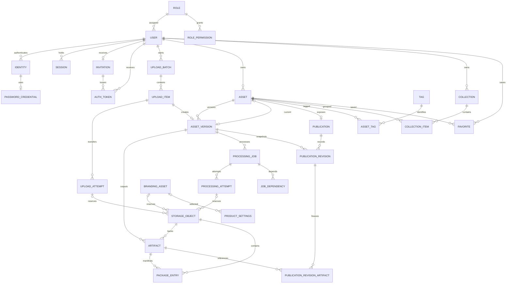

# 拾灵详细设计 v0.1：领域与数据模型

> 公开归档状态：P00/P01/P03 与 D01/D02 已确认；当前只推进 M0，业务未实现。跨分册合同见 [M0 收口文档](06-m0-interaction-and-contract-closure.md)。

状态：M0 详细设计归档。本文只定义模型、约束与事务边界，不是 DDL、迁移脚本或业务开发授权。

## 1. 已确认边界与建模原则

- 独立工程为 `shiling/`；当前允许工程基础和设计归档，不实现业务模型，也不迁移旧平台的用户、数据库、文件或 URL。
- 单实例服务一个团队或个人；不设 tenant、部门 ACL、ABAC 或项目授权继承。
- 首期支持图片、MP4 视频、自包含 HTML / 已构建静态 ZIP 动效。MP4 与网页动效是不同类型；动效包不允许依赖公网资源。
- 处理合格后进入团队目录；上传工作区仅用于本人或治理人员追踪上传与失败，不是私人素材库。
- 首期有团队集合和个人收藏；集合有归档/恢复，不改变其中素材；没有分类树、私人收藏夹或通用项目模型。标签首期创建、改名、停用和恢复，合并后置。
- 首期保留 AssetVersion 结构，但只有新素材的第 1 版创建流程；不提供替换原件、版本历史操作或把上传指定到已有 Asset 的 API。
- 只有 owner 且具备 publications.publishOwn 的用户可公开或更新自己的公开快照。管理员或被委派的治理角色可撤回他人公开，不能代为公开或更新其公开快照。
- 公开 DTO 不含 ownerId、成员姓名、头像、登录标识、原始文件名；公开下载名来自公开标题与经过验证的扩展名。
- 首期只有素材归档和恢复，没有永久删除入口；恢复不自动公开。归档和公开撤回是可追踪的独立事实。
- 原件不可覆盖；不实行跨素材全局 blob 去重。摘要只用于提示重复内容，允许用户继续上传独立 Asset，不自动复用他人素材、转移 owner 或产生文件共享权限。

## 2. 物理约定

采用 PostgreSQL。以下为表级设计，全部业务表由 backend 统一迁移管理，各模块只写自己拥有的表；跨模块更改通过应用用例协调。

| 约定       | 设计                                                                                          |
| ---------- | --------------------------------------------------------------------------------------------- |
| ID         | uuid，由可信服务端生成；首期可用随机 UUID，不以 UUID 自身表达权限或时间                       |
| 时间       | timestamptz，服务端以 UTC 写入；业务显示时再转换时区                                          |
| 枚举       | text + 允许值检查；不使用任意字符串状态，也不要求 PostgreSQL 原生 enum                        |
| 计数与容量 | bigint，非负；字节数不是浮点；revision / generation 为 bigint 且至少为 1                      |
| revision   | 资源的乐观并发版本，不等于 AssetVersion.version_no，不用于代替授权                            |
| 文本       | text，API 与数据库共同限制长度；字段禁止值、规范化规则由共享合同固定                          |
| 摘要       | SHA-256 为 64 位小写十六进制文本；与供应商 ETag 独立保存                                      |
| 可空       | 表中“是”表示允许 NULL；空字符串不能代替未知值；空集合用空数组而非 NULL                        |
| 外键       | 默认 RESTRICT，不对业务实体做级联物理删除；指向无硬删除对象的审计引用保持有效                 |
| JSON       | 仅用于经过 schema 校验的媒体元数据、冻结处理计划和受限响应引用；版本化，不作为任意插件数据仓  |
| 索引       | 主键 / UNIQUE 自动产生的索引不重复创建；引用侧 FK 不假定自动有索引，根据本稿列出的查询补充    |
| 敏感值     | 密码只存专用密码哈希；随机 token 只存摘要；凭证、完整签名 URL、原始请求头不入通用 JSON 或日志 |

字段缩写：A 表示 id uuid 非空主键、created_at timestamptz 非空；M 表示 A 加 updated_at timestamptz 非空。每张表明确列出使用 A 或 M；没有列出的公共字段不隐式增加。复合主键表在本节约定之外明确列出全部字段。

跨表“version 必须属于 asset”“revision 必须属于 publication”优先用复合 UNIQUE + FK 保证；“引用的 version 必须 ready”“不得移除最后一个管理员”等状态条件由同事务加锁用例保证。不能把跨表查询写成 PostgreSQL CHECK 来假装持续保证该不变量。依据：[PostgreSQL 约束文档](https://www.postgresql.org/docs/current/ddl-constraints.html)。

## 3. 实体关系

图中 current 是 assets.current_version_id 的可空引用；不是第二份版本内容。每个 storage_object 必须属于一个上传 attempt、处理 attempt 或品牌候选，三者恰一成立。

## 4. 身份、会话与角色

### 4.1 roles、role_permissions

roles 使用 M。

| 字段        | 类型        | 可空 | 约束 / 含义                                      |
| ----------- | ----------- | ---- | ------------------------------------------------ |
| key         | text        | 否   | 全局 UNIQUE；稳定机器标识；sysadmin 为内置保留值 |
| name        | text        | 否   | 展示名                                           |
| kind        | text        | 否   | system / custom；sysadmin 为 system              |
| revision    | bigint      | 否   | 初始 1，名称或权限组合变更时递增                 |
| archived_at | timestamptz | 是   | 自定义角色停用；内置管理员不可归档               |

role_permissions：role_id uuid 非空 FK roles；permission_key text 非空；复合 PK(role_id, permission_key)。能力目录由代码定义，共 26 keys，明细以权限文档为准；未知 key 拒绝写入。无需可随意新增权限语义的 permissions 管理表。

一个用户只有一个 role_id。只有 system.* 保留给 sysadmin；业务 governAny、withdrawAny、tags.manage 可由管理员授予可信自定义角色，默认 member 不拥有。不存在 publishAny。修改角色不会放松 owner、公开状态、版本 ready、归档等资源规则。sysadmin 的 key、kind、能力集合固定，不允许通过角色编辑器改删。

索引：roles(key) UNIQUE；role_permissions(permission_key, role_id) 用于受影响用户与诊断。归档角色前必须完成用户重分配；不得让 active / invited 用户继续使用归档角色。不要在实现中创建一个“管理员绕过所有检查”的分支。

### 4.2 users

使用 M。

| 字段         | 类型        | 可空 | 约束 / 含义                                 |
| ------------ | ----------- | ---- | ------------------------------------------- |
| display_name | text        | 否   | 内部展示名；不进入公开快照                  |
| status       | text        | 否   | invited / active / suspended                |
| role_id      | uuid        | 否   | FK roles                                    |
| auth_epoch   | bigint      | 否   | 初始 1；恢复凭据、禁用账号等安全事件递增    |
| revision     | bigint      | 否   | 成员资料、角色或状态变更时递增              |
| created_by   | uuid        | 是   | FK users；首次初始化或受控 CLI 系统操作可空 |
| activated_at | timestamptz | 是   | 邀请接受前为空                              |
| suspended_at | timestamptz | 是   | suspended 时必填，其他状态为空              |

索引：users(role_id, status)、users(status, created_at, id)。成员不硬删除；离职用 suspended，素材所有权和审计不丢失。创建邀请先建 invited 用户；邀请不要求预填登录名，未预填时内部 display_name 暂用受控“待接受邀请”展示，接受时填写。取消未接受邀请保留 invited 用户并撤销 token；重发邀请复用该用户，不产生重复成员。

最后一个有效管理员保护：变更成员状态 / role_id 或影响 sysadmin 身份可登录性的操作，先锁定 sysadmin 角色行，再检查仍有至少一个 active 且持有可用身份的 sysadmin。相关操作都使用相同锁，防两名管理员并发互相移除。CLI 恢复走受控恢复用例并审计，不绕过数据不变量。

### 4.3 identities、password_credentials

identities 使用 M。

| 字段         | 类型        | 可空 | 约束 / 含义                                                 |
| ------------ | ----------- | ---- | ----------------------------------------------------------- |
| user_id      | uuid        | 否   | FK users                                                    |
| provider_key | text        | 否   | 首期固定 password；未来受信任 OIDC adapter 使用稳定配置 key |
| subject      | text        | 否   | provider 内唯一的规范化登录标识                             |
| status       | text        | 否   | active / disabled                                           |
| verified_at  | timestamptz | 是   | 邀请接受或身份绑定完成时间                                  |

约束：UNIQUE(provider_key, subject)；password 身份对 user_id 建部分 UNIQUE，首期一个用户一个本地登录身份。登录名规范化算法在 API 合同固定，所有查询和唯一判定共用，不依赖系统默认排序规则猜测大小写行为。预留 provider 边界不代表首期实现 OIDC 绑定 API。

password_credentials：identity_id uuid 非空 PK/FK identities；password_hash text 非空；changed_at timestamptz 非空。邀请给出 reserved loginName 时创建规范化的 identity 预留唯一 subject；未给出时暂不建 identity，接受邀请时再创建。密码行在成功接受邀请时才生成；不得用空哈希或空 subject 占位。只允许 password provider 的 identity 写入此表，由身份用例在事务内保证。

未来 OIDC 不能用邮箱自动合并用户：受信任 provider_key 必须绑定不可变 issuer，subject 对应该 issuer 的 sub；变更 issuer 应使用新 provider_key，绑定到已有用户需显式受控流程。依据：[OIDC Core 的主体标识规则](https://openid.net/specs/openid-connect-core-1_0.html)。

### 4.4 sessions

使用 A。

| 字段                  | 类型        | 可空 | 约束 / 含义                                                                       |
| --------------------- | ----------- | ---- | --------------------------------------------------------------------------------- |
| user_id / identity_id | uuid        | 否   | 分别 FK users / identities；identity 必须属于 user                                |
| token_hash            | text        | 否   | UNIQUE；随机高熵 session token 的摘要                                             |
| auth_epoch            | bigint      | 否   | 创建时用户 epoch 快照                                                             |
| reauthenticated_at    | timestamptz | 否   | 登录/最近一次成功密码确认时间，供fresh-auth窗口判定；敏感操作不靠last_seen_at延长 |
| expires_at            | timestamptz | 否   | 绝对过期时间                                                                      |
| last_seen_at          | timestamptz | 否   | 可节流更新，不必每请求写库                                                        |
| revoked_at            | timestamptz | 是   | 显式登出、凭据恢复或治理撤销                                                      |
| revoke_reason         | text        | 是   | 受控代码，无秘密                                                                  |

identities 增加 UNIQUE(user_id, id)，sessions 通过复合 FK 保证 user 与 identity 一致。索引：sessions(user_id, expires_at)、未撤销会话的 expires_at 清理索引。每个请求仍检查用户 active、身份有效、会话未过期未撤销且 epoch 一致；不将创建会话时的 role / permissions 永久缓存为授权事实。角色变更立即影响后续请求。

### 4.5 invitations

邀请是可修订的稳定管理资源，使用 M；明文 token 不是邀请主体。

| 字段                     | 类型        | 可空 | 约束 / 含义                               |
| ------------------------ | ----------- | ---- | ----------------------------------------- |
| user_id                  | uuid        | 否   | FK users 且 UNIQUE；复用预建 invited 用户 |
| revision                 | bigint      | 否   | 创建为 1；撤销或重签递增                  |
| state                    | text        | 否   | pending / accepted / revoked              |
| accepted_at / revoked_at | timestamptz | 是   | 与 state 一致                             |
| created_by               | uuid        | 否   | FK users；审计发起者                      |

接受、撤销和重签均锁 Invitation；重签复用 Invitation/User，撤销旧 token、创建新 token 并递增 revision。过期只影响当前 token 的可用性，不新建第二个 Invitation，也不靠定时任务修改资源修订。

### 4.6 auth_tokens

统一保存邀请与账户恢复的一次性凭据，使用 A。

| 字段                     | 类型        | 可空 | 约束 / 含义                                                |
| ------------------------ | ----------- | ---- | ---------------------------------------------------------- |
| user_id                  | uuid        | 否   | FK users                                                   |
| invitation_id            | uuid        | 是   | purpose=invitation 时 FK invitations 且必填；recovery 为空 |
| purpose                  | text        | 否   | invitation / recovery                                      |
| token_hash               | text        | 否   | UNIQUE；不存可还原明文                                     |
| issued_by                | uuid        | 是   | FK users；受控 CLI 初始化/恢复可空，审计 actor_kind=system |
| expires_at               | timestamptz | 否   | 接受时必须使用服务器时间检查                               |
| consumed_at / revoked_at | timestamptz | 是   | 两者不可同时非空；消费与撤销均为终态                       |

部分 UNIQUE(user_id, purpose)，条件为 consumed_at 与 revoked_at 都为空；邀请 token 另保证同一 Invitation 只有一个当前有效行。条件不包含“当前时间”；过期 token 重发时先显式撤销旧行。索引 auth_tokens(expires_at)、auth_tokens(invitation_id)。邀请链接或恢复凭据只在创建/重签操作首次结果中交付，不发邮件也可完成管理员/CLI恢复。

接受邀请：锁 Invitation、token 和现有 invited user，校验 purpose、时间、未消费、Invitation revision/state 与可用角色。已有预留 identity 时提交的 loginName 必须规范化后匹配；没有预留时按唯一 subject 创建 identity。写密码凭据并更新 display_name，原用户转 active、Invitation accepted、token consumed，审计同事务提交；不是再新建第二个用户。普通邀请不授予 sysadmin。接受恢复：锁同类对象、更新密码、递增 auth_epoch、撤销会话、消费 token；不能因此把 suspended 用户转 active，也不能更改 role_id。并发接受/撤销/重签只允许一个合法结果。

## 5. 上传批次、传输与素材创建

### 5.1 upload_batches

使用 A。

| 字段                   | 类型   | 可空 | 约束 / 含义                          |
| ---------------------- | ------ | ---- | ------------------------------------ |
| owner_id               | uuid   | 否   | FK users                             |
| client_batch_key       | text   | 是   | 客户端关联信息，不能代替幂等键或权限 |
| intake_policy_revision | bigint | 否   | 接收时产品配置版本，用于追溯         |

索引 upload_batches(owner_id, created_at, id)。批次不保存独立可变 success / failed 状态；从各 item 推导总数、传输中、处理中、成功、失败、取消数量，允许部分成功。关闭页面不是取消批次。

### 5.2 upload_items

使用 M。

| 字段                     | 类型        | 可空 | 约束 / 含义                                                                            |
| ------------------------ | ----------- | ---- | -------------------------------------------------------------------------------------- |
| batch_id                 | uuid        | 否   | FK upload_batches；owner 由 batch 得到                                                 |
| ordinal                  | integer     | 否   | 批次内顺序，非负                                                                       |
| client_item_id           | text        | 否   | 客户端在批次内稳定关联键；重复创建不能产生第二个item                                   |
| creation_request_hash    | text        | 否   | 创建参数的不可变摘要，区分同clientItemId不同参数；后续metadata编辑不改变               |
| requested_type           | text        | 是   | API typeHint；image / video / web_motion；为空时由可信探测决定，不能只信hint           |
| original_filename        | text        | 否   | 内部用途，规范化/长度限制；从不直接作对象路径或公开下载名                              |
| declared_bytes           | bigint      | 否   | 客户端声明，用于预检查，不能代替实际核验                                               |
| declared_media_type      | text        | 否   | API declaredMediaType；未识别可为application/octet-stream，不是可信MIME                |
| declared_sha256          | text        | 是   | 仅提示，不能作为可信摘要                                                               |
| initial_metadata         | jsonb       | 否   | schemaVersion、title、description、tagIds；title必须满足必填规则，可由服务端生成默认值 |
| requested_collection_ids | uuid[]      | 否   | 默认空数组；待入库时应用的整理意图，尚不是集合成员关系，无数组FK                       |
| revision                 | bigint      | 否   | metadata/目标集合编辑递增，支持上传metadata URI的ETag                                  |
| organization_warnings    | jsonb       | 否   | 默认空数组；ready提交时跳过失效可选整理项的受控结果                                    |
| transport_state          | text        | 否   | pending / uploading / verifying / verified / failed / canceled / expired               |
| attempt_generation       | bigint      | 否   | 初始 1；新 attempt、取消或过期时递增作为栅栏                                           |
| current_attempt_id       | uuid        | 是   | FK 当前 upload_attempt；pending 尚未签发时可空                                         |
| expires_at               | timestamptz | 否   | 未完成传输的接受期限                                                                   |
| failure_code             | text        | 是   | 对用户安全的稳定错误码                                                                 |

约束：UNIQUE(batch_id, ordinal)、UNIQUE(batch_id, client_item_id)；重复clientItemId同creation_request_hash返回原item，不同参数返回冲突。current_attempt_id 通过复合 FK(item id, attempt id) 保证属于本 item。索引 upload_items(batch_id, ordinal)、未结束传输的(transport_state, expires_at)。不重复保存 asset_id 和 version_id 两个可漂移字段；通过 asset_versions.upload_item_id 反查已创建的素材与版本。

initial_metadata 与 requested_collection_ids 是上传阶段的编辑真相，API按schema校验去重和限制数量；尚未入库时可以用If-Match修改。pending Asset 的标题仅为过程展示，ready事务必须从最新item复制title/description。tagIds/collectionIds是可失效的整理请求，不提前建立asset_tags/collection_items，也不把数组当数据库外键。

### 5.3 upload_attempts

使用 M。

| 字段                      | 类型        | 可空 | 约束 / 含义                                                                                     |
| ------------------------- | ----------- | ---- | ----------------------------------------------------------------------------------------------- |
| item_id                   | uuid        | 否   | FK upload_items                                                                                 |
| attempt_no                | integer     | 否   | 同 item 从 1 单调递增                                                                           |
| generation                | bigint      | 否   | 创建时 item.attempt_generation                                                                  |
| state                     | text        | 否   | issued / receiving / verifying / verified / failed / aborted / expired                          |
| transfer_mode             | text        | 否   | server_stream / direct_put / multipart，必须在 storage adapter 能力内                           |
| intake_policy             | jsonb       | 否   | 本次签发时冻结的schemaVersion、settingsRevision、可接收类型和业务限额；不冻结可绕过的安全硬上限 |
| provider_upload_id        | text        | 是   | 分片上传关联标识，仅服务端可见；不是长期凭证                                                    |
| expires_at                | timestamptz | 否   | 本 attempt 的有限授权时间                                                                       |
| received_bytes            | bigint      | 是   | 服务端观测值，尚不确定时为空                                                                    |
| verified_at               | timestamptz | 是   | 服务端完成摘要、真实格式和尺寸/限额验证后记录                                                   |
| failure_code              | text        | 是   | 受控错误码                                                                                      |
| completion_manifest       | jsonb       | 是   | complete 首次接纳的不可变完成清单；未 complete 为空                                             |
| completion_request_hash   | text        | 是   | 规范化完成请求摘要；重复 complete 必须一致                                                      |
| verification_queue_job_id | text        | 是   | pg-boss 核验任务 ID；不是业务处理 Job FK                                                        |
| verification_fence        | bigint      | 否   | 初始 0；核验重试/取消时递增，拒绝迟到结果                                                       |
| verification_deadline_at  | timestamptz | 是   | 核验任务硬期限                                                                                  |

约束：UNIQUE(item_id, attempt_no)、UNIQUE(item_id, id)；每 item 对 issued / receiving / verifying 的 attempt 建部分 UNIQUE，保证一个活跃传输。索引 upload_attempts(state, expires_at)。原始对象的位置由 storage_objects.upload_attempt_id 关联；不要把临时签名 URL 固化成状态。

### 5.4 创建 Asset 的时间点与传输状态机

1. 建 batch、item，尚无 Asset。每个 item 代表一个文件或一个动效包；不把 ZIP 内每个资源拆成用户上传项。
2. 在短事务中签发 attempt 与 storage_object 登记，再进行远程/流式传输。签名只允许指定对象与受限方法，禁止客户端自行选服务端路径。
3. `complete` 的短事务只接纳不可变 completion_manifest/hash、把 attempt/item 置 verifying，并以 `uploadAttemptId + generation` 为主体原子投递核验任务；成功返回 202 时仍无 Asset/Version。重复 complete 不能改写清单或重复投递。
4. 核验任务在长事务外读取并验证真实内容，不信任浏览器声明。它不写入要求 version_id 的 processing_jobs，也不建立第二套队列。
5. 核验通过后短事务锁定 item，复核 attempt、generation、fence、期限和状态；把 attempt/item 标记 verified，创建 pending Asset、version_no=1、original Artifact、处理计划和可执行媒体 Job，并事务性入队。
6. 对同 item 的完成请求，无论相同幂等键还是并发回调，最多产生一个 version；UNIQUE(asset_versions.upload_item_id) 是最后一道保护。任一入队事务失败均不能报告 202/入库成功。

在入库提交前重新检查 batch.owner 当前 active 且仍有 uploads.create。尚未创建 Version 时若资格已撤销，将传输项/attempt 记 failed、failure_code=AUTHORIZATION_REVOKED，不创建 Asset；恢复资格后手动 retry 产生新传输 attempt。浏览器此前获得上传能力或管理员拥有任务治理权，都不能替代上传者的当前入库资格。

acceptUploads=false只阻止创建新item、签发新transfer attempt；已经接纳的当前attempt可继续到期内的传输/核验/完成，按其intake_policy与当前安全硬上限检查。普通业务限额后来调低不自动使已接纳输入失败。新transfer retry必须重新满足当前接收开关和业务限额，并冻结新的attempt.intake_policy；不能借旧batch创建无限的新授权。

传输允许：pending → uploading → verifying → verified；早期步骤可进入 failed / canceled / expired；failed 在用户发起 retry 后创建新 attempt 回到 uploading。旧 attempt 保留终态，新 attempt 使用新的对象 key。canceled / expired 是该 item 的终态，重新上传需新 item。

verified 后的取消和重试属于处理层：传输事实继续为 verified。上传项 API 同时返回 transportState 与可空 processingState；前端可映射“处理中、处理失败”等展示标签，不另持久化第三套重复状态。

## 6. 素材、内容版本和产物

### 6.1 assets

使用 M。

| 字段                      | 类型               | 可空 | 约束 / 含义                                                     |
| ------------------------- | ------------------ | ---- | --------------------------------------------------------------- |
| owner_id                  | uuid               | 否   | FK users；首期不可通过普通 PATCH 转移所有权                     |
| type_key                  | text               | 否   | image / video / web_motion，创建后不变                          |
| title                     | text               | 否   | 内部标题，默认可由上传名生成但公开时须单独确认                  |
| description               | text               | 否   | 默认空文本；纯文本或严格受控格式，不允许任意 HTML               |
| lifecycle                 | text               | 否   | pending / active / archived                                     |
| current_version_id        | uuid               | 是   | FK asset_versions；pending 必须为空；active / archived 必须非空 |
| revision                  | bigint             | 否   | 初始 1；内部元数据、当前版、归档/恢复变化递增                   |
| archived_at / archived_by | timestamptz / uuid | 是   | archived 时同时非空；archived_by FK users                       |

资产建立时 lifecycle=pending、current_version_id=NULL；版本 ready 提交时原子切换 active 与 current_version_id。正常团队列表、检索、集合候选只取 active 且当前版 ready。pending 只能从有权限的上传/任务工作区访问；失败或取消不伪装成已入库的团队素材。

asset_versions 增加 UNIQUE(asset_id, id)，assets 使用复合 FK(id, current_version_id)，允许先创建空指针 Asset 再创建 Version，不需要临时关闭外键。索引 assets(lifecycle, created_at, id)、assets(owner_id, lifecycle, created_at, id)、assets(type_key, lifecycle, created_at, id)。标签关系见第 10 节；标题匹配索引按真实查询与中文样例验证，不预设 pg_trgm 能解决所有中文短词。

只有 active 可归档，只有 archived 可恢复为 active。pending 取消用上传任务取消接口；首期不为 pending 增加“恢复入库”的归档副语义。账号 suspended 不改变 asset.owner_id，也不自动归档或撤回公开。

归档管理只允许 owner 或具备 assets.governAny 者读取必要元数据及安全静态预览；不能发放原件下载或执行 HTML 动效。需要使用原件时先恢复，不把管理界面变成正常素材可见性的旁路。

### 6.2 asset_versions

使用 M。

| 字段                 | 类型        | 可空 | 约束 / 含义                                                                           |
| -------------------- | ----------- | ---- | ------------------------------------------------------------------------------------- |
| asset_id             | uuid        | 否   | FK assets                                                                             |
| version_no           | integer     | 否   | 至少 1；首期只能创建 1                                                                |
| upload_item_id       | uuid        | 否   | FK upload_items，UNIQUE；一个已验证 item 只生成一个版本                               |
| processing_state     | text        | 否   | processing / ready / failed / canceled                                                |
| execution_generation | bigint      | 否   | 初始 1；整次失败处理重试或取消时推进，阻止旧代提交                                    |
| processor_plan       | jsonb       | 否   | 冻结的 schemaVersion、处理器标识/版本、步骤、必需/可选角色、有限retryPolicy及配置摘要 |
| source_sha256        | text        | 否   | 经服务端验证的原件摘要                                                                |
| media_metadata       | jsonb       | 否   | 有 schemaVersion 的真实尺寸、编码、时长、入口等；不得含凭证或成员身份                 |
| ready_at             | timestamptz | 是   | 首次 ready 时间；ready 时必填                                                         |
| failure_code         | text        | 是   | 失败时受控原因                                                                        |
| created_by           | uuid        | 否   | FK users，首次为 owner；是内部审计字段                                                |

约束：UNIQUE(asset_id, version_no)、UNIQUE(asset_id, id)、UNIQUE(upload_item_id)。索引 asset_versions(processing_state, updated_at, id)。同 item 的重试不换原件、不增加 version_no；只推进执行 generation。改变原件必须重新创建素材；改变冻结处理计划的兼容性属于后续再处理设计，不在 retry 中悄悄升级处理器。

“不可变版本”指原件身份、内容摘要和冻结的处理合同不可变；处理状态、受控进度与检查结果可推进。不能因为 version 行可更新，就允许覆盖已确认的原始字节。

### 6.3 artifacts

使用 A；提交后角色与内容绑定不可变。

| 字段                   | 类型  | 可空 | 约束 / 含义                                                                                   |
| ---------------------- | ----- | ---- | --------------------------------------------------------------------------------------------- |
| version_id             | uuid  | 否   | FK asset_versions                                                                             |
| role                   | text  | 否   | original / thumbnail / preview_image / poster / playback_video / motion_manifest / loop_video |
| variant_key            | text  | 否   | 首期通常 default；规范化非空键                                                                |
| storage_object_id      | uuid  | 否   | FK storage_objects，必须是已核验可引用对象                                                    |
| produced_by_attempt_id | uuid  | 是   | FK processing_attempts；original 来自传输，故可空                                             |
| media_type             | text  | 否   | 真实探测 MIME，不直接复制上传声明                                                             |
| metadata               | jsonb | 否   | schemaVersion + 宽高/编码等角色限定属性；默认空属性对象                                       |

约束：UNIQUE(version_id, role, variant_key)、UNIQUE(version_id, id)。索引 artifacts(storage_object_id)、artifacts(produced_by_attempt_id)。原件只对应一个 original 角色；多个角色可以在同一 version 内引用经验证适用的同一对象，例如兼容的视频原件同时充当 playback_video，不复制不必要的字节。禁止由此扩展到不同 owner / asset 的隐式全局去重。

提交用例必须验证 original 对象来自该version的upload_item当前已验证attempt；派生对象来自该version合法处理attempt。FK只能证明引用存在，不能单独证明这些来源状态条件。客户端不能直接指定storage_object_id来关联对象。

artifact 表只记录已核验并正式接纳的产物，不插入 status=processing 的假产物占位；未提交文件在 storage_objects 与 processing_attempts 中追踪。物理丢失/损坏由 storage_objects.integrity_state 表达，媒体交付必须复核并给出受控失败；不会因曾经 ready 就保证外部磁盘永不故障。

### 6.4 package_entries

仅 web_motion 的规范化包资源使用。

| 字段                 | 类型    | 可空 | 约束 / 含义                                          |
| -------------------- | ------- | ---- | ---------------------------------------------------- |
| manifest_artifact_id | uuid    | 否   | FK artifacts，必须是 motion_manifest                 |
| path                 | text    | 否   | 规范化相对路径，不可绝对路径、..、符号链接或跨包引用 |
| storage_object_id    | uuid    | 否   | FK storage_objects                                   |
| media_type           | text    | 否   | 核验后的资源 MIME                                    |
| is_entrypoint        | boolean | 否   | 默认 false；每包恰好一个入口                         |

PK(manifest_artifact_id, path)；对 is_entrypoint=true 的 manifest_artifact_id 建部分 UNIQUE；索引 package_entries(storage_object_id)。至少一个入口及所有资源已核验由包提交事务保证。包 manifest 包含同一套路径、摘要和类型清单，提交前核对与本表一致；预览服务只解析已登记路径，不根据请求拼接磁盘路径。HTML 原文件/ZIP 原包下载始终采用 attachment；可执行预览使用规范化包与隔离来源。

### 6.5 ready 的最小定义

必需角色保存在 version.processor_plan 中，不能随管理员后来修改全局配置而重写历史判定。ready 是一次受控提交，不是“队列空了”或“有一张占位图”。

| 类型         | 首期必需证据 / 产物                                                                                     | 可选产物，失败不阻止 ready        |
| ------------ | ------------------------------------------------------------------------------------------------------- | --------------------------------- |
| image        | 原件校验；original、thumbnail；真实格式/尺寸/像素上限核验，缩略图可解码                                 | 更大 preview_image 或其他展示尺寸 |
| video（MP4） | original、poster、兼容目标播放合同的 playback_video；真实容器/编码/时长/尺寸核验                        | loop_video；更多码率/分辨率       |
| web_motion   | original、motion_manifest 与完整资源清单、真实录制 poster；包自包含/路径/配额核验；隔离执行冒烟检查通过 | loop_video；额外截图              |

可播放原视频可复用为播放角色，但仍须通过约定的编码/播放检查；不以 .mp4 扩展名作为证明。动效 poster 是成功隔离执行后生成的封面，不能用占位图通过 ready。自包含包、完整源包下载与交互预览能力必须保留，loop MP4 只是可选派生物。

ready 提交需同时满足：源对象可信；所有必需步骤成功；必需角色各有唯一有效 Artifact；媒体/包元数据符合冻结合同；generation 和任务栅栏仍有效；资产未取消且仍 pending；上传者当前 active 且仍具备 uploads.create。一次事务把 version 变 ready、asset 变 active并设 current_version_id。可选工作之后成功可追加此前缺失的角色，但不能覆盖已有 Artifact，更不能自动修改已公开的 artifact 快照。ready 之后的可选产物处理不重新要求历史上传者持续持有上传权限。

该事务先锁UploadItem，读取最新initial_metadata并应用必要标题/说明，再重新校验所选标签与集合的当前状态、上传者的素材编辑和集合维护能力。失效、停用、无权限或已归档的可选整理目标跳过，写organization_warnings；其余有效目标原子建立关系并更新受影响集合revision。媒体本身合格时，不能因为此前选中的标签被停用而卡住入库。title等必需元数据始终在编辑时保持有效。ready与metadata PATCH争用同一item锁；ready先完成后PATCH返回冲突并引导编辑Asset。

## 7. 对象登记与清理

### 7.1 storage_objects

使用 M。这是“应用准备写什么、已接纳什么、能否清理”的账本，不是可跨权限共享的 blob 去重系统。

| 字段                  | 类型          | 可空 | 约束 / 含义                                            |
| --------------------- | ------------- | ---- | ------------------------------------------------------ |
| upload_attempt_id     | uuid          | 是   | FK upload_attempts；素材原件对象的来源                 |
| processing_attempt_id | uuid          | 是   | FK processing_attempts；派生/临时对象的来源            |
| branding_asset_id     | uuid          | 是   | FK branding_assets；Logo/favicon 候选的来源            |
| backend_key           | text          | 否   | 稳定存储配置标识；有引用时不得把它重绑到另一个存储位置 |
| namespace             | text          | 否   | bucket 或本地受控根标识，不是用户提供的任意绝对路径    |
| object_key            | text          | 否   | 可信端生成，包含唯一随机部分；不能覆盖历史对象         |
| provider_version_id   | text          | 是   | 后端返回的不可变版本标识；不支持时为空                 |
| provider_etag         | text          | 是   | 仅作供应商标识，不替代 SHA-256                         |
| state                 | text          | 否   | reserved / stored / gc_pending / deleted               |
| integrity_state       | text          | 否   | pending / verified / missing / corrupt                 |
| bytes / sha256        | bigint / text | 是   | 核验前可空；verified 时都必填                          |
| verified_at           | timestamptz   | 是   | 核验成功时间                                           |
| retain_until          | timestamptz   | 是   | 临时对象最早可清理时间；NULL 不是立即删除              |
| gc_token              | uuid          | 是   | 清理认领栅栏，防过期清理任务继续执行                   |
| deleted_at            | timestamptz   | 是   | 确认后端删除或已不存在后记录                           |

约束：upload_attempt_id、processing_attempt_id、branding_asset_id 三者恰有一个非空；UNIQUE(backend_key, namespace, object_key)；upload_attempt_id 非空时 UNIQUE，首期一次传输一个原件对象。索引 storage_objects(processing_attempt_id)、storage_objects(branding_asset_id)、可清理候选(state, retain_until)、integrity_state 异常索引。

在产生远程写入前先登记 reserved；远程成功但数据库提交失败时，重试可按登记位置对账，不靠全桶扫描猜测归属。对象写入不可覆盖保证由 adapter 合同验证：支持的后端使用条件写入/完整分片提交条件；本地使用排他创建/受控提交，不使用 HEAD 然后 PUT 的竞争流程。后端 ETag 与内容摘要分离，特别是分片上传。依据：[S3 条件写入](https://docs.aws.amazon.com/AmazonS3/latest/userguide/conditional-writes.html)、[S3 完整性校验](https://docs.aws.amazon.com/AmazonS3/latest/userguide/checking-object-integrity-upload.html)。

### 7.2 保留与清理规则

| 对象类别                                               | 首期处理                                                                                                           |
| ------------------------------------------------------ | ------------------------------------------------------------------------------------------------------------------ |
| 被任一版本 Artifact、package_entry 或当前品牌设置引用  | 永不因归档、撤回、用户禁用、任务失败或开关关闭而自动删除；包含公开历史引用和失败版本已接纳的原件                   |
| 未完成/失败/取消传输的暂存对象                         | 到配置保留期且无有效 attempt、未被接纳为原件后可清理                                                               |
| 失败或迟到处理产生的未接纳输出                         | 到保留期、执行授权已过期且无 artifact/package 引用后可清理                                                         |
| 已取消但已经创建 pending Asset / Version 的原件        | 默认保留；它尚未真正入库到团队目录，但已被版本接纳，本轮不把取消扩大为永久删除                                     |
| 分片上传未完成片段                                     | 按 adapter 合同终止；云生命周期规则只能覆盖明确暂存区，不覆盖正式产物                                              |
| 会话、一次性token、幂等记录、pg-boss调度历史和运行日志 | 按安全/运营保留期清理；不等于永久删除素材与公开历史；被对象/产物/依赖引用的业务Job/Attempt保留最小追溯行，不破坏FK |

清理必须从对象接纳/引用事实出发，不能从 Job 的 failed/canceled 状态直接推导。先在短事务锁对象并复核全部引用、有效写入/执行授权和宽限期，置 gc_pending 与 gc_token；任何新引用提交都必须锁同一对象并拒绝 gc_pending / deleted。随后在事务外按精确位置/版本执行幂等删除，最后校验 token 后记 deleted。删除失败保留任务重试，不能先删 DB 位置再尝试删文件；Job/Attempt 最小追溯行不因对象回收而删除。

短期签名写入或执行器能力可能在取消后仍未失效。因此清理等待窗口必须超过本对象最后写入授权到期时间与执行器强制结束窗口；禁止清理后旧写入重新生成孤儿对象。已被标记 deleted 的 key 永不复用。临时保留、任务保留与 URL TTL 的具体数值由运行配置文档统一，本稿不擅自设定用户数据自动删除期限。

如果存储缺失/损坏，记录 integrity_state、产生受控告警并停止错误交付；不自动从引用表移除证据。没有承诺的再生成能力时不得悄悄删除原件。首期不建立强制全桶定期扫描，提供可控对账任务，避免对大型存储无边界遍历。

保留失败/取消 pending 版本的已接纳原件会产生容量成本，运行诊断必须单独统计并报警。首期不自动清理这些原件，也不借任务失败实现永久删除；未来若增加用户主动销毁，须作为新的产品能力单独设计、授权和验收。

## 8. 处理任务、执行尝试与 pg-boss

### 8.1 processing_jobs

使用 M。

本表只承载已经存在 Version 的媒体处理任务。`complete` 之后、Version 创建之前的接收核验以 upload_attempt 为主体，由 pg-boss 投递但不插入本表，避免伪造非空 version_id 或第二套队列。

| 字段                              | 类型        | 可空 | 约束 / 含义                                                   |
| --------------------------------- | ----------- | ---- | ------------------------------------------------------------- |
| version_id                        | uuid        | 否   | FK asset_versions                                             |
| execution_generation              | bigint      | 否   | 对应创建时的 version generation                               |
| step_key                          | text        | 否   | 冻结计划中稳定步骤键                                          |
| processor_key / processor_version | text        | 否   | 精确处理器与合同版本，不使用运行时 latest                     |
| required                          | boolean     | 否   | 该步骤失败是否阻止 ready                                      |
| state                             | text        | 否   | pending / queued / running / succeeded / failed / canceled    |
| queue_job_id                      | uuid        | 是   | pg-boss 调度记录关联；pending 尚未入队可空；不对库内部表建 FK |
| current_attempt_id                | uuid        | 是   | FK 当前 processing_attempt；未执行可空                        |
| attempt_fence                     | bigint      | 否   | 从 1 单调递增；接管/重试时推进                                |
| attempt_count                     | integer     | 否   | 从 0 起；每次实际执行递增                                     |
| next_attempt_at                   | timestamptz | 是   | 延迟重试展示信息，不建立第二个调度器                          |
| failure_code                      | text        | 是   | 对用户安全的稳定错误码                                        |

约束：UNIQUE(version_id, execution_generation, step_key)、UNIQUE(id, version_id)；current_attempt 通过复合 FK 保证属于 job。索引 processing_jobs(state, updated_at, id)、processing_jobs(version_id, execution_generation)、processing_jobs(queue_job_id)。pending 表示等待依赖；queued 包含待投递和退避等待，前端可结合 next_attempt_at 展示。

job_dependencies：job_id uuid 非空 FK processing_jobs；depends_on_job_id uuid 非空 FK processing_jobs；PK(job_id, depends_on_job_id)；禁止自依赖。索引反向(depends_on_job_id, job_id)。冻结计划生成时检查无环、同一 version，依赖均成功才入队。依赖失败时必需后继可标 failed/dependency_failed，不能无限挂 pending。

### 8.2 processing_attempts

使用 A。

| 字段            | 类型        | 可空 | 约束 / 含义                                           |
| --------------- | ----------- | ---- | ----------------------------------------------------- |
| job_id          | uuid        | 否   | FK processing_jobs                                    |
| attempt_no      | integer     | 否   | 从 1 递增                                             |
| fence           | bigint      | 否   | 创建时 job.attempt_fence                              |
| state           | text        | 否   | running / succeeded / failed / abandoned / canceled   |
| worker_instance | text        | 否   | 非秘密诊断标识                                        |
| started_at      | timestamptz | 否   | 实际开始时间                                          |
| deadline_at     | timestamptz | 否   | 本次执行的硬期限，与队列过期/执行器终止策略一致       |
| finished_at     | timestamptz | 是   | 非 running 状态必须有结束时间                         |
| error_code      | text        | 是   | 受控分类，不存未经脱敏的执行器输出                    |
| output_manifest | jsonb       | 是   | 输出 object IDs、角色、摘要与检测结果；尚无输出时为空 |

约束：UNIQUE(job_id, attempt_no)、UNIQUE(job_id, id)。索引 processing_attempts(state, deadline_at)、processing_attempts(job_id, created_at)。current_attempt_id + fence 决定谁可以提交；不能仅因为旧进程仍在运行就允许其覆盖新执行结果。没有额外的分布式业务租约续租服务：pg-boss 负责投递、过期和重试，可信 Worker 将每次交付映射为带栅栏的业务 attempt。

### 8.3 原子入队与 outbox 边界

首期固定使用 pg-boss 官方现有数据库事务 adapter：创建 Version/Job 与 send 在同一个 PostgreSQL 事务、同一事务连接内完成；提交或回滚必须共同发生。其官方资料明确支持现有事务内发送与完成任务。实施前必须通过真实 PG 测试证明回滚没有残留队列消息、提交不丢投递，不能只看方法接受一个 tx 参数就认定成立。依据：[pg-boss 官方文档](https://pgboss.io/)。

不在首期重复创建第二套 task_outbox、任务抢占锁、重试时钟或业务 DLQ。若选定版本/数据库访问层不能提供可验证的原子事务集成，应暂停该实现选择，改选受支持集成或单独评审事务 outbox；严禁退化成“先提交业务表，稍后尽力 send”。队列适配器故障时上传完成接口返回可恢复失败，而不是假报成功。

后续第三方事件如需多个外部消费者，再引入独立 integration_outbox，至少含 event_id、event_version、aggregate_id、aggregate_revision、destination、白名单 payload、status、attempts、next_attempt_at、delivered_at，并对(event_id, destination)唯一。第三方派发至少一次，消费者按事件 ID 去重、按 revision 防旧消息覆盖；不承诺外部系统恰好一次。这是后续扩展边界，本稿首期物理表中不创建这张空表。

处理器 I/O 不在长事务内：先认领并登记 attempt / 输出位置，执行隔离处理，再验证输出；提交产物时短事务复核 version generation、job fence、current_attempt_id、对象状态。重复交付已成功任务为幂等无操作；迟到输出不接纳，按临时对象清理。重试次数耗尽后写 failed 并可诊断；允许有限次数人工重试，不无限堆积。

### 8.4 失败、重试、取消的完整语义

- 必需步骤出现不可重试错误或有限自动重试耗尽：version=failed，Asset 保持 pending，currentVersion=NULL；上传页展示受控原因及是否可重试。单个attempt临时失败而队列仍将退避重试时，job回queued、version仍processing，不能提前标为最终失败。
- 未 ready 时上传者被禁用或失去 uploads.create：在后续可信调度/提交检查处将 version 置 failed、failure_code=AUTHORIZATION_REVOKED，推进 generation 并取消未完成 Jobs。恢复账号/权限不自动继续；上传者恢复资格后才允许手动 retry，治理人员不能绕过该资格替其入库。已 ready 素材及其可选派生不因此变回 failed。
- 用户重试失败处理：锁 item/version，保持同一原件与 version_no，version generation 递增、state 回 processing，生成该代尚需执行的任务。冻结计划不变；先前已经接纳且仍匹配该计划的不可变产物可复用，不覆盖 Artifact。
- 已verified输入的processing retry不是新上传，acceptUploads关闭时仍可重试；仍需上传者当前uploads.create及当前安全/执行策略允许。executePreview=false时，不启动或接纳需要该执行能力的新处理结果；必需执行步骤受阻则version失败并给出可解释原因，重新启用后手动retry；ready后的可选执行失败不影响原ready或已有静态封面。执行器应尽力终止已开始工作，但提交侧策略检查不可省略。
- 可选步骤失败：不把 ready 倒改 failed；显示可选预览不可用。ready 后派生任务治理属于 system.jobs.manage，首期只补缺失可选角色，不能替换已有产物或改变公开快照。
- 用户在 verified 后取消处理中/失败项：锁 Asset/Version，version=canceled、generation 递增，取消未完成 Jobs。传输仍是 verified；源文件按第 7 节保留。
- ready 已先提交：取消返回 409，并提示归档。取消已先提交：任何旧 worker 均不得提交 ready。以同一 Asset/Version 的锁与 generation 检查裁定先后，前端按钮状态不是裁定依据。
- canceled / expired 不用 retry 复活；新上传使用新 item。失败重试与取消并发同样串行化；取消后排队消息即使仍被投递，也必须无操作退出。

## 9. 公开发布与不可变快照

### 9.1 publications

使用 M；仅第一次公开时创建，asset_id 唯一。

| 字段                | 类型   | 可空 | 约束 / 含义                                              |
| ------------------- | ------ | ---- | -------------------------------------------------------- |
| asset_id            | uuid   | 否   | FK assets，UNIQUE                                        |
| state               | text   | 否   | active / withdrawn                                       |
| revision            | bigint | 否   | 从 1 开始；公开、更新、撤回均单调递增                    |
| current_revision_id | uuid   | 否   | FK publication_revisions；指向最新动作记录，包含撤回记录 |
| updated_by          | uuid   | 否   | FK users，仅内部审计                                     |

不存在 publication 时 API 的 expectedPublicationRevision 为 0；首次创建后不删除此行，不因撤回把 revision 重置为 0。索引 publications(state, updated_at, id)。公开稳定路由使用 assetId，访客不能直接选择一个历史 revision 来绕过当前 withdrawn 状态。

首次插入的 publications 与第一条 publication_revisions 是循环引用，使用可延迟至事务提交校验的 FK；事务中先分配两者 ID，再写两行，提交时两者必须存在。其他场景无需关闭 FK 或允许外部观察到 current_revision_id 为空。

### 9.2 publication_revisions

使用 A；每次动作追加，不覆盖历史行。

| 字段                    | 类型    | 可空 | 约束 / 含义                                                                            |
| ----------------------- | ------- | ---- | -------------------------------------------------------------------------------------- |
| publication_id          | uuid    | 否   | FK publications                                                                        |
| asset_id                | uuid    | 否   | FK assets；与所属 publication 的 asset 一致                                            |
| revision_no             | bigint  | 否   | 等于该动作提交后的 publication.revision                                                |
| action                  | text    | 否   | publish / update / withdraw                                                            |
| version_id              | uuid    | 否   | FK asset_versions，且必须属于 asset_id                                                 |
| title                   | text    | 是   | publish/update 非空；withdraw 为 NULL                                                  |
| description             | text    | 是   | publish/update 非空，可空文本；withdraw 为 NULL                                        |
| tag_labels / tag_keys   | text[]  | 是   | publish/update 非空数组；公开标签名及规范化匹配键，非内部关系实时引用；不含team tag ID |
| download_filename       | text    | 是   | publish/update 非空；公开标题规范化 + 已核验扩展名；withdraw 为 NULL                   |
| snapshot_schema_version | integer | 否   | 初始 1                                                                                 |
| source_asset_revision   | bigint  | 否   | 所依据内部元数据 revision，仅内部可见                                                  |
| actor_id                | uuid    | 否   | FK users；内部审计，公开 DTO 不映射                                                    |
| reason_code             | text    | 是   | withdraw 原因，如 owner_withdraw / governance / archive；不是自由填写身份信息          |

约束：UNIQUE(publication_id, revision_no)、UNIQUE(publication_id, id)、UNIQUE(id, version_id)；以复合 FK 保证 publication 与 asset 相同、version 属于 asset。publications 增加 UNIQUE(id, asset_id) 供引用；current_revision_id 用复合 FK(id, current_revision_id)。状态与 action 匹配由同事务保证：active 指向 publish/update，withdrawn 指向 withdraw。

撤回历史仍记录当时 version 与内部源 revision，但没有可公开 DTO；读取历史仅限有治理或本人管理权限的内部端点。公开展示既不读取 assets.title 替代快照，也不通过 users 联表拼出成员信息。公开 tag_keys 支持精确标签筛选，可按需求建 GIN；标题/短词检索先用确定性策略与真实样例验收。

### 9.3 publication_revision_artifacts

| 字段                    | 类型 | 可空 | 约束 / 含义                                                                                              |
| ----------------------- | ---- | ---- | -------------------------------------------------------------------------------------------------------- |
| publication_revision_id | uuid | 否   | FK publication_revisions                                                                                 |
| version_id              | uuid | 否   | 与 revision 和 artifact 分别复合 FK，保证同一版本                                                        |
| role                    | text | 否   | 对外允许的 original / thumbnail / preview_image / poster / playback_video / motion_manifest / loop_video |
| artifact_id             | uuid | 否   | FK artifacts                                                                                             |

PK(publication_revision_id, role)；索引(artifact_id)。发布/更新时冻结可交付 artifact 集合，不把之后补出的可选 loop 自动加到旧公开快照。withdraw 记录没有公开 artifact 映射。快照 artifact 的 role 和实际类型一致，由发布用例验证；不允许客户端传任意 artifactId 从其他版本“拼出”公开包。

### 9.4 事务与公开资格

publish/update 用例要求当前 actor=asset.owner_id、具有 publishOwn、账号 active、实例和类型允许公开、Asset active、指定/current version ready；同时比较 expectedAssetRevision 和 expectedPublicationRevision。初次无 publication 的并发以唯一 asset_id 与 Asset 行锁串行化。只授权 owner，不因用户是 sysadmin 就改变检查。

更新公开字段是显式单项操作。publicMetadata 输入 title、description、tagIds；tagIds 必须是当前 Asset 已关联标签的子集，服务端在提交时取其标签名，形成 tag_labels / tag_keys 快照，不能提供一个未关联的内部标签 ID 或另建公共标签字典。PublicAsset 输出 publicTags 字符串，不暴露 team tag ID；公开筛选按 tag 文本匹配，重复 tag 参数为 AND，facets 为公开 label/value/count。管理员修改内部标题/标签不会自动更新他人公开内容；需要隐藏时只能执行撤回。首期不批量公开。

撤回：追加 withdraw revision，推进 publication.revision、置 withdrawn；内部 Asset 不变。归档：在同一事务将 Asset archived 并撤回其 active publication；已经 withdrawn 时不无意义重复创建公开动作。恢复：Asset 恢复 active，publication 仍 withdrawn；需 owner 再次显式公开生成新 revision。

所有匿名列表、详情、搜索命中和新媒体授权都必须核对当前公开策略、asset.active、publication.active、当前 revision 与可用对象。关闭公开入口保留 active publication 历史与数据，但拒绝新授权。已确认 D01：显式重新开启前提示将恢复的有效公开数量，开启后恢复仍 active 的快照；不能因此公开 never-published、archived 或 withdrawn 素材，也不要求每个 owner 重发快照。此开关恢复语义已确认，数据实现与验收仍未完成。

实例 public_access_epoch 只标识媒体授权代次；关闭与重新开启都递增，应用 grant 必须匹配当前 epoch 和 publication revision。Publication 本身不绑定“必须重新发布才能获得新 epoch”的资格。旧 grant 不因重新公开/开启而复活；直连对象存储签名 URL 只能承诺在有限 TTL 后失效，该边界不由 revision 表自动消除。

## 10. 标签、团队集合与个人收藏

### 10.1 tags

标签字典治理按已确认 D02：管理员或受委派角色维护、普通成员选择既有标签；模型按能力判断，不把该规则写死为角色名称。此节定义 tags 与 asset_tags。

tags 使用 M。

| 字段            | 类型   | 可空 | 约束 / 含义                                    |
| --------------- | ------ | ---- | ---------------------------------------------- |
| name            | text   | 否   | 内部标签展示名                                 |
| description     | text   | 否   | 默认空文本；内部字典说明，不自动进入公开快照   |
| normalized_name | text   | 否   | 同一规范化算法生成，UNIQUE，停用标签仍保留名称 |
| state           | text   | 否   | active / disabled                              |
| revision        | bigint | 否   | 标签改名、停用/恢复时递增                      |
| created_by      | uuid   | 否   | FK users                                       |

asset_tags：asset_id uuid 非空 FK assets；tag_id uuid 非空 FK tags；assigned_by uuid 非空 FK users；created_at timestamptz 非空；PK(asset_id, tag_id)；反向索引(tag_id, asset_id)。成员选择已有标签，挂/摘标签按 assets.editOwn / governAny；维护字典按 tags.manage，默认管理员，可信自定义角色可获授。

首期不删除已使用标签。停用仅阻止新增关联，保留既有 asset_tags、内部显示和筛选；恢复后可再次选择。标签停用与挂标签操作锁同一标签行，确保停用先提交后不能新增关联。更新完整标签集合时，可原样保留此前已有的 disabled 标签，也可移除，不能把它作为新关联加入另一素材。改名立即改变内部字典展示，不逐个制造 Asset 元数据编辑事件。

公开标签是字符串快照，内部改名/停用/恢复不改既有公开内容。发布可选择当前已经关联的标签，包含此前保留的 disabled 标签；这是保留历史使用关系，不是新增内部关联。合并后置：首期不创建 merged_into_id 或 merged 状态；未来需独立设计别名保留、去重、循环保护、批量关系变更与并发，不用“改名成已有名称”模拟合并。

### 10.2 collections、collection_items

collections 使用 M。

| 字段                      | 类型               | 可空 | 约束 / 含义                               |
| ------------------------- | ------------------ | ---- | ----------------------------------------- |
| owner_id                  | uuid               | 否   | FK users；创建者，首期不可普通 PATCH 转让 |
| title / description       | text               | 否   | description 默认空文本；允许同名集合      |
| revision                  | bigint             | 否   | 资料、成员、归档/恢复变化递增             |
| archived_at / archived_by | timestamptz / uuid | 是   | 同空或同非空；archived_by FK users        |

collection_items：collection_id uuid 非空 FK collections；asset_id uuid 非空 FK assets；added_by uuid 非空 FK users；created_at timestamptz 非空；PK(collection_id, asset_id)；反向索引(asset_id, collection_id)。collections 索引(owner_id, archived_at, updated_at, id)。首期无任意拖拽排序字段，无父集合关系。

团队成员可读有效集合；只有其 owner+manageOwn 或具备 governAny 的治理角色可修改集合和成员。集合 owner 可把他人的 active、团队可见素材加入自己的集合，这不授予素材编辑/公开权，也不修改对方标签。非集合 owner 即使拥有待加入素材，也不能擅改别人的集合。集合 items:batch 是单个集合内的原子修改，任一输入无效则整体不提交，不与素材批量操作的逐项结果混用。

归档素材不物理删除 collection_items；普通集合列表过滤不可用项，可展示受权限控制的不可用计数，治理界面可解释归档原因。恢复素材后重新满足团队可见条件；集合不会使 pending / archived 素材绕过可见性规则。集合本身无公开发布功能，也不产生公开 URL 权限。

集合本身首期支持归档/恢复，保留 items；归档集合不归档其素材，也不撤回素材公开。归档集合移出正常集合列表，只允许 owner / governAny 管理和恢复，不再修改成员关系。

### 10.3 favorites

user_id uuid 非空 FK users；asset_id uuid 非空 FK assets；created_at timestamptz 非空；PK(user_id, asset_id)；列表索引(user_id, created_at, asset_id)，反向索引(asset_id)。只允许用户操作自己的 favorites，管理员没有编辑他人收藏接口。收藏不产生文件副本、所有权或分享权限；归档保留关系，读取按当前可见性过滤，恢复后可重新显示。

## 11. 设置、审计与幂等

### 11.1 branding_assets

品牌候选是 administration 模块的独立受限资源，使用 M，不创建团队 Asset/Artifact/Publication。

| 字段                                         | 类型 | 可空 | 约束 / 含义                               |
| -------------------------------------------- | ---- | ---- | ----------------------------------------- |
| uploader_id                                  | uuid | 否   | FK users；仅用于内部审计                  |
| purpose                                      | text | 否   | logo / favicon                            |
| state                                        | text | 否   | receiving / verifying / verified / failed |
| storage_object_id                            | uuid | 是   | verified 时 FK storage_objects 且必填     |
| media_type / width / height / bytes / sha256 | 组合 | 是   | verified 时完整、安全核验后的属性         |
| failure_code                                 | text | 是   | 对用户安全的受控错误                      |

候选只有在 verified 且 purpose 匹配时可以被设置引用。未引用候选和替换后的无引用对象按独立宽限期清理；设置保存失败不能改变旧品牌引用。

### 11.2 product_settings

单行设置表，不存部署凭证。

| 字段                      | 类型        | 可空 | 约束 / 含义                                                                   |
| ------------------------- | ----------- | ---- | ----------------------------------------------------------------------------- |
| id                        | smallint    | 否   | PK，固定 1                                                                    |
| schema_version            | integer     | 否   | 设置合同版本                                                                  |
| revision                  | bigint      | 否   | 乐观并发版本                                                                  |
| public_access_epoch       | bigint      | 否   | 影响公开授权的配置变更时递增，API映射accessEpoch；应用grant必须匹配           |
| preview_access_epoch      | bigint      | 否   | 动效执行策略收紧/重开时递增，团队和公开交互预览grant均绑定；不改素材/公开快照 |
| logo_branding_asset_id    | uuid        | 是   | FK branding_assets；必须 verified 且 purpose=logo                             |
| favicon_branding_asset_id | uuid        | 是   | FK branding_assets；必须 verified 且 purpose=favicon                          |
| values                    | jsonb       | 否   | 白名单品牌、类型开关、业务限额、公开策略；不存云密钥/DB密码                   |
| updated_at                | timestamptz | 否   | 服务端时间                                                                    |
| updated_by                | uuid        | 是   | FK users；初始化可空                                                          |

上传接收、动效执行和公开访问分别配置。acceptUploads关闭只阻断新item/新transfer；已接纳attempt与verified处理遵守原接收策略和当前安全硬上限。executePreview关闭或独立预览主机/服务器网络与资源隔离不可用时，阻断需要执行的新处理和交互预览，不能用占位封面使新动效 ready；既有 ready 的安全静态封面及有权限源包下载可保留，重新启用不会复活旧 grant。关闭 public 拒绝新匿名授权但不批量修改 Publication。服务端设置不能超过部署硬限制，普通业务限额与必须立即生效的安全硬限制分别建模。

### 11.3 audit_events

使用 A，只追加，应用普通账号无更新/删除既有审计权限。

| 字段                        | 类型  | 可空 | 约束 / 含义                                                  |
| --------------------------- | ----- | ---- | ------------------------------------------------------------ |
| actor_kind                  | text  | 否   | user / system / anonymous                                    |
| actor_id                    | uuid  | 是   | FK users；system/anonymous 为空                              |
| action                      | text  | 否   | 固定审计事件目录                                             |
| resource_type               | text  | 否   | 固定资源种类                                                 |
| resource_id                 | uuid  | 是   | 资源标识；多态审计指向不建立虚假单表 FK                      |
| outcome                     | text  | 否   | success / denied / failed                                    |
| request_id / correlation_id | text  | 是   | 安全的请求/任务串联 ID                                       |
| changes                     | jsonb | 否   | 允许字段的差异或摘要；禁止密码、token、签名URL及完整媒体内容 |

索引 audit_events(created_at, id)、audit_events(resource_type, resource_id, created_at)、audit_events(actor_id, created_at)。业务变更成功审计与变更同事务；拒绝/失败记录使用独立受控路径，避免因原事务回滚而消失。运行日志和执行器输出不塞入本表。保留期由运营策略确定；导出/清理需有权限并审计。

### 11.4 idempotency_records

使用 M；首期用于认证用户的指定写入操作，不承担公开下载缓存。

| 字段            | 类型        | 可空 | 约束 / 含义                                                     |
| --------------- | ----------- | ---- | --------------------------------------------------------------- |
| actor_id        | uuid        | 否   | FK users；scope 不使用易改的登录名                              |
| operation       | text        | 否   | 版本化路由/动作标识，如 uploads.complete:v1                     |
| idempotency_key | text        | 否   | 客户端高熵 key，限制长度                                        |
| request_hash    | text        | 否   | 对规范化业务参数、资源路径和前置版本求摘要                      |
| state           | text        | 否   | started / completed                                             |
| resource_refs   | jsonb       | 否   | 受限资源 IDs、结果码及必要动作 revision；不存完整旧DTO或签名URL |
| expires_at      | timestamptz | 否   | 重放窗口，不代表目标资源到期                                    |

UNIQUE(actor_id, operation, idempotency_key)；索引(expires_at)。同 key 不同 request_hash 返回冲突；首个请求及其幂等完成记录与业务写入在同一短事务中提交，DB 行锁裁定并发，不留下与业务结果不一致的永久 started。远程传输本身由 upload_attempt 负责，不能为等待整个上传而持有幂等事务锁。

重放先验证当前身份、角色和资源权限，再通过 resource_refs 生成安全结果；权限被撤销时不能直接回放旧响应。保持原命令的资源 ID 和动作 revision，另以明确字段表示当前资源状态，避免把后续用户操作伪装成此次命令的新结果。过期签名重新申请，不缓存 URL。若需要重放一次性邀请/恢复秘密，通用幂等层只返回已创建的安全引用，不回显 token；管理员可显式撤销重发，不能把明文 token 塞进本表。

TTL 后同一 key 可被重新接受，因此关键业务唯一性仍依靠 upload_item、版本、关系主键等约束，不能只依赖临时幂等缓存。发布动作另有 expectedPublicationRevision，已过期的旧命令不得再次发布覆盖当前状态。

## 12. 事务与并发不变量清单

默认使用短事务与必要行锁，不全库启用高隔离级别；涉及多实体时规定稳定锁顺序，并对死锁/可重试冲突做有限重试。PostgreSQL 行锁可保护竞争写入，但必须保证所有竞争路径遵守同一规则；不能只在正常路径加锁。依据：[PostgreSQL 显式锁文档](https://www.postgresql.org/docs/current/explicit-locking.html)。

| 用例              | 同一事务内必须成立                                                                                                                                               | 外部 I/O                                         |
| ----------------- | ---------------------------------------------------------------------------------------------------------------------------------------------------------------- | ------------------------------------------------ |
| 邀请/恢复消费     | Invitation/token 未终结未过期；密码/用户状态变更、Invitation 修订、token消费、会话撤销、审计共同提交                                                             | 不依赖邮件发送成功；密码昂贵校验在受限上下文完成 |
| 最后管理员保护    | 锁 sysadmin角色；更改后仍有可登录 active sysadmin                                                                                                                | 无                                               |
| 传输 complete     | 锁 item/attempt并校验 generation；不可变完成清单、verifying 与核验任务入队共同提交                                                                               | 不执行对象读取                                   |
| 核验提交          | 锁 item/attempt 并校验 generation/fence；verified、Asset/Version/original、媒体 Jobs 与队列共同提交                                                              | 对象核验在事务外，提交前复核不可变对象身份       |
| 处理提交          | 先锁资格相关Role/User及当前策略，再按UploadItem→Asset→Version→Job→Attempt→StorageObject固定顺序；检查generation/fence；Artifact只接纳一次；ready应用有效整理请求 | 解码/转码/录屏全部事务外                         |
| ready与cancel竞争 | 同一Asset/Version锁；只能有一个终态胜出；currentVersion与lifecycle同步                                                                                           | best-effort终止执行器不代替状态栅栏              |
| 公开/更新         | Asset→Publication固定顺序；核对两种revision；仅owner；新快照、artifact引用、指针和审计共同提交                                                                   | URL按提交后的当前资格另行签发                    |
| 撤回/归档/恢复    | 归档同时撤回；恢复仅内部；publication revision不重用                                                                                                             | 外部已签URL遵守TTL                               |
| 标签停用与挂标签  | 锁相关Tag并复核新关联必须active；保留历史关系；无首期merge操作                                                                                                   | 首期无外部索引                                   |
| 集合成员变更      | 锁集合、核对revision/owner能力；检查当前Asset可见；关系唯一                                                                                                      | 无                                               |
| 品牌切换          | 锁 settings 与候选；核验 purpose/state；引用、revision 和审计共同提交；旧引用只在提交后成为清理候选                                                              | 候选字节核验在事务外                             |
| 对象清理          | 锁对象复核接纳状态、全部引用、有效授权及宽限；先gc_pending+token；引用方拒绝回挂                                                                                 | 精确对象删除在事务外，完成再确认token            |
| 幂等命令          | 当前授权→同键/参数判定→业务变更→结果引用共同提交                                                                                                                 | 不在锁内做长网络等待                             |

补充要求：

1. 不把多个模块各自独立提交的“仓储方法”拼成一个看似原子的用例；应用层显式持有统一事务上下文。
2. API PATCH 的 If-Match 过期返回 412；动作 POST 的 expectedRevision 过期返回 409；缺少规定前置条件返回 428。取消/重试接口无需资源revision，但必须在事务内检查当前状态和栅栏。
3. 公开动作同时接收 expectedAssetRevision 与 expectedPublicationRevision；不能把 Asset 的 ETag 作为 Publication URI 的 ETag。
4. 主键/FK/UNIQUE不能替代状态条件；状态条件也不能替代最终唯一约束。拒绝未知枚举、未知权限、未知 type_key 或不兼容 processor plan。
5. 原始对象身份、已接纳Artifact、公开内容快照不可原位覆盖；任何补偿不通过偷偷修改历史来“修复”审计。
6. 数据库状态与文件读写无法构成跨系统ACID事务；对象先登记、不可覆盖、引用提交、栅栏和可恢复清理共同解决该边界。
7. 需要在异步提交前校验用户资格时，以共享锁锁定对应 Role 与 User；角色权限变更必须先锁 Role，成员状态变更必须锁 User。若从预读到加锁期间 role_id 已改变，重读并重试，不用旧角色通过校验；涉及多角色按固定ID顺序。这样资格撤销与ready提交有明确先后，不只做一个可能瞬间过时的普通SELECT。
8. 需要当前执行/公开策略的提交，在角色/用户资格锁之后、业务实体锁之前共享锁product_settings并重读策略；设置更新也遵循同一资格→设置顺序，确保关闭执行与提交结果有明确先后。远程I/O期间不持有这些锁。普通上传接收开关按已冻结attempt策略的例外继续处理，不与安全执行开关混用。

## 13. 详细设计验收点与仍需定值的事项

数据层最低验证范围：真实 PostgreSQL 的FK/唯一/延迟约束；上传重复complete；取消与ready双向竞争；资格撤销与ready竞争；旧attempt迟到提交；pg-boss事务回滚；处理失败再试；公开撤回后旧revision访问；归档恢复不公开；标签停用与挂标签并发；集合原子批次及越权；最后管理员并发保护；对象清理与新引用竞争；幂等重放时权限变化。测试验证不变量与故障恢复，不仅复制代码中的字段赋值。

下列为配置/样例定值，不通过新增复杂表先行假设：输入格式与视频编码合同、文件/像素/解压/执行上限、实际处理器版本、各类TTL和临时保留期、中文检索样例与规模、审计/任务保留期、数据库和文件备份RPO/RTO。没有默认原件80KB限制；图片原件保持完整，预览另设资源预算。

本稿未增加的能力：多租户、原件替换API、审批流、分类树、标签合并、私人收藏夹、全局内容寻址去重、公开成员身份、管理员代发、自动永久删除素材、在线执行第三方插件、通用第三方outbox。后续加入任一能力需先更新领域规则、合同与验收边界。
