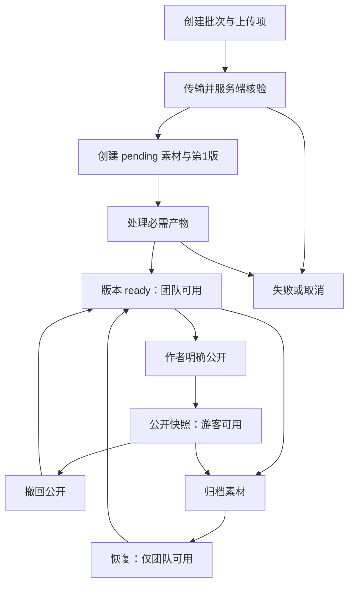

**拾灵详细设计 v0.1｜评审入口与决策清单**

> 公开归档状态：P00/P01/P03、D01/D02 与 v0.2 视觉方向已确认；当前只推进 M0 设计收口与技术风险验证，业务未实现。确认范围见 [ADR 0002](../adr/0002-public-reopen-and-tag-governance.md)、[ADR 0003](../adr/0003-prototype-visual-direction.md) 和 [ADR 0004](../adr/0004-product-defaults-recovery-and-m0-scope.md)。

日期：2026-11-16。阶段：M0 设计收口与技术风险验证。独立项目名称为 **shiling**；用户已确认 P00/P01/P03、D01/D02 与 v0.2 视觉方向，并授权完成 M0 后先汇报；M1 仍未授权。本文的页面、数据、接口和权限仍是待实现的详细设计，不表示已经编写业务代码、生成业务数据库迁移或完成运行验证。

本设计继承[《拾灵重构方案 v1.0》](../product/refactor-proposal.md)。原方案保留为调研与决策基线；本目录记录当前细化结果，新增字段、接口、并发处理和参数仍是设计建议，不能把方向认可理解为所有细节已逐项批准。

**1．文档导航**

| 文档                                                                | 主要内容                                                                                | 建议审阅重点                               |
| ------------------------------------------------------------------- | --------------------------------------------------------------------------------------- | ------------------------------------------ |
| [01 页面与流程](./01-page-flows.md)                                 | 页面路由、页面构成、搜索/筛选、上传批次、整理、公开、归档、账户与设置、异常恢复         | 用户能否理解并高效完成日常操作             |
| [02 数据模型](./02-data-model.md)                                   | 字段类型/可空/约束/索引、关系图、状态机、事务、产物与任务、并发和清理                   | 模型职责、公开快照、取消与重试的完整性     |
| [03 API 合同](./03-api-contracts.md)                                | 路径、请求/返回字段、错误码、幂等、并发、分页、文件交付与账户恢复                       | 页面操作是否有对应合同，接口是否越权或含糊 |
| [04 权限与验收](./04-permissions-and-acceptance.md)                 | 26 项能力、默认角色、授权矩阵、账号与任务身份、公开撤回、“前置条件／操作／预期结果”验收 | 成员、整理员、管理员及游客的边界           |
| [06 M0 交互与合同收口](./06-m0-interaction-and-contract-closure.md) | 页面状态、邀请/上传/品牌/模块/清理等跨分册闭合                                          | M1 实施前是否只存在一套语义                |

建议先审本文件第 2、3、6 节，再按关注点进入分册。分册是相互配套的合同：页面操作使用同一资源名、API 状态和权限语义；没有附带实现代码。页面描述与已确认方向的 v0.2 静态稿配套，不是浏览器实测。新增[原型落地与体验验收](05-prototype-acceptance.md)，统一四页任务映射、缺失状态和 UX-01～UX-14。

**2．已确认要求与本轮采用的基线**

| 状态           | 结论                                                                                                                                                  |
| -------------- | ----------------------------------------------------------------------------------------------------------------------------------------------------- |
| 用户已确认     | 使用独立新项目 `shiling/`；本地位置由使用者选择                                                                                                       |
| 用户已确认     | 允许工程基础和设计归档，暂不编写业务代码                                                                                                              |
| 用户已确认     | v0.2 视觉方向与桌面居中双栏详情弹窗；见 [ADR 0003](../adr/0003-prototype-visual-direction.md)                                                         |
| 用户已确认     | 初期服务一个团队，之后作为通用、可配置、独立部署的开源项目                                                                                            |
| 用户已确认     | 不迁移旧数据库、素材、用户或文件存储；没有旧链接与 API 兼容要求                                                                                       |
| 用户已确认     | 灵感浏览与直接取得可用素材同等重要；核心包括图片、MP4、动效包                                                                                         |
| 本轮明确确认   | 动效首期仅接受可直接运行的自包含 HTML/ZIP，不运行依赖安装或构建脚本                                                                                   |
| 用户已确认     | 本实例所有成员可公开自己的素材；游客可下载已公开素材                                                                                                  |
| 本轮明确确认   | 素材首期仅归档与恢复，永久删除后置                                                                                                                    |
| 本轮明确确认   | 公开页只展示素材信息，不展示成员姓名、头像或其他成员身份字段                                                                                          |
| 采用的方案基线 | 处理合格后团队可用，对外公开单独操作；未就绪内容留在上传工作区                                                                                        |
| 采用的方案基线 | 类型、标签、团队集合、个人收藏；无私人收藏夹、分类树或资源 ACL                                                                                        |
| 工程评估基线   | 按用户允许自行评估的授权，保留原件、取消固定 80,000 字节门槛，衍生预览另设预算；P02 不再列为必答确认，限额由 D03/D04 收口；首期无替换原件/历史版本 UI |
| 用户已确认     | P00 首期计划与验收、P01 产品默认和 P03 新系统备份恢复安全策略；见 [ADR 0004](../adr/0004-product-defaults-recovery-and-m0-scope.md)                   |
| 采用的技术方向 | Vue/TypeScript/Fastify、PostgreSQL/pg-boss、Local/S3、模块化单体与隔离媒体处理、通用 Compose                                                          |

成员身份不进入公开 DTO，不意味着平台能识别和去除文件画面、文字、EXIF 或动效源包中的身份信息。下载仍提供保真的原件；发布表单会明确提示文件本身也将交给游客，避免将界面隐私承诺扩大为内容自动匿名化。

**3．产品流程的详细设计摘要**

**3.1 页面与导航**

团队主导航为素材库、集合、我的收藏、上传任务。归档入口附属于素材管理，成员/标签/角色/设置/任务/审计按能力显示。公开站使用独立精简页面，不混入团队导航。

| 用户任务      | 页面入口与行为                                                                           |
| ------------- | ---------------------------------------------------------------------------------------- |
| 找灵感        | /app/library 网格；类型/标签/集合筛选，封面优先，按需播放                                |
| 快速整理      | 同一素材库切列表，选中后批量标签/集合/归档；筛选与视图共享状态                           |
| 看清并使用    | /app/assets/:assetId；桌面从列表打开居中双栏弹窗，深链独立页与移动全屏可用；明确下载原件 |
| 批量入库      | /app/uploads 与批次详情；逐项进度、失败、取消和重试；一项失败不拖累整批                  |
| 组织项目/主题 | /app/collections；集合 owner 或治理角色维护，不因此取得素材编辑权                        |
| 公开给游客    | 单项公开表单预览标题、说明和选定标签，明确游客将可获取原件                               |
| 撤回与恢复    | 撤回只取消公开；归档同时撤回；恢复只回到团队库，不重新公开                               |
| 游客使用      | /public 与 /public/assets/:assetId；只读公开快照；不存在/撤回/无资格统一不可用           |

搜索条件写入 URL；浏览器返回恢复查询和滚动位置；失效状态有重试或刷新入口。列表不同时运行所有视频/动效，触屏使用明确的播放按钮。公开链接与团队链接分开，复制链接不改变任何权限。

**3.2 上传、入库和公开状态**

失败、取消和过期在模型中区分：可重试失败使用新执行代次；取消/过期不能复活旧上传 attempt。图中的失败分支仅为流程概览，精确状态见 02/03。

关键规则：

- ready 是必需产物验证完成的结果，不能只凭浏览器上传成功或存在占位封面判定。
- 取消与 ready 原子竞争：取消先成功，迟到 worker 结果拒绝；ready 先成功，取消返回 409 并引导归档。
- 原件上传成功后的处理失败允许重试，无需重复上传同一有效输入。
- 重复内容仅提示，允许独立逻辑素材；不自动覆盖、共享所有权或全局物理去重。
- 可选标签/集合在提交时失效，应反馈整理警告，不能让合格媒体永久卡在工作区；必需的格式和安全检查仍不得跳过。
- 上传者失去账号或上传资格时，尚未入库版本失败并提示 AUTHORIZATION_REVOKED；恢复资格后需手动重试。已 ready 素材不会随账号停用自动消失。

**3.3 元数据与公开快照**

内部素材保存最新标题、说明与标签关联；Publication 保存某个 ready 版本与一份独立的公开字段快照。成员修改内部标题、管理员整理标签或字典改名，都不会自动改变公开页面。

发布输入为 title、description 和当前资产关联标签的子集 tagIds。服务端把标签名称复制为 publicTags 文本数组；公开响应不含团队 tagId、ownerId、原始文件名、内部集合、任务或审计信息。

更新公开快照也只由所有者执行，并校验内部素材与公开记录两个 revision。任何角色都没有 publishAny。管理员或受委派治理角色可以撤回他人的公开内容，但不能代其更新快照或重新公开。

**3.4 归档、集合和标签**

- 素材归档保留原件、版本、公开历史和整理关系；首期不提供永久删除。归档详情只向所有者/治理者提供元数据、必要静态预览和恢复；原件下载、视频播放、主动动效执行需先恢复。
- 集合可归档/恢复；保留条目，不归档其中素材。集合本身不会公开，不提供“公开整个集合”。
- 收藏只属于当前用户；管理员也没有代看或代改他人收藏的产品接口。
- 标签字典按已确认 D02 由管理员或受委派角色治理；普通成员选择已有标签。停用标签保留旧关联、禁止新增关联；改名不更新公开快照；标签合并后置。

**4．模型与接口的落地边界**

**4.1 核心数据关系**

| 模型组                                                               | 职责                                                                         |
| -------------------------------------------------------------------- | ---------------------------------------------------------------------------- |
| users、identities、sessions、invitations、auth_tokens、roles         | 业务身份、登录凭据、会话、稳定邀请/恢复和单角色授权分离                      |
| upload_batches、upload_items、upload_attempts                        | 批次与逐文件接收；一项可有多次传输，但同一项只建立一个首版素材               |
| assets、asset_versions、artifacts                                    | 稳定素材身份、不可变内容版本与按角色区分的原件/预览产物                      |
| processing_jobs、processing_attempts                                 | 处理计划、尝试、故障和迟到提交栅栏；pg-boss 管投递与重试，不再自建第二个队列 |
| storage_objects                                                      | 对象登记、引用和临时清理账本；不实现跨用户 blob 共享权限                     |
| publications、publication_revisions                                  | 公开状态、不可变快照/撤回历史及单调递增修订                                  |
| tags、asset_tags、collections、collection_items、favorites           | 内容组织与个人偏好，不承载新的访问授权边界                                   |
| branding_assets、product_settings、audit_events、idempotency_records | 独立品牌候选、配置、审计、重复命令结果引用；不保存可回放的秘密               |

02 文档已细化字段类型、可空、外键、唯一约束、重要索引与事务边界。它是设计字典，不是可执行 DDL。取消、失败任务的临时对象与正式素材的保留规则分开；已被版本接纳的原件采用保守保留，不借技术清理实现用户尚未授权的素材永久删除。其容量影响需要在运维保留策略中明确。

**4.2 API 合同要点**

- /api/v1/auth、/team、/public 分开；内部与公开 DTO 分开。
- PATCH 对目标资源用 If-Match：缺失 428，过期 412。动作 POST 使用显式 expectedRevision：过期 409。取消/重试按实时状态执行，不要求客户端提供已过期的 revision。
- 创建和动作幂等记录保存 actor、operation、key、请求摘要与资源引用；重放仍鉴权，不重放过期签名 URL 或明文 token。
- 批量素材操作逐项授权、逐项结果；集合条目批次是同一集合聚合内的原子修改，避免两种语义混写。
- 文件通过受控交付授权获取，视频支持 Range；HTML 永不在主站直接执行。短期对象 URL 不能承诺立即撤销，已下载内容不能远程收回。
- 公开分页、计数、标签分面和搜索都基于公开范围；索引命中仍核对当前资格。
- 不提供原件替换、素材永久删除、所有者转移、批量公开或任意处理命令接口。

业务写入与任务创建通过同一 PostgreSQL 事务及经验证的 pg-boss 事务适配完成。媒体 I/O 在事务外，提交前重新验证资格、状态和执行代次。相关能力依据：[pg-boss 事务接口](https://pgboss.io/api/adapters)。

**4.3 权限设计要点**

固定能力共 26 项，一个用户首期绑定一个 roleId。初始 member 拥有本人上传、编辑、归档、公开/撤回与团队浏览等能力；内置 sysadmin 定义固定。自定义角色可以组合受委派业务能力，例如整理他人素材和撤回公开，但不能获得 system.* 系统管理权限。

权限判断同时考虑主体、当前能力、所有权、资源状态和实例策略。拥有管理员角色不代表能绕过 owner 公开约束、查看个人收藏、跳过媒体安全检查或移除最后一个有效管理员。

04 文档的验收不是“已经通过”的测试报告，后续需要在实际实现、真实 PostgreSQL、Local/S3 和目标浏览器中执行。

**5．设计完成后仍需要的验证**

M0 已完成部分一次性风险 spike，但不包含以下正式实现与生产验收：

| 验证             | 要回答的问题                                                                                | 进入开发后的产出                                    |
| ---------------- | ------------------------------------------------------------------------------------------- | --------------------------------------------------- |
| 页面原型与可用性 | v0.2 方向已确认；剩余交互、未绘制状态、桌面/移动/键盘是否可用                               | 按原型落地文档补交互稿与 UX 验收，真实页面截图/录屏 |
| MP4 样例         | 真实编码、尺寸、时长能否转为约定播放版                                                      | 输入支持矩阵、播放与转码时间/内存记录               |
| 自包含动效       | 包内路径、资源、WebGL/音频等实际内容能否在隔离条件运行                                      | 包规范、隔离验证和不支持情况提示                    |
| 存储合同         | Local 和目标 S3 的流式、分片、校验、Range、取消语义是否成立                                 | 两套实际合同结果，不能以 fake 存储代替              |
| 事务与任务       | M0 已验证 pg-boss 基础同事务与重启恢复；正式 schema 的迟到输出、取消/公开竞争是否满足不变量 | 真实 PG 业务集成与故障测试                          |
| 中文检索         | M0 已验证 12,004 行合成样例和区域设置风险；实际数据量下短词、标签和排序是否可用             | 标注样例、质量与延迟基线                            |
| 独立部署与恢复   | 外部人员能否无内部依赖安装；库和文件能否一致恢复                                            | 清洁环境安装、备份恢复与版本升级演练                |

M0 结果见[技术风险验证](../operations/m0-risk-validation.md)。一次性 spike 不能在未编写和运行新系统的情况下被宣称为正式安全、性能、部署或业务验收。

**6．已确认决策与待补充输入**

本表不重复已确认的项目路径、HTML/ZIP 范围、无历史迁移、无素材永久删除及公开不展示成员身份。

| ID  | 状态/最晚时间                   | 决策或输入                                                             | 采用规则与后续工作                                                                                                                                                 |
| --- | ------------------------------- | ---------------------------------------------------------------------- | ------------------------------------------------------------------------------------------------------------------------------------------------------------------ |
| D01 | 已确认；业务待实现              | 公开总开关重新开启                                                     | 恢复仍 active 且素材/版本仍有效的既有快照；操作前明确提示范围；不公开从未公开、已撤回或已归档素材。见[ADR 0002](../adr/0002-public-reopen-and-tag-governance.md)   |
| D02 | 已确认；业务待实现              | 标签字典治理                                                           | 默认由管理员或受委派治理角色创建/改名/停用/恢复；普通成员选择既有标签，上传不要求标签，标签合并后置。见[ADR 0002](../adr/0002-public-reopen-and-tag-governance.md) |
| D03 | 输入支持；对应媒体合同冻结前    | 常用图片格式、MP4 大致大小/时长、动效 WebGL/音频需求、目标设备/浏览器  | 由样例检测编码与支持矩阵；可先给区间，不阻塞独立账户工作；具体分支见计划第 8 节                                                                                    |
| D04 | 容量与部署；对应验证/指标冻结前 | 人数、容量与增长、并发、机器资源及架构；实例首发存储与实际 S3 验收目标 | Local 可先闭环；两类适配均属首期支持，不要求实例双写；未验收 S3 阻塞 M2 完整结项                                                                                   |
| D05 | 分为 D05-a 与 D05-b             | 公开撤回残余窗口；数据损失/恢复时间、停机与保留成本                    | D05-a 在 T04/T09 交付合同冻结前，D05-b 在 T12 方案前；工程方设计具体 TTL/备份参数；不承诺收回已下载文件                                                            |
| D06 | 资源复用前／公开发行前          | 最终许可证、拟复用品牌/字体等资源的使用范围、安全报告渠道、发行目标    | 原创内部开发可继续；实际引入前核对使用范围，公开打包前核对再分发，发行前确定许可证；视觉认可不等于再分发许可                                                       |
| D07 | 计划输入；开发排期前            | 维护者熟悉的技术栈、人数和可投入时间                                   | 技术方向已认可；此信息用于安排实现顺序与工期，不自动触发换栈                                                                                                       |

P00 启动范围、P01 产品默认与 P03 新系统备份恢复策略已经确认，P02 已按自行评估授权采用。剩余 D03～D07 是按最晚时点提供的媒体、容量、运维、发行和排期输入，集中见[待提供媒体与部署信息](../operations/m0-required-inputs.md)，不是新的产品默认确认。

标题/标签长度、页大小、重试次数、会话时限等具体数值属于统一配置与合同校验工作；文档中的推荐值不是用户已经接受的生产指标。限额涉及真实视频、动效资源消耗的部分必须先取得 D03/D04 输入再固定。

**7．后续阶段与停止边界**

页面、数据、API 与权限设计已归档；M0 继续补齐交互状态、合同与风险证据，完成后先汇报。接下来仍需按对应能力的最晚时点补充媒体、部署及运维输入。M0 不包含业务功能、业务 DDL 或真实服务部署；停止边界见 [ADR 0004](../adr/0004-product-defaults-recovery-and-m0-scope.md)。

本目录为新工程中的公开友好设计归档副本，内部链接使用相对路径。历史完整审计保存在独立评审资料，不纳入公共仓；旧项目代码、素材、凭据与 Git 历史未随文档导入。最终许可证尚待决定，归档不代表已经对外发布。
