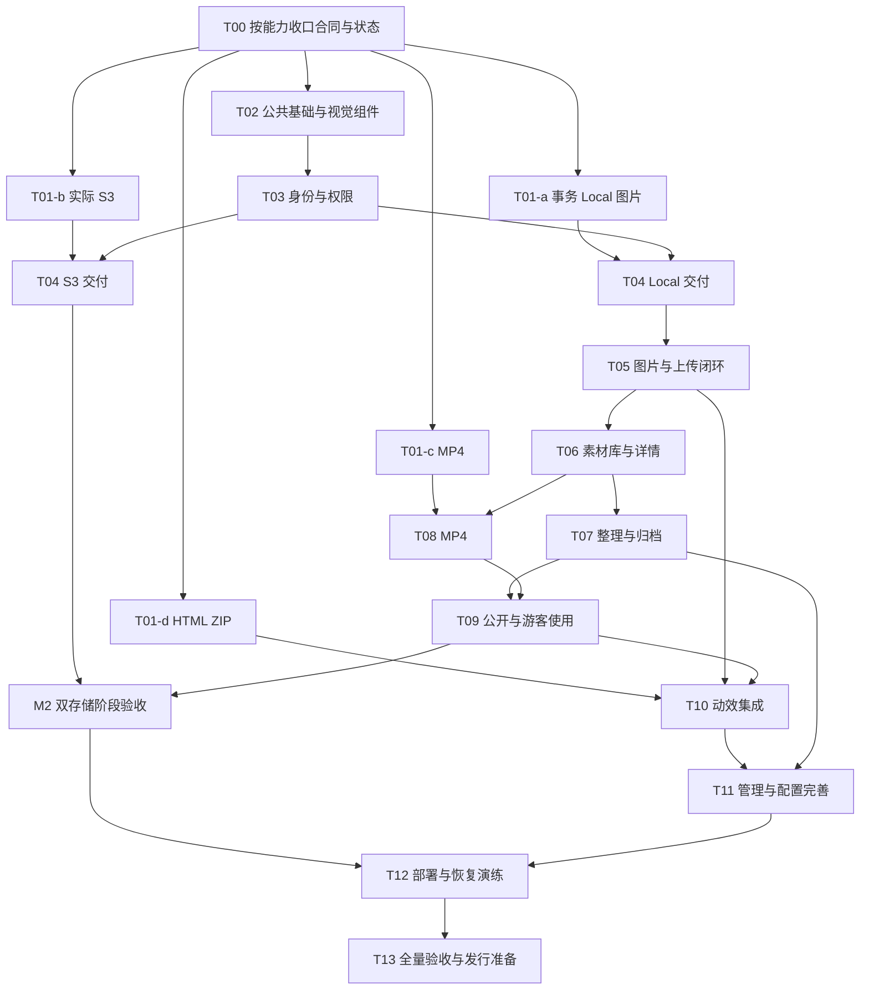

# 拾灵首期业务开发计划

- 日期：2026-11-16
- 状态：**P00/P01/P03 与 v0.2 视觉方向已确认；M0 已完成，首期业务已进入实现与本地集成验收。**
- 当前交付：按本计划推进首期平台；Local 图片/MP4、身份、整理、公开与管理已有正式实现，未完成项以验收记录为准。
- 范围：基于现有独立工程开发首期产品；不迁移旧数据、旧文件、旧账号或旧接口。

本计划不是实施完成报告，也不将工程基础、M0 spike 或代码存在等同于业务验收通过。历史风险证据见[工程基础验证记录](../operations/foundation-validation.md)和 [M0 技术风险验证](../operations/m0-risk-validation.md)，当前正式实现与运行证据见[首期部署与验收记录](../operations/deployment-validation.md)。阶段退出条件用于检查交付质量；各任务的真实完成状态以代码、测试和验收记录为准。

## 1. 依据与优先级

| 编号 | 依据                                                                                                                                                             | 在本计划中的用途                        |
| ---- | ---------------------------------------------------------------------------------------------------------------------------------------------------------------- | --------------------------------------- |
| S01  | [项目协作约定](../../AGENTS.md)、[工程基础阶段范围](../adr/0001-foundation-scope.md)                                                                             | 当前实施边界、文档语言、通用开源要求    |
| S02  | [公开重开与标签治理决策](../adr/0002-public-reopen-and-tag-governance.md)                                                                                        | D01、D02 已确认，不再重新询问           |
| S03  | [重构方案](../product/refactor-proposal.md)第 3.3、3.16～3.18 节                                                                                                 | 首期范围、阶段目标与发行要求            |
| S04  | [详细设计索引](../design/README.md)第 2、4、6 节                                                                                                                 | 已确认要求、采用基线、D03～D07 未决输入 |
| S05  | [页面与流程](../design/01-page-flows.md)                                                                                                                         | 页面、交互与 PF 验收编号                |
| S06  | [领域与数据模型](../design/02-data-model.md)                                                                                                                     | 状态、事务、所有权、对象保留与处理资格  |
| S07  | [API 合同](../design/03-api-contracts.md)                                                                                                                        | 请求、响应、幂等、并发与文件交付        |
| S08  | [权限与验收](../design/04-permissions-and-acceptance.md)                                                                                                         | ID/AU/UP/PB/FL/CF 验收编号与证据要求    |
| S09  | [工程基础验证记录](../operations/foundation-validation.md)、[部署边界](../../deploy/README.md)                                                                   | 识别尚未实现、尚未验证的能力            |
| S10  | [视觉方向决策](../adr/0003-prototype-visual-direction.md)、[原型 v0.2](../prototypes/v0.2/README.md)、[原型落地与体验验收](../design/05-prototype-acceptance.md) | 已确认视觉基准、页面任务映射与 UX 验收  |
| S11  | [产品默认、灾备与 M0 决策](../adr/0004-product-defaults-recovery-and-m0-scope.md)、[M0 合同收口](../design/06-m0-interaction-and-contract-closure.md)            | P00/P01/P03、交互状态与跨分册合同       |

明确的用户决定和已确认 ADR 优先；具体行为以最新详细设计为基线。旧方案摘要中的模糊措辞不能扩展详细设计的权限或删除范围。本计划新增的安排、收口建议与恢复策略均标明性质，不将其改写为已确认需求。

## 2. 首期交付范围

首期目标是让一个团队在独立部署实例中，高效完成三类素材的“上传 → 校验与处理 → 团队可用 → 整理与检索 → 预览与下载 → 显式公开 → 游客使用 → 撤回或归档”。图片与视频可以先形成中间版本，完整 MVP 必须包含自包含 HTML/ZIP 动效。

| 能力           | 首期应交付的内容                                                                     | 依据与状态                                                         |
| -------------- | ------------------------------------------------------------------------------------ | ------------------------------------------------------------------ |
| 账户与权限     | 首次初始化、本地登录、邀请、退出/改密/恢复、成员停用、固定系统管理员与可配置业务角色 | P01 已确认；S04/S05/S07/S08/S11 定义具体合同                       |
| 上传工作区     | 批量逐项上传、真实内容核验、进度、部分成功、取消、失败重试、重复提示、恢复任务状态   | S05～S08；采用详细设计基线                                         |
| 图片           | 约定格式的原件、缩略图、尺寸/像素核验、缩放查看、原件下载                            | S06 第 6.5 节；格式与预算待 D03/D04，固定小图门槛采用 P02 评估结论 |
| MP4            | 原视频保留、封面、符合播放合同的播放版本、拖动播放与范围读取                         | MP4 类型已确认；编码、大小、时长、浏览器待 D03                     |
| HTML/ZIP 动效  | 自包含校验、资源清单、受限处理、真实封面、独立来源交互预览、源包下载                 | 格式范围已确认；执行资源与浏览器能力待 D03/D04                     |
| 素材库与详情   | 网格/列表、关键词与结构化筛选、稳定分页、详情深链、内部纯文本编辑、复制团队/公开链接 | S05/S07/S10；v0.2 方向已确认，补充交互与实测待完成                 |
| 整理与生命周期 | 标签字典及选用、团队集合、个人收藏、受控批量操作、素材与集合归档/恢复                | D02 已确认；其余采用详细设计基线                                   |
| 公开使用       | 本人单项公开、独立快照、更新/撤回、游客检索与下载、公开开关                          | 成员公开本人素材、游客下载、不展示成员身份、D01 已确认             |
| 管理与配置     | 品牌、已注册类型启停与限额、成员/角色、任务查询和受控重试、必要审计、脱敏健康状态    | S05/S07/S08；不提供在线安装任意插件或编辑基础设施密钥              |
| 独立运行       | Local 与实际选定的 S3 目标、通用 Compose、安装与升级文档、备份恢复、中文开发说明     | S03/S04/S09；目标环境与运维指标待确认                              |

以下不纳入首期：历史迁移、多租户、资源级 ACL、分类树、私人收藏夹、审批流、批量公开、管理员代发、原件替换与历史版本 UI、永久删除素材、标签合并、全局物理去重、相似图/AI 搜索、专项配色/图标/模板工具、OIDC/SSO、外部搜索引擎、额外云存储专用适配、在线插件市场、SEO 与多语言。依据：S03 第 3.3 节、S06 第 13 节。新增上述能力应另行评估，不挤入本次任务。

### 2.1 已确认的原型基准与剩余页面工作

v0.2 的白底灰黑、浅灰筛选、紫色品牌与管理动作、原比例瀑布流，以及桌面居中双栏详情弹窗已确认。四张原型分别落到 T06/T07（素材库）、T06/T08～T10（详情）、T05/T08/T10（上传）、T09/T10（公开）；T02 提供共用视觉组件，T11 完成可配置品牌。

尚需补齐列表与批量整理、移动端、直接访问详情、公开确认/更新/撤回、完整上传状态、归档恢复、账户及管理页面。它们延续已确认方向，不重新选风格，也不因原型未画而从首期删去。详见[页面补齐顺序与 UX 验收](../design/05-prototype-acceptance.md)。

## 3. 实施顺序与里程碑

采用按业务流程逐步打通的方式。每个任务同时包含必要的接口、数据、页面、权限、测试和文档，避免全部后端完成后才第一次联调。设置校验、授权、审计和失败恢复随业务任务实现，管理页面集中完善并不意味着这些约束可以最后补。

| 里程碑                   | 任务                              | 可演示的交付结果                                                           | 退出条件                                                                                                                    |
| ------------------------ | --------------------------------- | -------------------------------------------------------------------------- | --------------------------------------------------------------------------------------------------------------------------- |
| M0：规则与风险验证       | T00、T01                          | v0.2 方向已确认；补齐合同、交互状态、样例与分项验证记录                    | 每项相关产品规则/合同闭合后放行；技术验证按能力分支记录，不是所有后续工作的总串行门槛                                       |
| M1：图片最小业务闭环     | T02～T05 的相关分支               | 初始化并邀请成员，上传合格图片，处理后团队可见，按 v0.2 基础布局查看与下载 | 真实数据库与 Local 下跑通；事务/图片/Local 验证通过，权限、重试、取消、失败恢复与对应 UX 条目通过；未验证 S3 明确保留未完成 |
| M2：图片与视频日常使用   | T06～T09，补齐 T01/T04 的 S3 分支 | 素材库、整理与详情、图片/MP4、公开与归档可日常使用                         | Local 和选定 S3 的图片/MP4 流程均通过；四页对应交互、公开与归档边界通过；动效相关条目仍待 M3                                |
| M3：三类完整 MVP         | T10、T11，并补齐前述任务          | HTML/ZIP 动效闭环，完整管理与配置页面                                      | 三类素材、未绘制首期页面及 UX 全范围完成；角色、配置、隔离、真实交互通过                                                    |
| M4：可独立运行的首发候选 | T12、T13                          | 可复现安装、恢复、升级和验收报告                                           | 本文第 6 节全部门槛满足；公开发行另须许可证、发行内容与发布目标就绪                                                         |

T01 的 MP4、动效和 S3 验证各自前置于对应实现；T10 不是第一次研究动效是否能运行。T01-a（事务/Local/图片）通过即可放行 Local 图片链路；T01-b（S3）、T01-c（MP4）、T01-d（动效）分别记录。T02 与这些分支可并行；未通过的分支只阻塞其依赖能力，不能因此声称完整 M0 或相关里程碑已完成。

建议依赖顺序如下：

这是推荐交付顺序，不意味着所有代码都必须串行：T07 与 T08 可以并行；T10 可在 T01 媒体验证通过、上传/交付合同稳定后提前开发，其公开能力在 T09 完成后联调。T11 的公共约束在前序任务中已经执行，只在此完善管理交互。部署、测试脚本与文档随任务迭代，T12/T13 负责完整演练与收口。

当前没有足够依据承诺人日或日期。D07 明确维护者、投入时间和技术熟悉度后，结合 T01 实测结果估算；任务依赖与验收范围可以先确认。

## 4. 开发任务清单

M0 可交付已完成并等待用户确认：T00 合同已冻结，T01 已按“通过／部分通过／未执行”归档证据。T02～T13 的业务工作均未开始。接口名称指 S07/S11 中的计划合同，不代表现有代码已注册这些路由。

### T00：产品默认、合同与原型状态收口

- 已完成：P00/P01/P03、v0.2 四个静态核心页面与体验验收确认；跨页面状态和第 7 节合同在 [M0 收口文档](../design/06-m0-interaction-and-contract-closure.md)冻结。
- 待后续输入：按 P02 评估结论结合 D03/D04 定义真实图片支持与预算；媒体/环境输入见[集中清单](../operations/m0-required-inputs.md)。
- 补图顺序：先账户与共用壳层，再上传完整状态、素材库列表/筛选/批量及详情深链/移动；随后整理/归档、公开确认、媒体状态、管理。每组交互稿在对应业务任务实施前完成；补齐“改密、退出全部会话”入口。
- 验收：每个写操作有主体、权限、资源状态、修订/幂等和失败行为；每项首期能力有负责人角色与用例编号；未决输入明确负责人和最晚时点。静态流程可走查，真实浏览器验收仍未执行。
- 按相关合同分项放行：公共合同闭合后才可实施 T02/T03；图片规则在 T05 前闭合，品牌文件引用合同在相应接收实现前闭合。不要求所有后期参数一次全部确定。
- 依据：S04～S08、S10；放行仅描述获准开发后的依赖，不改变本轮停止边界。

### T01：按能力前置验证技术风险

| 分支  | 交付与通过条件                                                                                                                                      | 影响范围                                            |
| ----- | --------------------------------------------------------------------------------------------------------------------------------------------------- | --------------------------------------------------- |
| T01-a | 真实 PostgreSQL/pg-boss 原子入队；Local 接收、校验、取消、Range；图片必需产物；中文检索基准样例。回滚无任务、提交不丢任务；旧上传授权不能覆盖新内容 | 事务基础、T04 Local 与 T05；中文质量在 T06 继续验证 |
| T01-b | 选定实际 S3 目标，验证写入、校验、分片/取消、Range 与授权；与 Local 使用同一合同断言，不能用模拟存储代替                                            | T04 S3、双存储联调及 M2 完整结项                    |
| T01-c | 约定 MP4 输入/播放矩阵，记录支持、拒绝、转码资源与目标浏览器结果                                                                                    | T08 对应媒体能力与预算                              |
| T01-d | HTML/ZIP 自包含校验、独立来源与执行资源隔离、真实封面及失败案例；不通过关闭沙箱来获得成功结果                                                       | T10 对应媒体能力与预算                              |

- M0 当前证据：T01-a 基础 spike 通过；T01-b 因实际 S3 目标未提供而未执行；T01-c 的 H.264/AAC 合成基线通过、真实媒体矩阵待输入；T01-d 的 ZIP/部分浏览器边界通过，但同主机跨端口 Cookie 与 iframe 自导航证明仅靠 CSP/sandbox 不足，服务器网络/资源隔离和真实动效仍未通过。详见 [M0 技术风险验证](../operations/m0-risk-validation.md)。
- 依赖：T00 中相关合同及 D03/D04 的对应输入。M0 已授权使用合成样例探索；未得到实际目标与实测时，不宣称供应商或任意媒体已支持。结果见 [M0 技术风险验证](../operations/m0-risk-validation.md)。
- 缺少 S3、视频或动效输入时，账户及已验证的 Local 图片工作可推进；未通过的分支保持未完成，相关阶段不得整体结项。
- 依据：S04 第 5 节、S06 第 8.3 节、FL-04～FL-10/FL-12。验证失败先修正方案，不以“写库后尽力发消息”替代原子性。

### T02：数据库、API 与前后端公共基础

- 交付：确定并记录数据库访问/迁移工具；增量数据库迁移、事务入口、请求校验、独立内部/公开 DTO、错误和 requestId、幂等记录、修订冲突、配置校验与审计基础；前端路由、请求层、表单错误；按 v0.2 建立品牌/配色/间距变量、团队/公开壳层，以及按钮、输入、筛选、弹窗、反馈等共用组件。
- 验收：空库可建立当前版本并重复检查；迁移失败有明确状态；PATCH 缺前置条件为 428、过期为 412，规定动作过期为 409；同幂等键不同请求拒绝，重放仍重新鉴权；日志无令牌/签名 URL/原始 SQL。
- 体验验收：UX-01/11/12/13；主视觉与配置共享，弹窗键盘和错误反馈可用，不以四张静态图片嵌入页面冒充组件实现。
- 依赖：T00 的公共合同；涉及队列的事务适配采用 T01-a 结果。业务表按所属任务增加，不一次性创建尚未实施的增强功能表。
- 依据：S06 第 2、11～12 节、S07 第 1 节、CF-03/04/06/08。查询/迁移库和内部实现方式属于工程决策，不要求用户逐个选择库名。

### T03：首次初始化、账户与权限

- 交付：受控初始化、本地登录/退出、改密/全会话退出、邀请/恢复；固定 sysadmin、单角色能力目录、可撤销会话；成员邀请、停用、角色分配的最小管理页面。
- 数据/API：身份、凭据、会话、一次性令牌与角色；`/bootstrap`、`/setup/initialize`、`/auth/*`、`/team/capabilities` 和相关成员/角色接口。
- 验收：空实例只能受控初始化一次；无邮件/云账户也能完成邀请与恢复；并发停用/降权仍保留最后管理员；旧会话与已消费令牌失效；自定义角色不能获得 `system.*`；用户改名为“管理员”不提升权限。
- 依赖：T02。依据：ID-01～ID-12、PF-01/13/14；每项资源用例仍需实施自己的所有权和状态检查。

### T04：Local/S3 存储与受控文件交付

- 交付：对象登记与引用合同、不可变接纳策略、流式本地接收、适用的 S3 分片传输、取消与过期；文件授权、范围读取和安全下载响应。存储路径及长期凭据不进入业务 DTO。
- 验收：Local 与实际 S3 同一用例集分别通过；伪造 key、路径穿越、篡改授权绑定、非法 Range 有界拒绝；交付不整文件缓冲；上传、下载、预览授权各自有有限 TTL；HTML 原件按附件下载。
- 分支验收：T04 Local 依赖 T01-a，通过后可支撑 M1；T04 S3 依赖 T01-b，可独立推进。T04 全任务及 M2 结项仍要求两者实际通过。
- 依赖：相应存储分支验证、T02/T03。与素材主体关联的完整交付在 T05/T08/T09/T10 分别联调，不能仅凭存储适配器测试宣称素材权限已通过。
- 依据：S06 第 7 节、S07 第 6 节、FL-01～FL-06/FL-12。

### T05：上传工作区与图片最小闭环

- 交付：批次、上传项、传输尝试、独立核验与媒体处理派发；图片真实校验/缩略图；逐项状态、取消、重试、重复提示；最小真实列表/详情与原件下载。
- 验收：同批部分失败不影响其他项；完整输入的处理失败可重试而无需重传；重复 complete 不重复建素材；核验通过前不提前创建可用素材；取消与 ready 两种先后次序均确定；旧任务结果不得覆盖新尝试；本人失去上传资格后不能继续入库。
- 原型与体验：按 v0.2 上传工作区实现，补齐 S10 状态清单；UX-06/07/11/12/13 通过。传输/处理/可用明确区分，进度未知不伪造百分比，失败动效不显示可执行预览。
- 依赖：T01-a、T02/T03 与 T04 Local 可完成 M1；T04 S3 完成后复用同一链路联调。图片必须保存保真原件和可解码缩略图；没有占位封面冒充 ready。
- 依据：S06 第 5、6.5、8 节；UP-01～UP-14、PF-02～PF-05。M1 在此形成，仍未达到完整 MVP。

### T06：素材库、中文检索、详情与编辑

- 交付：真实数据原比例瀑布流/整理列表、关键词/类型查询、紧凑筛选与排序、稳定游标分页、详情深链与桌面居中双栏弹窗、移动详情、图片预览、内部标题/说明编辑；标签/集合/收藏筛选随 T07 接入。
- 验收：刷新恢复筛选；同会话从详情返回恢复列表及滚动；直接访问详情独立可用；中文组合输入不逐字发请求；迟到响应不覆盖新查询；错误态与无结果区分；412 保存冲突保留输入且不覆盖他人修改。
- 原型与体验：默认封面＋小标题，详细元数据进入列表/详情；补齐筛选、视图与批量入口，不删掉原型未画的既定功能。UX-02～UX-05、UX-10～UX-13 的图片范围通过，移动全屏、直接访问与返回恢复均有实测。
- 依赖：T05。依据：S05 第 3～4 节、S07 第 2/5 节、AU-01/02、PF-06/16。相关性排序仅在验证后开放，首期不承诺中文语义搜索。

### T07：标签、集合、收藏、归档与批量整理

- 交付：D02 标签字典及选择器；团队集合和集合归档/恢复；个人收藏；素材归档/恢复；批量增删标签、集合关系及归档；补齐 T06 筛选与计数。
- 验收：普通成员不能治理字典；停用标签禁止新关联且保留历史；把他人素材放入本人集合不取得素材管理权；管理员也无查看他人收藏的产品入口；素材批量逐项反馈，单集合条目批次原子成功或不变。
- 归档验收：保留文件和整理关系；仅授权静态预览，不提供原件/主动播放；恢复不自动公开；无永久删除或定期清空归档。归档与公开并发在 T09 联合验收。
- 体验验收：UX-03/05/14，补齐集合、收藏、字典治理与归档页面；批量操作不改变当前查询范围或所有权。
- 依赖：T03/T06。依据：D02、AU-01～AU-14、PF-07/08/12。

### T08：MP4 处理、播放与下载

- 交付：按支持矩阵识别容器/编码、时长/尺寸与资源预算；封面与合格播放版；浏览器播放、跳转、倍速/全屏等合同内控制；保真原视频下载。
- 验收：必需的 original/poster/playback_video 均合格才 ready；约定样例在目标浏览器可播放和拖动；Range 实测；不支持的编码或资源超限给出受控失败；可选短循环失败不阻止合格视频使用。
- 体验验收：UX-06/10/11/12 的 MP4 范围；鼠标/触屏操作、播放失败、离屏暂停、减少动态效果按真实页面验收。
- 依赖：T01-c、相应 T04 存储分支、T05/T06；可与 T07 并行。依据：S06 第 6.5 节、PF-02、FL-04/05/10/12。具体格式和时长不由扩展名推断。

### T09：公开快照、游客使用、撤回与总开关

- 交付：单项公开/更新表单、不可变公开快照、游客列表/详情/检索/下载、撤回、D01 总开关及影响范围提示；公开文件名与字段白名单。
- 验收：仅 owner 且具能力可公开，系统管理员不能代发；内部编辑/标签改名不更新公开快照；公开标签只选当前关联子集并保存文本；公开响应不含成员身份、原始文件名及内部集合；游客下载无需登录。
- 撤回验收：新资格即停止，旧供应商 URL 按确认 TTL 失效；归档与公开竞争无越权结果；关闭后重开仅恢复仍有效的 active 快照，不复活旧应用 grant；下载副本不可收回的边界在界面中说明。
- 原型与体验：按 v0.2 公开页扩展公开详情，补齐公开确认、更新与撤回；UX-05/08/09/11/12/13 通过。公开不由复制链接或上传自动触发，游客无登录门槛；不能复用内部 DTO 后仅隐藏字段。
- 依赖：T03/相应 T04 存储分支/T06/T07；图片与视频里程碑同时要求 T08 和实际 S3 联调。依据：D01、PB-01～PB-12、FL-01/03/04/11、PF-09～PF-12/15。

### T10：HTML/ZIP 动效完整集成

- 交付：HTML 单文件与静态 ZIP 接收、资源清单、包结构/配额验证、隔离处理生成真实封面、独立来源交互预览、源文件下载；接入同一上传、素材、公开和归档流程。
- 验收：两种输入分别跑通；新动效 ready 必须通过真实隔离执行与必需产物验证；外链/路径穿越/软链/ZIP 炸弹/跨任务读取受限；不能访问主站身份或云元数据；禁用执行时按已定策略阻止新执行。
- 限制：浏览器来源隔离与服务端执行器资源隔离分别验收，不声称 iframe 提供 CPU 硬隔离。隔离缺失时不允许新包绕过必需处理成为 ready；已有合格素材可以保留获准的安全封面与源包下载。
- 体验验收：UX-06/08/10/11/12 的动效范围；补齐预览能力受限、错误、源包下载及移动交互，真实封面不等于实际交互已经通过。
- 依赖：T01-d、相应 T04 存储分支、T05/T06；公开集成依赖 T09。依据：S06 第 6.5 节、S08 第 6 节、FL-06～FL-10、PF-02/16。

### T11：管理、品牌与配置能力完善

- 交付：成员/角色完整管理，品牌与 Logo/favicon 专用接收，已注册类型及业务限额，任务查询/受控重试，审计筛选、脱敏健康信息；配置变更影响提示。
- 验收：两个不同实例配置下，名称/品牌/公开/角色/类型策略无需改源码；类型停止接收不删除历史内容；已受理请求按详细状态机处理；未知能力和越界限额拒绝；无任意命令执行入口；品牌保存失败保留原配置。
- 体验验收：UX-01/11～UX-14；按统一组件补齐管理页，团队和公开两处预览品牌配置。v0.2 视觉认可不代替拟复用资源的许可核对。
- 依赖：T03/T07/T09/T10 的相关能力。权限与审计不是本任务才开始实现；这里只完善管理入口和配置反馈。品牌对象归属须先在 T00 收口。
- 依据：S05 第 9 节、S07 第 7 节、ID-06～ID-09、UP-06/08、CF-01/02/06/08、PF-13/15。

### T12：独立部署、对象保留、备份与升级恢复

- 交付：通用开发/生产部署说明与 Compose、持久化与独立预览来源配置、容量/失败告警；仅对合格临时对象的清理和对账；新系统数据库与文件一致备份、恢复、版本升级及兼容回退流程。
- 验收：干净环境从空数据库/存储安装，按文档建立管理员，三类流程可用；Local 与目标 S3 均验证；对象清理与新引用竞争不误删；已接纳原件和归档素材不会因失败/保留期被清理。
- 恢复验收：比对对象摘要和关系、素材/公开状态、角色、授权与任务；旧 worker 不得提交；达到届时冻结的 RPO/RTO。P03 恢复授权策略已确认，仍待实现和演练。新版本数据库升级不等于旧平台数据迁移。
- 基础约束前置：对象不可变、引用保护、版本兼容与授权/任务代次随 T02/T04 落地；本任务完成 P03 的完整演练。P03 不改变 D01 日常开关。
- 依赖：完整 MVP、D04/D05 与 P03。依据：S06 第 7/12 节、CF-07、S03 第 3.15～3.17 节。

### T13：完整验收、中文文档与发行准备

- 交付：全部首期用例证据、真实桌面/触屏/键盘检查、约定负载下的性能报告、安装/配置/升级/恢复/开发文档、示例配置与可分发样例、第三方依赖与许可归属清单、安全报告渠道。
- 验收：第 6 节门槛及 UX-01～UX-14 全范围全部满足；记录四页桌面与移动交互证据，逐条标明失败或未执行，不能以原型图代替运行页面；外部使用者按文档从干净环境复现；跳过和失败项目明确记录；无内部信息和真实素材随制品分发；许可证与发行内容确认后才具备公开发行条件。
- 依赖：T00～T12，公开发行另依赖 D06。许可证未定时可以完成内部试用与技术验收，但不能宣称已完成开源发布。
- 依据：S03 第 3.17 节、S08 第 11 节、[贡献指南](../../CONTRIBUTING.md)、[安全约定](../../SECURITY.md)。

## 5. 验收用例与任务的对应关系

现有设计包含 16 条页面旅程与 72 条权限/状态/文件/配置验收条目，共 88 条。它们是待执行的验收约定，不要求机械生成 88 个重复测试；可用有清晰映射的参数化、集成、端到端或人工检查覆盖同一组断言。

| 用例组       | 覆盖内容                                     | 主要落地任务                  |
| ------------ | -------------------------------------------- | ----------------------------- |
| PF-01～PF-16 | 页面旅程、三类素材、错误恢复、桌面与移动体验 | T03、T05～T11；T13 全量复核   |
| ID-01～ID-12 | 登录、降权、系统角色、会话、CSRF、最后管理员 | T02/T03；后续每个写用例复核   |
| AU-01～AU-14 | 所有权、标签、集合、私人收藏、批量与归档     | T06/T07；T09 联合验收         |
| UP-01～UP-14 | 上传、幂等、取消、重试、资格撤销、迟到结果   | T01/T04/T05，T08/T10 扩展格式 |
| PB-01～PB-12 | 公开快照、成员隐私、撤回、D01 与无批量公开   | T09，T10 接入动效后复核       |
| FL-01～FL-12 | 文件交付、TTL、Range、隔离、双存储           | T01/T04/T08/T09/T10/T12       |
| CF-01～CF-08 | 开关、错误、审计、恢复与日志脱敏             | T02/T05/T11/T12，T13 收口     |

另外补充以下工程验收编号，避免现有编号中没有单独覆盖的事项被遗漏：

| 新增编号 | 必须验证的断言                                                     | 落地任务                   |
| -------- | ------------------------------------------------------------------ | -------------------------- |
| EN-01    | 业务写入与 pg-boss 入队同提交或同回滚；提交后重启仍有可恢复任务    | T01/T02/T05                |
| EN-02    | 空库与已有新系统版本的迁移可复现；真实 FK/唯一约束及幂等竞争有效   | T02/T12                    |
| EN-03    | 临时清理与新引用竞争不误删；已接纳原件、归档素材不进入暂存回收     | T04/T12                    |
| EN-04    | 固定中文短词、组合标签与分页样例有预期结果；计数与内容授权范围一致 | T06/T07/T09                |
| EN-05    | 两套实例配置不改源码；干净环境独立安装可复现                       | T11/T12/T13                |
| EN-06    | 备份恢复、P03 授权/公开失效、版本升级及兼容回退满足冻结目标        | T12；RPO/RTO 待 D05-b 冻结 |
| EN-07    | T00 四项合同衔接具备并发、权限与引用完整性回归                     | T03/T05/T11                |

这些是本计划新增的验收建议；只有 EN-01/EN-04 的 M0 基础 spike 有证据，正式业务用例均未执行。P03 语义已冻结，恢复演练与 RPO/RTO 仍未执行。

### 5.1 结合原型新增的体验验收

新增 **UX-01～UX-14**，完整前置/动作/预期与证据要求见[原型落地与体验验收](../design/05-prototype-acceptance.md)。覆盖共同视觉、瀑布流、搜索/列表/批量、详情导航与权限、上传状态与恢复、公开浏览与确认、三类媒体、键盘、响应式、错误与管理配置。

这些条目细化已有业务旅程，不要求为每条重复写一套测试。M1 执行图片与基础交互范围，M2 补齐整理/视频/公开，M3 补齐动效与管理，M4 汇总真实运行证据；当前全部未执行。

## 6. 首期完成门槛

| 维度         | 可判定的通过标准                                                                                                                       | 证据要求                                                                  |
| ------------ | -------------------------------------------------------------------------------------------------------------------------------------- | ------------------------------------------------------------------------- |
| 三类完整流程 | 图片、约定 MP4、自包含 HTML、静态 ZIP 分别完成上传至撤回；原件下载摘要与接纳时一致；恢复不自动公开                                     | 每类样例、实际流程结果、原件摘要                                          |
| 权限与隐私   | 本人/他人/治理角色/游客/停用账号直接请求 API 与文件入口结果正确；公开字段、检索计数与分面不含内部数据；无管理员代发                    | ID/AU/PB 自动化与公开响应断言，不能只看隐藏按钮                           |
| 事务与恢复   | 原子入队；重复提交不重复建资源；取消/ready、降权/写入、撤回/更新、归档/公开两种提交顺序均通过；旧执行结果被拒绝                        | 真实 PostgreSQL、可控并发屏障、故障重启记录                               |
| 媒体与存储   | 三类必需产物合格才 ready；Local 与实际 S3 分别通过权限/取消/Range/过期合同；缺少隔离不能启用执行                                       | FL、真实供应商与目标执行环境；模拟存储不能替代                            |
| 使用体验     | 按已确认 v0.2 实现并通过 UX-01～UX-14；桌面弹窗/深链/移动全屏一致，原比例浏览与列表整理可用，上传/公开状态明确，键盘/触屏/错误恢复完成 | 真实浏览器截图/录屏、视口、输入方式、UX/PF 映射；静态原型不能充当通过证据 |
| 性能与资源   | 在已确认硬件、数据量、并发和媒体集合下满足冻结的查询/处理时间与 CPU/内存/磁盘预算；超限受控失败                                        | D03/D04 冻结的指标及实测；未定数值不得写“性能通过”                        |
| 独立运行     | 无旧仓、内部服务、私密账号依赖的干净安装；两套实例配置无需改源码；新系统备份恢复和升级/回退达到目标                                    | 脱敏配置、安装与恢复步骤、摘要核对、RPO/RTO 实测                          |
| 发行准备     | 中文文档可复现；许可与第三方归属明确；示例可再分发；仓库与制品无内部信息；安全报告渠道明确                                             | 内容审查和第三方许可清单；实际公开发布状态单独记录                        |

所有记录注明代码版本、环境、数据库及存储版本、浏览器、脱敏配置、样例、用例编号和结果。未执行项目标为“未执行”；失败和跳过不能计为通过。权限越界、公开泄漏、原件损坏、竞态复活、隔离绕过、不可恢复的数据错误属于首发阻断项。

常规检查沿用 `corepack pnpm check`，随能力补充真实集成与端到端检查。通过类型检查、构建或现有 `/health/live` 不等于通过本节门槛。

## 7. 开发前必须收口的设计衔接

以下属于 T00 的工程设计工作。它们不会扩大产品范围，也不要求用户选择表名、库名或事务写法；如解决方式影响用户行为或既定安全边界，再提交具体取舍。

| 问题                                                        | 现有依据                                 | 收口要求                                                                                               |
| ----------------------------------------------------------- | ---------------------------------------- | ------------------------------------------------------------------------------------------------------ |
| 邀请撤销/重签要求修订号，但一次性令牌模型未给出对应修订主体 | S07 管理接口、S06 第 4.5 节              | 明确 invitationId、修订主体、令牌与 invited 用户关系；并发消费/撤销/重签只有合法结果                   |
| 上传中的元数据编辑能力未在接口中明确                        | S07 上传 metadata PATCH、S08 能力目录    | 明确本人及治理者的编辑授权和失权行为；不能套用仅适用于 ready 素材的编辑判断                            |
| complete 返回异步核验，但媒体处理任务要求已存在版本         | S07 complete、S06 第 5.4/8.1 节          | 核验任务以接收尝试为主体，媒体处理以已建立版本为主体；可靠派发与状态原子一致，不在核验前伪造可用 Asset |
| 品牌文件专用接收与对象账本归属不闭合                        | S07 branding-assets、S06 第 7.1 节       | 明确品牌文件独立归属、持久引用和替换后清理，不伪装为团队素材或随意绕过引用保护                         |
| 物理目录与逻辑模块命名不一                                  | `backend/src/modules` 的占位目录与职责表 | 建立明确映射并统一文档，避免 ingestion/uploads、publication/publications 等重复实现                    |
| 旧方案的管理员代发措辞较宽                                  | S03 权限摘要与 S08 第 2/5 节             | 采用详细设计：任何角色均没有 publishAny；管理员只能治理和撤回他人公开                                  |
| 失败任务清理摘要可能误删已接纳原件                          | S03 任务摘要与 S06 第 7.2 节             | 以对象类别和引用状态判定；失败/取消版本已接纳原件保守保留；仅符合条件的无引用暂存对象回收              |
| 隔离缺失时降级与新动效 ready 条件容易混淆                   | S08 第 6 节、S06 第 6.5 节               | 降级只保留已有合格内容的获准静态读取/下载，不能使未完成必需隔离处理的新动效变 ready                    |

上述八项已在 [M0 交互与合同收口](../design/06-m0-interaction-and-contract-closure.md)冻结。P03 也已按 [ADR 0004](../adr/0004-product-defaults-recovery-and-m0-scope.md) 确认，不再作为本表的待决条件。

## 8. 剩余决定、输入与工程事项

本节为统一清单。只需用户决定产品取舍、提供已知运行约束；库名、表名、组件细节和验证方法由工程工作收口。当前用户要求暂停业务开发，以下“可推进”均指后续明确获准开发之后。

### 8.1 已确认的产品与启动决定

| ID  | 已确认决定                                   | 采用方案                                                                                                                                                        | 当前状态                      |
| --- | -------------------------------------------- | --------------------------------------------------------------------------------------------------------------------------------------------------------------- | ----------------------------- |
| P00 | 首期范围、顺序、验收，以及当前允许阶段       | 按 M0～M4、T00～T13 推进并采用 S10/UX；当前只推进 M0，完成后先汇报，不进入 M1                                                                                   | M0 已授权；M1 待后续明确授权  |
| P01 | 首期产品默认                                 | 邀请制本地账户；固定 sysadmin＋每人单角色；合格即团队可见；内部纯文本；团队集合＋个人收藏且集合可归档；单项公开；归档先恢复；重复内容可独立入库；失权后手动重试 | 已确认，待实现与验收          |
| P03 | **新系统自身的较早备份**恢复后的公开安全姿态 | 先关闭公开入口；使旧会话、一次性令牌、grant、执行代次失效；恢复出的 active 转 withdrawn 并保留快照，核对成员/角色后由作者逐项重新公开                           | 已确认，待 T12 实现与恢复演练 |

P03 不是旧平台迁移，也不改变已确认 D01 的日常关闭/重开。第三方对象 URL 仍受既定 TTL，已下载副本不能收回。

### 8.2 P02：已委托评估的图片原件方案

状态：**工程评估后采用的设计基线，不再作为必答审批项**。依据是用户此前明确允许“图片限制可以保留，你可以自己评估”，不是本次视觉认可。

采用保真原件，取消固定 80,000 字节原图发布门槛；缩略图与预览独立设预算，接收仍受格式、文件大小、像素和处理资源上限约束。理由是首期同时服务灵感浏览与取得可用原件，固定小图门槛会限制有用素材；控制浏览成本应主要由衍生预览承担。取舍是原件存储和下载预算更高，需 D03/D04 的实际输入与验证。首期不增加替换原件或历史版本 UI。

原型的 1.8 MB、8.7 MB 等仅为示例，不代表不设上限或生产指标已确定。如果后续实际场景有明确的下游小图交付要求，再评估单独的输出预设，不恢复为所有原件的统一硬门槛。

### 8.3 需要补充的输入与运行/发行目标

| ID    | 用户需要提供或决定                                                                               | 工程处理与推荐                                                                                                                   | 实际影响与最晚时点                                                                                           |
| ----- | ------------------------------------------------------------------------------------------------ | -------------------------------------------------------------------------------------------------------------------------------- | ------------------------------------------------------------------------------------------------------------ |
| D03   | 常用图片格式、MP4 大致大小/时长；动效是否使用 WebGL、音频等；必须覆盖的浏览器/设备               | 用户可描述已知需求和区间，不必自行识别所有编码；用合成或获准样例检测支持矩阵与处理成本，不承诺任意 MP4/网页能力                  | 对应 T01/T05/T08/T10 支持合同与预算冻结前；不阻塞账户、共用页面和无关媒体分支                                |
| D04   | 初期人数、素材量/容量及增长、并发；目标机器系统/架构与资源；本实例首发存储选择及实际 S3 验收目标 | 延续 Local＋S3 可选适配；明确供应商/兼容目标，据实确定并发和资源预算。两类适配均属首期支持，不要求每个实例双写或同时启用两套存储 | Local 可先完成 M1；实际 S3 未验收阻塞 M2 完整结项；运行规模未定不能在 M4 声称性能达标                        |
| D05-a | 撤回公开后，可接受此前已签发下载/预览地址继续有效多久                                            | 由该窗口设计公开交付 TTL 与重新授权机制，结合 S3、视频拖动实测。上传授权时限另由传输需求与安全策略确定，不从公开撤回窗口推导     | T04/T09 对应交付合同冻结前                                                                                   |
| D05-b | 可接受的数据损失时间、恢复时间（RPO/RTO）、停机窗口，以及暂存/审计保留成本约束                   | 工程方设计一致备份、恢复与保留参数；正式及已接纳原件不因临时清理被删除                                                           | T12 具体恢复方案前；M4 前完成演练，不阻塞正常业务实现                                                        |
| D06   | 最终开源许可证、拟复用品牌/字体等资源的可用范围、安全报告渠道和发行目标                          | 原创开发不依赖旧代码；仅在拟复用资源时核对权属。视觉认可不自动授予资源再分发许可；品牌可配置能力可继续                           | 资源实际引入前核对使用范围，公开打包前核对再分发；许可证与渠道在公开发行前确定；不阻塞原创内部功能与技术验收 |
| D07   | 如需日历排期：维护人数、熟悉度、投入时间或优先里程碑                                             | 可选计划输入，用于结合风险验证估算日期，不重新选择已认可技术方向                                                                 | 承诺日期前；未提供不阻塞任务拆分，也不虚报人日                                                               |

D03/D04 可先给估计区间。对不掌握的技术参数先测量再建议；不要求用户逐项决定编码库、S3 SDK、数据库工具、断点、重试次数或所有 TTL 数值。

### 8.4 不再重复确认与由工程收口的工作

- 已确认：独立项目、无历史迁移、单部署单团队、本人公开与游客下载、自包含 HTML/ZIP、素材仅归档/恢复、公开隐藏成员身份、D01/D02、v0.2、P00/P01/P03。见 ADR 0001～0004。
- 已由 M0 收口：第 7 节合同衔接和缺失交互状态；组件细节、响应式断点、实现分包、数据库访问/迁移工具仍由对应实施任务选择。
- P02 已有自行评估授权；D03～D07 是有时点区分的输入或目标，集中见[待提供信息](../operations/m0-required-inputs.md)，不是开工前必须一次答完的问卷。

## 9. 本轮结果与下一步

本轮完成 M0 的决策、交互和合同归档，并使用临时隔离环境执行事务、Local、图片、检索和媒体风险 spike；没有编写业务代码、生成数据库迁移、接入正式存储、部署或发布。

M0 完成后暂停并先汇报。后续获得明确 M1 授权时，从 T02/T03 与已经放行的 T01-a 范围推进；未通过的 S3、真实 MP4/动效和部署分支只阻塞其相关能力与阶段退出条件，不擅自补全需求，也不把未执行验收写为通过。
