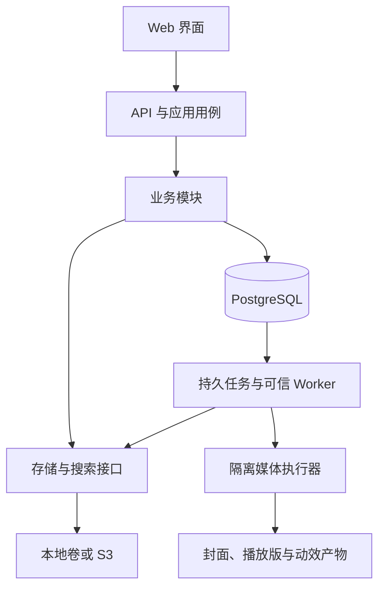

# 拾灵重构方案｜公开归档副本 v1.0

日期：2026-11-16。归档状态：重构方向、新独立工程、P00/P01/P03、D01/D02 与 v0.2 已确认。本文保留调研与方案依据；最新决策和 M0 停止边界见 [ADR 0004](../adr/0004-product-defaults-recovery-and-m0-scope.md)，业务实现仍未获授权。

本稿整合现状调研、产品优化与开源架构设计。现阶段允许建立独立工程与归档设计，仍不实现业务。当前详细合同见[详细设计索引](../design/README.md)，阶段授权见[ADR 0001](../adr/0001-foundation-scope.md)，已确认的 D01/D02 见[ADR 0002](../adr/0002-public-reopen-and-tag-governance.md)。发生细节差异时，以最新明确决策和详细设计为准，不把本历史方案描述当作已完成实现。

**阅读约定与证据范围**

- **[已确认]**：用户明确给出的目标或决定。
- **[现有代码]**：在当前代码、配置、SQL 或测试中找到实现；不等同于已经在部署环境验证。
- **[推荐]**：本稿在归档时提出的设计；其后已确认或调整的内容以 ADR 和详细设计为准。
- **[待确认]**：现有信息不足，不能作为既定需求。
- 文中的 E 编号对应文末旧项目证据索引，W 编号对应官方技术资料。设计表格的建议均是基于业务目标与证据作出的判断，不代表旧项目已经具备这些能力。

历史调研来自旧平台代码、配置、SQL、测试和文档的只读检查；未连接旧服务或数据库。数据库结论来自建表定义，运行状态来自项目方说明，页面流程来自静态代码分析；不宣称完成视觉、可访问性、性能或真实环境安全验收。历史完整审计及私有定位信息保存在独立评审资料中，不纳入公共仓库。

本归档副本移除了私人路径、旧仓库标识与私有环境定位；E 编号仅保留逻辑来源和结论摘要，不复制旧源码、素材、凭据或 Git 历史。它提供可理解的历史依据，不提供访问旧环境的入口。

**0．本次统一后的结论**

| 事项       | 统一结论                                                                 | 状态与依据                                         |
| ---------- | ------------------------------------------------------------------------ | -------------------------------------------------- |
| 产品定位   | 通用、可配置、可独立部署的开源素材管理平台；当前团队是其中一个实例       | 已确认                                             |
| 工作方式   | 使用独立项目 shiling；旧项目只提供业务与实现经验                         | 已确认；当前允许工程基础，不含业务实现             |
| 项目根目录 | `shiling/`；克隆或创建位置由部署者选择                                   | 名称与独立工程方向已确认；不绑定个人路径           |
| 历史迁移   | 不迁移旧素材、旧用户、数据库、文件存储、收藏或历史链接，不做旧接口兼容   | 已确认的最新范围覆盖早期迁移要求                   |
| 使用目标   | 寻找灵感与获取可直接使用的素材同等重要                                   | 已确认                                             |
| 核心类型   | 图片、MP4 视频、自包含 HTML/静态 ZIP 动效包                              | 已确认；具体编码、资源上限与浏览器能力仍需样例验证 |
| 公开权限   | 当前实例所有成员可显式公开自己的素材；游客可下载已公开素材               | 已确认                                             |
| 团队入库   | 上传处理合格后团队可用，公开另行操作                                     | P01 已确认；不是旧系统行为                         |
| 图片限制   | 取消原图必须小于 80,000 字节的旧限制；原件保真，缩略图设置独立优化预算   | 用户授权评估；推荐；E05                            |
| 数据库     | PostgreSQL 为新平台唯一首期数据库；旧 MySQL 不形成兼容约束               | 推荐，替代早期候选                                 |
| 存储       | 默认本地持久卷；首期提供经验证的 S3 兼容适配器；OSS 原生后置             | 推荐，替代绑定 OSS 的默认方案                      |
| 扩展方式   | 固定业务核心与清晰适配接口；可信扩展在构建期安装，启动时配置             | 推荐；开源与扩展要求                               |
| 首期边界   | 完整 MVP 必须包含图片、MP4、动效三类闭环；图片和视频先跑通仅是中间里程碑 | P00 已确认                                         |

**一、现状功能清单与业务流程**

**1.1 已实现的功能与边界**

| 功能领域     | 当前能从代码确认的能力                                                                               | 限制或未确认之处                                                                                 | 依据          |
| ------------ | ---------------------------------------------------------------------------------------------------- | ------------------------------------------------------------------------------------------------ | ------------- |
| 用户与权限   | member、curator、admin；密码登录、邀请激活、退出、角色调整、成员停用恢复；服务端会话                 | 未见完整密码找回、企业 SSO、多租户业务实现；角色定义固定                                         | E02           |
| 上传工作流   | 类型选择、文件与元数据录入、对象存储上传、校验、异步处理、结果查看、上传者确认发布；有幂等与恢复处理 | 当前四类是图片、配色、动效、图标，MP4 不是既有独立上传类型                                       | E03、E04      |
| 图片         | 新上传 PNG/JPEG/WebP、生成缩略图；上传大小有校验                                                     | 上传允许至 20 MiB，但原图发布要求严格小于 80,000 字节；历史 GIF/AVIF 兼容不等于新上传支持        | E05           |
| 配色         | 上传前创建或导入 JSON，色标与语义角色校验，生成 JSON/CSS，色卡预览                                   | 不能推定存在发布后的完整在线调色编辑器                                                           | E07           |
| 动效         | HTML、静态 ZIP、已构建应用 ZIP；入口与包内容检查、隔离交互预览；按素材实际能力提供控制               | 上传阶段有占位产物；发布后独立 worker 为新旧已发布动效生成真实封面和短循环，不能称为始终只有占位 | E06、E08      |
| 图标         | SVG/SVG ZIP、集合展示、单项 SVG 下载；来源、作者、许可证等元数据校验                                 | 专项格式与数量限制；部分历史动画图标运行时属于兼容实现                                           | E09           |
| 分类和检索   | 固定技术路径分类、标签、风格、图标用途；关键词、排序、计数、分页/游标、虚拟列表                      | 未证实可由管理员维护的通用目录树或分类治理；多套查询路径并存                                     | E10           |
| 个人整理     | 账号收藏、个人收藏夹创建/改名/删除/条目操作；浏览器旧收藏导入                                        | 不是团队共享集合；有每人 5,000 收藏、50 收藏夹、每夹 500 素材的代码限制                          | E11           |
| 发布与下载   | 作者发布本人处理合格的内容；整理员/管理员下架、恢复；已发布当前版本文件可匿名下载                    | 匿名详情另外受开关控制，不能将详情登录限制理解成文件下载保护                                     | E04、E12      |
| 后台与配置   | 成员、角色、游客详情开关、下架列表、部分处理重试；存在审计实现                                       | 未证实完整运营统计、通用品牌后台、复杂审批、评论协作或分享权限系统                               | E02、E08、E12 |
| 版本与编辑   | 数据表存在资产版本、文件等关系                                                                       | 发布创建 version=1；未发现完整的发布后改原文件、版本比较/恢复产品流程                            | E04、E13      |
| 离线素材工具 | CLI 包含扫描、导入、压缩、目录生成、校验、恢复、迁移及图标工具                                       | 属于独立工具链，不是在线平台第二种运行模式                                                       | E14           |
| 模板生成     | 独立模板引擎与前端项目生成 CLI                                                                       | 当前在线平台不提供对应模板 UI 和完整旧 API；不能称为安装后即可使用的在线业务                     | E14           |
| 外部集成     | MySQL、阿里云 OSS/相关上传授权、Chromium 媒体处理；部署脚本和流水线依赖具体环境                      | 未证实通用 OIDC、任意对象存储或第三方搜索适配体系                                                | E13、E17      |
| 工程验证     | 已有单元、合同、数据库、架构边界与浏览器测试                                                         | 本次没有重跑；模拟对象存储测试不能证明真实云服务和生产部署可用                                   | E18           |

“未发现”仅代表本轮检索范围内没有确认实现，不能补写成确定的历史业务事实。

**1.2 当前主要流程**

1. **成员使用**：邀请激活或登录 → 浏览目录/筛选 → 查看详情、收藏或加入私人收藏夹 → 下载。依据：E02、E10—E12。
2. **素材发布**：选择类型与文件 → 填写元数据 → 上传 → 服务端验证及后台处理 → 进入上传 review 状态 → 作者确认发布 → 创建 Asset 与首个版本 → 进入已发布目录。处理完成本身不等于进入独立的团队素材库。依据：E03、E04。
3. **动效生成**：动效包校验和上传阶段处理 → 发布 → 动效 worker 录制真实封面/短循环 → 列表展示与隔离交互预览。依据：E06、E08。
4. **游客使用**：公开目录 → 详情可能要求登录，但已发布文件路由允许匿名下载。依据：E12。
5. **管理操作**：成员治理；整理员/管理员下架恢复；异常任务/预览处理。依据：E02、E08、E12。

**1.3 当前模型、依赖和系统边界**

SQL 可确认的主要关系为：用户关联角色与会话；素材关联版本和文件；素材关联标签；用户关联收藏与收藏夹条目；上传关联上传文件与处理任务。物理细节以 SQL 为证据，本轮没有连接数据库确认实际实例状态。依据：E13。

现有包大致分为 Vue Web、Fastify server、contracts、library-core、兼容 core、模板引擎与项目生成 CLI。library-core 同时承载离线素材操作和在线处理基础能力；server 同时包含身份、上传、目录、发布、存储与迁移装配。API 和预览入口存在同进程装配，另有独立上传处理与动效 worker。依据：E01、E15。

数据库记录业务状态，对象存储保存原件与产物，浏览器执行或服务端录制处理动效。模板生成工具、旧库导入工具、部署流水线与在线素材管理属于不同职责，重构时应重新界定，而非沿用同一应用边界。

**二、现有问题分析**

| 问题                       | 证据与判断                                                                          | 影响                                       | 重构处置                                    |
| -------------------------- | ----------------------------------------------------------------------------------- | ------------------------------------------ | ------------------------------------------- |
| 团队可用与公开概念混淆     | 发布才创建资产；上传界面使用“发布到团队”等文案；文件实际可匿名下载。E03、E04、E12   | 用户难以判断谁能看到文件                   | 分开入库、公开与归档；明确范围和公开快照    |
| 上传前整理负担较重         | 类型、技术分类路径和元数据前置，提交后受状态限制。E03、E10                          | 批量录入和后续整理效率受限                 | 自动识别类型、批次工作区、非必要元数据后补  |
| 图片上传与发布限制不一致   | 20 MiB 上传上限与小于 80,000 字节发布规则并存。E05                                  | 文件传完才发现无法发布；不利于保留可用原件 | 原件安全限额与预览性能预算分开              |
| 技术目录直接进入产品语义   | 分类含固定技术路径，前端据分类判断类型。E10                                         | 增加分类或类型需要改代码；用户理解成本高   | 类型、标签、主题集合各司其职                |
| 领域职责交叉               | asset-repository 同时包含下载、收藏、集合和审计相关处理；全局装配依赖较多。E11、E15 | 修改一个领域容易牵动其他功能               | 按业务模块定义用例和公开接口                |
| 校验和查询存在重复路径     | 发布重复执行多类型验证；目录有 V1/V2 与历史实现。E04、E10                           | 行为容易不一致，维护测试范围扩大           | 一份类型合同、一个明确的查询语义            |
| 长事务风险                 | 上传流程在事务和锁范围内执行部分远程存储读取、核验。E16                             | 慢存储可能占用连接与锁                     | I/O 在事务外；短事务提交状态并原子入队      |
| 读取与检索的扩展性需要改善 | 文件路径存在整文件读取/哈希；关键词匹配拼接字段；输入查询缺少统一防抖。E10、E11     | 大文件、视频和大目录的开销风险             | 流式/Range、索引与查询预算；实测后定容量    |
| 运行与审计观测边界不足     | 当前装配关闭部分框架日志；限流有进程内实现。E15                                     | 多实例与问题定位能力需要重新设计           | 脱敏结构化日志、请求/任务关联、明确限流边界 |
| 测试存在，但发布证据不统一 | 有数据库/E2E 测试；部分发布路径只验证入口和构建。E18                                | 构建通过不能证明发布版本核心流程通过       | 同一提交绑定完整必要检查和部署记录          |
| 升级回退被历史机制耦合     | 迁移日志精确匹配与旧切换装配。E19                                                   | 旧镜像与新 schema 不一定兼容               | 不搬迁旧机制；新系统使用明确升级兼容窗口    |
| 默认部署绑定内部环境       | 生产 JSON、镜像、代理、CI 含真实环境标识。E17                                       | 外部团队无法直接部署，也不适合直接公开     | 通用配置与私有部署配置分离                  |
| 开源与文档归档未形成边界   | 根目录缺少项目级许可/贡献/安全文档；测试依赖历史素材；部分文档含私人上下文。E20     | 再分发、复现、维护和信息安全风险           | 新公开仓白名单导入、合成样例、文档分层      |

这里的性能问题是代码路径所支持的风险判断，并非本轮测得线上故障或瓶颈。现有测试、SVG 处理、动效隔离等经验值得参考，不能将旧项目概括为“没有安全措施、没有测试”。

**三、重构架构方案**

**3.1 产品目标与范围原则**

[推荐，依据用户目标与第一、二节] 以一个素材库服务“浏览发现”和“整理使用”两类目标，通过视图、筛选和操作区区分任务，不拆成两套内容系统。

- 上传后能尽快获得可用素材，失败能够定位和重试。
- 原文件、预览产物、公开版本各自有明确用途。
- 类型决定处理方式；标签描述属性；集合组织主题或项目；个人收藏表示个人偏好。
- 首期不同时建设文件夹、目录树、项目、专辑和收藏夹等多套相近结构。
- 一个实例服务一个个人或团队。独立部署不等于多租户 SaaS。
- 开源默认值不含内部资源；任何内部专属能力从扩展接口接入。

**3.2 产品优化与旧功能处置**

以下均为推荐方案，成本为相对判断，不是工期承诺。

| 当前问题或机会                           | 建议与处置                                                      | 价值                                   | 成本与取舍                             | 阶段         |
| ---------------------------------------- | --------------------------------------------------------------- | -------------------------------------- | -------------------------------------- | ------------ |
| 图片、动效等入口割裂，缺少 MP4           | 统一上传入口，文件识别后分发到处理器；新增 MP4                  | 用户按任务操作，不必先理解后台分类     | 中；格式边界需明示                     | 首期         |
| 上传前填表较重                           | 批量上传、逐项状态/重试，标题默认取文件名，非必要标签和集合后补 | 减少入库阻力                           | 中；需要清晰的待整理提示               | 首期         |
| 公开与入库混合                           | 合格后团队可用；公开独立、可撤回                                | 内部协作不被公开流程阻塞               | 中；误传会向团队可见，上传入口必须提示 | 首期，已确认 |
| 技术分类与收藏夹概念混杂                 | 合并为类型、标签、团队集合和个人收藏                            | 更易理解与查找；不复制文件也能多重归类 | 中；不做多级目录和资源 ACL             | 首期         |
| 持续整理能力不足                         | 本人元数据编辑、批量标签/集合/归档；管理员治理                  | 避免只能重新上传来调整信息             | 中；需乐观锁和部分失败反馈             | 首期新增     |
| 原图发布体积过严                         | 保留原件，缩略图分档优化                                        | 既能浏览，也能下载实际可用素材         | 中；增加处理与存储开销                 | 首期         |
| 详情和使用动作缺少稳定入口               | 可寻址详情页/侧栏；明确“下载原图/视频/动效包”；复制详情链接     | 便于复用与分享                         | 低至中；复制链接不改变访问权限         | 首期         |
| 列表可能同时运行重型预览                 | 封面优先，悬停/主动操作播放，限制并发，离屏停止                 | 降低浏览资源消耗                       | 中；静态浏览时交互感减少               | 首期         |
| SVG 图标、配色是独立专项产品             | 保留在现状清单，移出新版首期；以后作为类型扩展评估              | 聚焦已确认的三类核心素材               | 低首期成本；旧专项能力不会自动带入新版 | 后续候选     |
| 模板生成、离线旧库工具与素材平台边界不同 | 移出新核心，不搬迁旧 CLI/模板服务                               | 减少耦合和公共维护负担                 | 不再承接旧工具兼容                     | 不纳入首期   |
| 新平台需要被他人安装                     | 初始化引导、品牌配置、健康状态、通用部署文档                    | 外部用户无需维护者协助即可起步         | 中；是首发交付的一部分                 | 首期         |
| AI/审批/复杂分享等尚无确定需求           | 保留扩展位置，不首期实现                                        | 控制学习、运维和权限复杂度             | 暂不提供这些增强                       | 后续         |

“移出”仅表示不纳入新项目范围，不表示现在删除旧仓库、旧功能或旧文件。

**3.3 首期功能清单**

“首期”指完整 MVP 和首次对外发行所需能力；下面除已确认规则外，均需整体方案确认。

| 领域     | 首期包含                                                                                             | 首期不包含                                                                                      |
| -------- | ---------------------------------------------------------------------------------------------------- | ----------------------------------------------------------------------------------------------- |
| 账户     | 一次性管理员初始化、本地密码、邀请、退出、停用恢复、角色配置；无邮件也可由受控管理员/CLI 完成恢复    | 公共自助注册、OIDC/LDAP/SCIM、组织树                                                            |
| 图片     | PNG/JPEG/WebP 原件、元数据、封面/缩略图、详情与下载                                                  | 在线修图；GIF/AVIF/SVG 等待处理与安全支持验证后扩展                                             |
| MP4      | 格式/编码探测、尺寸/时长、封面、约定范围内播放版生成、Range 播放、原件下载                           | HLS、多清晰度自适应、视频编辑；不承诺所有 MP4 编码均可处理                                      |
| 动效     | 自包含 HTML 或已构建静态 ZIP；结构检查、封面/短循环、隔离交互预览、源文件/源包下载                   | 运行上传者的安装/构建脚本；任意外网依赖；AE/Lottie/SVGA/Rive 等未确认格式                       |
| 上传     | 多文件批次、逐项状态与重试、重新登录后恢复任务视图、进度和取消；已上传完整对象可恢复处理             | 不承诺所有浏览器在关闭页面后自动继续传输；本地存储断线可单文件重试，S3 大文件使用受验证分片能力 |
| 整理     | 标题/说明/标签编辑、团队集合、个人收藏、批量标签/集合/归档、恢复                                     | 多级目录、个人与团队两套集合体系、逐文件权限树                                                  |
| 搜索     | 关键词、类型/标签/集合筛选、排序、分页、可恢复查询状态                                               | 语义搜索、拼音/纠错质量承诺、跨实例搜索                                                         |
| 使用     | 稳定详情链接、图片查看、视频播放、按能力展示动效控制、原件下载                                       | 私密限时分享、批量打包下载、复杂嵌入服务                                                        |
| 公开     | 本实例成员公开自己的已就绪素材、撤回公开；游客访问公开投影并下载                                     | 审批流、自动公开上传、成员发布他人素材                                                          |
| 管理     | 成员、简单角色、标签/集合治理、品牌/类型/限额/公开配置、任务状态与重试、必要审计、基础数量与失败统计 | 商业分析看板、任意规则脚本、可视化基础设施运维                                                  |
| 存储     | 本地持久卷默认、S3 兼容可选；私有源件、鉴权交付                                                      | 首期同时维护所有云供应商适配；直接切配置自动搬迁文件                                            |
| 版本     | AssetVersion 和不可变产物模型；公开元数据快照                                                        | 首期不提供替换原文件、版本比较/回滚 UI；后续基于模型扩展                                        |
| 开源交付 | 可独立安装、配置样例、许可与贡献说明、安全报告入口、部署开发文档、合成样例                           | 插件市场、在线安装任意代码、多租户 SaaS                                                         |

**集合与权限的统一口径**：首期只有“团队集合＋个人收藏”。团队集合对团队可见，由创建者和管理员维护；不把集合本身作为授权容器，不自动公开整个集合。取消此前可能出现的“首期再做一套个人收藏夹”或“分类树模型”的候选建议。是否增加私有集合以后再评估。

**3.4 信息架构与主要交互**

[推荐，依据 E03、E10—E12 及用户的双重使用目标]

- 主导航：素材库、集合、我的收藏、上传任务；管理员另见成员与设置。
- 素材库：全局搜索、类型/标签/集合筛选、浏览网格与整理列表切换；视图共享同一数据和筛选条件。
- 详情：预览为主，右侧或下方展示用途、格式、尺寸/时长、说明和标签；主要操作为下载、收藏、加入集合；有权限者可编辑、公开或归档。
- 上传工作区：整批进度与逐文件状态并存；允许一批部分成功；动效 ZIP 是一个素材，不把包内每个文件拆成素材。
- 公开页面：只展示公开快照字段，隐藏团队管理入口和内部信息；公开详情字段范围是推荐设计，不能把“游客可下载”扩大解释为“所有内部元数据均可公开”。
- 空、加载、失败和权限不足状态必须可操作；桌面、移动宽度、键盘操作及动态效果偏好在后续真实页面中验收。

首期提供名称、Logo/favicon、主题色、简介和公开页基本品牌配置；不提供任意 CSS/JS 注入或布局搭建器。产品文案集中管理，首期中文优先；完整多语言翻译后续确认。

**3.5 整体架构与技术选型**

[推荐] 使用模块化单体承载业务规则，API、可信任务编排、媒体执行器及动效预览按运行职责分离。单一仓库不等于所有任务运行在同一进程；也不需要把每个业务模块拆成微服务。

| 模块      | 推荐方案                                                                    | 选择理由、适用场景与主要取舍                                                                                                                                                                                                                                                                                 |
| --------- | --------------------------------------------------------------------------- | ------------------------------------------------------------------------------------------------------------------------------------------------------------------------------------------------------------------------------------------------------------------------------------------------------------ |
| 前端      | Vue 3、TypeScript、Vite、Vue Router                                         | 适合交互密集的素材工具，已有经验可参考但不复用旧架构；SSR/SEO 不是当前主目标，若公开站强依赖搜索引擎收录再评估 Nuxt。[Vue 官方资料](https://vuejs.org/guide/scaling-up/tooling.html)                                                                                                                         |
| 后端      | Node.js、TypeScript、Fastify                                                | 前后端合同语言一致，轻量模块封装适合单体；需明确模块边界，不能让框架装配对象变成全局业务容器。[Fastify 官方资料](https://fastify.dev/docs/latest/Reference/Encapsulation/)                                                                                                                                   |
| 数据库    | PostgreSQL                                                                  | 关系、事务与检索投影统一；可承载持久队列，减少部署组件。首期只支持一种数据库，不做可切换数据库产品                                                                                                                                                                                                           |
| 持久化    | 模块仓储、参数化 SQL、版本化 schema 变更                                    | 保持 SQL 与事务可审查；具体查询/迁移库在详细设计中选择并锁版本，不影响本稿数据库结论                                                                                                                                                                                                                         |
| 任务      | pg-boss                                                                     | 基于 PostgreSQL，减少独立队列依赖；处理器必须幂等，配置重试、超时、并发、保留期和失败重放。[pg-boss 官方资料](https://pgboss.io/introduction)                                                                                                                                                                |
| 存储      | 本地持久卷＋S3 兼容适配                                                     | 无云账号可运行，也可使用托管/自托管对象存储；兼容供应商逐一通过合同测试，不承诺所有 S3 服务语义相同。[S3 条件写入](https://docs.aws.amazon.com/AmazonS3/latest/userguide/conditional-writes.html)与[完整性校验](https://docs.aws.amazon.com/AmazonS3/latest/userguide/checking-object-integrity-upload.html) |
| 搜索      | PostgreSQL 查询投影、常规索引、按样例验证的 pg_trgm                         | 首期部署简单；它不是完整中文分词或语义检索方案，短查询与中文匹配必须实测。[PostgreSQL 官方资料](https://www.postgresql.org/docs/current/pgtrgm.html)                                                                                                                                                         |
| 缓存      | 正确的 HTTP 缓存、受控进程内缓存                                            | 首期不强制 Redis；鉴权不依赖过期缓存，公开撤回需处理缓存窗口                                                                                                                                                                                                                                                 |
| 图片      | Sharp                                                                       | 输出受限尺寸/质量的衍生图，保留原件；限制像素数、解码资源与格式。[Sharp 官方资料](https://sharp.pixelplumbing.com/api-constructor/)                                                                                                                                                                          |
| 视频      | FFmpeg/ffprobe                                                              | 探测编码并生成封面与约定播放版；CPU 和编码支持需要基准样例，实际分发构建需许可检查。[FFmpeg 文档](https://ffmpeg.org/ffmpeg.html)与[许可说明](https://ffmpeg.org/legal.html)                                                                                                                                 |
| 动效      | 隔离 Chromium 执行/录制＋独立预览来源                                       | 保留浏览器动效能力；运行复杂度最高，需要网络、资源与凭证隔离；普通测试容器不是充分安全边界。[Playwright 容器说明](https://playwright.dev/docs/docker)与[iframe 说明](https://developer.mozilla.org/en-US/docs/Web/HTML/Reference/Elements/iframe)                                                            |
| 认证      | 本地账户首期；OIDC 后续适配                                                 | 无企业 IdP 也能安装；外部身份以后用 issuer＋subject 绑定，不按邮箱静默合并。[OIDC 规范](https://openid.net/specs/openid-connect-core-1_0.html)                                                                                                                                                               |
| 测试/部署 | Vitest/同类单元测试、真实 PG 集成、Playwright；Docker Compose、固定版本镜像 | 小团队能维护完整闭环；不默认 Kubernetes、微服务、独立搜索集群                                                                                                                                                                                                                                                |

**备选方案比较**

| 决策                            | 其他可行方案                                     | 本稿推荐及切换条件                                                                                  |
| ------------------------------- | ------------------------------------------------ | --------------------------------------------------------------------------------------------------- |
| Fastify 与 NestJS / Spring Boot | 后两者提供更强的既定结构或成熟 Java 团队经验     | 推荐 Fastify＋显式边界；维护团队若主要熟悉 Java，应在开工前重新评估，而非假设其熟悉 TypeScript      |
| PostgreSQL 与 MySQL / SQLite    | MySQL 可满足关系业务；SQLite 安装更轻            | 推荐 PG；无旧数据约束，持久任务也使用 PG。避免首期维护多库差异；SQLite 单文件不是本项目当前优先目标 |
| 数据库任务与独立队列            | 专用队列适合更高吞吐和独立扩缩容                 | 首期 pg-boss；出现经测量的瓶颈后再评估。不能笼统声称所有其他队列只支持 Redis                        |
| SPA 与 SSR                      | SSR 有利于特定公共页面传播和收录                 | 推荐 SPA；公共 SEO 是否重要仍待确认，不因“开源”自动引入 SSR                                         |
| 配置适配器与动态插件平台        | 插件市场更灵活，但带来兼容、供应链与执行安全成本 | 首期可信构建期扩展；后续有实际生态需求再增加分发机制                                                |

所有依赖在项目初始化时选择相互兼容、仍受支持的稳定版本，锁定 lockfile 和运行镜像，不使用浮动 latest 作为生产发布策略。当前不提前编造具体版本与最低机器规格。

**3.6 业务模块与依赖边界**

| 模块           | 负责                                               | 不负责                             |
| -------------- | -------------------------------------------------- | ---------------------------------- |
| identity       | 用户、登录身份、会话、角色、邀请/恢复              | 素材公开规则、云资源权限           |
| ingestion      | 批次、上传项、文件接收、校验、取消、去重提示       | 直接公开素材                       |
| assets         | 素材身份、所有权、版本、产物引用、内部元数据、归档 | 登录协议、供应商 SDK               |
| processing     | 任务编排、处理计划、产物校验和提交                 | 在任意插件中改业务表或发布内容     |
| library        | 标签、团队集合、个人收藏、内部检索投影             | 用集合成员关系隐式扩大访问权       |
| publication    | 显式公开、公开快照、撤回、公开查询和交付资格       | 直接暴露内部 Asset 全字段          |
| administration | 品牌与产品设置、必要治理、审计查询                 | 通过后台任意执行代码或变更基础设施 |

依赖方向为入口装配 → 应用用例 → 领域与接口；适配器实现接口，只有装配入口选用具体供应商。模块通过公开用例或事件协作，不相互直写表。简单模块可以少分层，不机械创建大量空目录或 npm 包。

**3.7 推荐目录结构与代码分包**

项目根目录记为 `shiling/`。以下是目标结构示意；该段形成于 M0，用于说明职责边界，不作为当前实现状态。最新实现与限制见[项目 README](../../README.md)和[首期部署与验收记录](../operations/deployment-validation.md)。

    shiling/
      apps/
        web/src/features/             按素材、上传、整理、管理等组织页面
        api/src/                      HTTP 入口、装配、生命周期
        worker/src/                   可信任务编排、结果提交
        preview/src/                  独立动效预览入口
      packages/
        contracts/                    API、任务、事件的可共享合同
        backend/
          modules/
            identity/
            ingestion/
            assets/
            processing/
            library/
            publication/
            administration/
          adapters/                   PostgreSQL、存储、认证、搜索、处理
          bootstrap/                  配置校验与依赖装配
        media/                        图片、视频、动效处理协议与实现
        ui/                           真正复用的组件与品牌设计变量
      extensions/                     官方可选扩展与开发示例
      deploy/
        compose/                      本地与服务器部署
        images/                       API、worker、隔离媒体镜像定义
        examples/                     中性配置示例
      docs/
        product/                      功能、术语、权限与业务流程
        architecture/                 系统与模块设计
        adr/                          重要技术决策及取舍
        api/                          接口合同与用例
        operations/                   安装、升级、备份、恢复、排障
        contributing/                 开发与扩展指南
      tests/
        fixtures/                     合成、可再分发样例
        contracts/                    存储和其他适配器共同验收
        integration/
        e2e/
      LICENSE
      README.md
      CONTRIBUTING.md
      SECURITY.md
      CHANGELOG.md
      .env.example

后端模块内部按需要使用 domain、application、ports；数据库迁移由 backend 统一版本化，表的写入归属仍由模块控制。前端不能依赖 backend 或供应商 SDK；contracts 不携带数据库实现、服务端密钥或 Node 专用运行依赖。架构边界由静态检查和必要的合同测试约束。

**3.8 核心领域模型**

以下是逻辑模型，不是已确定字段级数据库设计。

| 实体                        | 职责和关键关系                                                                               |
| --------------------------- | -------------------------------------------------------------------------------------------- |
| User / Identity / Session   | 业务用户、登录身份与会话分离；一个用户可连接不同受信任身份                                   |
| Role / Permission           | 固定能力目录与可配置角色组合；所有权及公开边界仍由服务端用例检查                             |
| UploadBatch / UploadItem    | 一次批量操作与独立文件接收；一批可部分成功；动效包是一个 Item                                |
| Asset                       | 稳定素材 ID、所有者、类型、内部元数据、当前团队可用版本、revision、归档状态                  |
| AssetVersion                | 不可变内容版本；处理中/可用/失败；首期通常只有一个版本，模型为以后替换原件保留空间           |
| Artifact                    | 版本的原件、缩略图、封面、播放版、循环预览、包清单；记录存储位置、角色、大小、摘要和格式属性 |
| ProcessingJob               | 某版本某处理步骤，关联处理器版本、重试、租约和错误信息；业务任务状态与队列执行记录可关联     |
| Tag / AssetTag              | 标签与素材多对多；字段可索引，不把所有查询条件塞入任意 JSON                                  |
| Collection / CollectionItem | 团队主题集合与素材多对多；成员关系不产生副本或权限继承                                       |
| Favorite                    | 用户与素材的个人偏好关系，和团队集合分开                                                     |
| Publication                 | 明确公开的 ready 版本、公开字段快照和修订号；active/withdrawn，不读取内部最新对象代替快照    |
| AuditEvent                  | 谁在何时对什么对象执行什么操作及结果；和运行日志分离                                         |
| ProductSettings             | 经 schema 校验和版本化的产品配置，不保存前端可见的密钥                                       |

关系摘要：User 拥有多个 Asset；Asset 拥有多个 Version；Version 拥有多个 Artifact/Job；Asset 与 Tag/Collection 多对多；Publication 指向一个 Version；UploadItem 生成或关联一个待处理版本。核心外键、唯一约束、索引与删除规则在详细设计确认。

**状态分开建模**：上传状态、处理状态、公开状态、归档状态不能混成一个 status。未完成或失败上传留在上传工作区；处理合格后才进入团队目录。工作区不是首期额外的私人素材库。

**3.9 新平台主要流程**

**上传入库**：[推荐]

1. 建立批次及上传项，识别格式并校验限额；生成不可覆盖的存储位置。
2. 本地后端经服务端流式上传；S3 后端可使用受限直传/分片。浏览器声明大小、类型和哈希不能替代服务端核验。
3. 核验完成后，短事务建立版本并可靠入队；对象读取、转码、录屏不在数据库长事务内。
4. Worker 选择处理器，执行器只获取需要的输入输出能力；执行器不持有数据库和长期存储凭证。
5. 核验产物 manifest 后提交版本 ready，更新团队当前可用内容；失败只影响对应项，可重试。
6. 后补标签和集合；重复文件给出已有内容提示，不静默丢弃，也不把物理文件复用等同于共享权限。

**查找与使用**：[推荐]

搜索/筛选 → 预览与元数据判断 → 收藏或加入集合 → 下载对应原件。详情链接始终经过当前权限判定；复制链接不自动授权。

**显式公开**：[已确认规则＋推荐实现]

成员选择本人 ready 素材 → 检查公开字段 → 用例检查所有权/状态/revision → 写入 Publication → 游客只读公开投影并获得对应文件交付资格。内部编辑默认不自动同步公开快照；更新公开信息需要明确操作。

**撤回与归档**：[推荐]

撤回停止新的公开读取/下载授权，内部仍可使用；归档移出正常团队目录并撤回公开，恢复归档后不自动重新公开。已发出的签名 URL 按有限 TTL 失效，已经下载的副本无法收回；该窗口应写入配置和验收标准，不能承诺隐藏卡片等于立即回收文件。

**任务失败与取消**：[推荐]

错误分类、有限重试和手动重放可见；同一 version＋processorVersion＋step 的提交幂等；取消或新修订通过状态栅栏阻止迟到结果覆盖当前状态。只清理未被接纳、无有效写入/执行授权、宽限期已到且没有 Artifact/package/品牌设置等受保护引用的暂存对象或迟到输出；不能按“任务失败/取消”直接删除已接纳原件、归档素材或追溯记录。

**3.10 权限与公开边界**

权限默认已随 P01 确认；角色名可配置，但下面的所有权与公开安全边界不可通过角色配置绕过。

| 操作                       | 游客             | 成员           | 管理员 |
| -------------------------- | ---------------- | -------------- | ------ |
| 读取团队素材、内部检索     | 否               | 是             | 是     |
| 读取公开详情与下载公开版本 | 公开功能启用时是 | 是             | 是     |
| 上传与修改本人素材         | 否               | 是             | 是     |
| 修改、归档他人素材         | 否               | 默认否         | 是     |
| 显式公开本人素材           | 否               | 本实例是       | 是     |
| 发布他人素材               | 否               | 否             | 否     |
| 撤回他人公开               | 否               | 否             | 是     |
| 维护团队集合               | 否               | 本人创建的集合 | 全部   |
| 成员、角色、产品设置       | 否               | 否             | 是     |

通用发行版默认关闭匿名访问；安装者明确启用公开功能并选择哪些角色拥有 publishOwn。本实例使用“全员可公开本人素材”的配置，不把它写死为所有部署的规则。

固定安全要求：默认拒绝；前端 capability 仅控制展示；后端每次验证身份和资源；最后一个有效管理员不能被移除；禁用账号立即失去后续操作权，但是否撤回其历史公开素材是单独操作；安全检查不能由角色编辑器关闭。

**3.11 素材存储、预览与搜索**

**存储**：原件和产物默认私有，不放在可绕过鉴权的 webroot。路径由服务端生成，版本引用不可变；摘要与供应商 ETag 分开记录。adapter 明确声明直传、分片、Range、条件写入、签名 URL 等能力；缺少直传可走流式上传，不能用 HEAD 后 PUT 假装满足并发不可覆盖保证。多节点不能各用各的本地卷。本地和 S3 的一致性、取消、失败、校验、删除与恢复行为分别验收。依据：[S3 条件写入](https://docs.aws.amazon.com/AmazonS3/latest/userguide/conditional-writes.html)与[完整性校验](https://docs.aws.amazon.com/AmazonS3/latest/userguide/checking-object-integrity-upload.html)。

**图片/视频**：原件保持不变，预览派生；探测真实类型、尺寸、像素/时长/解码限制。MP4 是容器，能否播放取决于编码；首期以确认样例定义输入和播放版范围，不能让不支持的文件最终只出现黑屏。视频支持流式 Range，避免每次完整缓冲。依据：[Sharp 官方资料](https://sharp.pixelplumbing.com/api-constructor/)、[FFmpeg 文档](https://ffmpeg.org/ffmpeg.html)与[许可说明](https://ffmpeg.org/legal.html)、[HTTP Range 说明](https://developer.mozilla.org/en-US/docs/Web/HTTP/Guides/Range_requests)。

**动效**：只接收自包含、已构建的静态内容。防路径穿越、符号链接、ZIP 炸弹、外部网络和资源耗尽。预览使用独立来源，不共享主站会话 cookie；CSP、sandbox 和网络策略由服务端控制。录制执行器低权限、无宿主凭证、限制 CPU/内存/时间/临时磁盘和网络；部署不满足隔离条件时明确拒绝启用执行能力，不通过关闭沙箱“解决”安装问题。是否支持 WebGL/音频等由样例验证。依据：E06、[Playwright 容器说明](https://playwright.dev/docs/docker)与[iframe 说明](https://developer.mozilla.org/en-US/docs/Web/HTML/Reference/Elements/iframe)。

**检索**：先提供确定性的标题/标签等匹配和结构化筛选，再评估相关性。内部与公开查询投影分离，公开投影只含快照；同步事件带 revision，防旧事件覆盖；返回前仍核对当前公开资格。索引可重建，不是数据真相。中文单字、短词、组合标签以及真实目录大小必须纳入验收。依据：[PostgreSQL 官方资料](https://www.postgresql.org/docs/current/pgtrgm.html)。

**3.12 配置与扩展机制**

| 层级     | 内容                                                               | 控制方式                                                    |
| -------- | ------------------------------------------------------------------ | ----------------------------------------------------------- |
| 部署配置 | 数据库、存储 endpoint、主站/预览来源、身份服务、监听与硬性资源上限 | 文件或环境变量；启动校验、显式优先级和生效方式              |
| Secret   | 数据库/存储凭证、签名密钥                                          | secret file 或部署平台 Secret；不进入浏览器、公共导出、日志 |
| 产品设置 | 品牌、类型启停、业务限额、公开策略、角色                           | 管理后台；只能在部署允许范围内调整；审计与版本化            |
| 内容治理 | 标签、集合及成员分配                                               | 产品界面与应用用例                                          |
| 扩展实现 | 存储、认证、搜索、处理及第三方集成                                 | 可信源码/构建期依赖，测试后启用                             |

配置缺项或能力冲突应给出明确错误，未知权限不静默放行。前端只获取白名单配置与可用能力；不需要将数据库密码和云密钥管理做进产品后台。

素材类型注册必须包含稳定 ID、接受格式、验证、元数据 schema、处理流程、产物角色、预览/下载方式、资源要求和测试样例。管理员只能启用已安装能力，不能添加一个字符串就绕过处理链。

开关语义必须分开：停止新上传不删除已有内容；停止动效执行预览可以保留安全封面和有权限的源包下载；关闭公开入口保留内部数据。删除是独立操作。新实例预设仅初始化配置，切换预设不能自动公开旧内容或清空自定义角色。

扩展接口有版本、兼容范围、配置 schema 和能力声明；不兼容时拒绝启用。插件不能直接改其他模块的表。首期不提供上传插件 ZIP 即执行、在线 npm 安装或任意远程代码热加载。同进程扩展是受信任代码，不宣称 TypeScript 接口提供安全沙箱。依据：[Fastify 官方资料](https://fastify.dev/docs/latest/Reference/Encapsulation/)。

内部专属功能放在私有扩展包或私有部署仓，通过公开端口接入；核心不得出现公司名分支、内部域名或特定人员 ID。第三方事件后续通过有限字段、版本化事件和可靠派发实现，默认不外传内部素材或启用遥测。

**3.13 API、异常、日志、测试与文档规范**

| 领域     | 最低规范                                                                                                                   |
| -------- | -------------------------------------------------------------------------------------------------------------------------- |
| API      | /api/v1/auth、/api/v1/team、/api/v1/public；内部/公开 DTO 分开；合同生成 OpenAPI；游标分页；写入幂等键与 revision 冲突检查 |
| 异常     | 稳定 code、可读 message、requestId、受控字段错误；区分输入、权限、冲突、可重试依赖故障；不回显 SQL、栈、签名 URL、密钥     |
| 事务     | 远程 I/O 在长事务外；状态与入队可靠衔接；幂等与重试不靠前端按钮禁用保障                                                    |
| 日志     | 结构化 requestId/jobId/assetId；敏感字段脱敏；运行日志与安全/业务审计分离；保留期可配置                                    |
| 配置     | schema 校验、配置版本、硬限制与业务值关系、公开字段白名单、可脱敏诊断                                                      |
| 自动验证 | 类型/构建、领域状态机、权限矩阵、真实 PG、Local/S3 合同、任务失败恢复、公开隔离、端到端核心旅程                            |
| 安全验证 | 路径/压缩包/恶意脚本、超限解码、网络访问、会话、跨资源越权、撤回缓存窗口；对输入校验与执行隔离分别验证                     |
| 产品验收 | 实际桌面/移动页面、键盘、空/错/加载状态、预览与下载；视觉与响应式验证不能由单元测试代替                                    |
| 文档     | 产品规则、ADR、接口、部署、备份恢复、贡献、扩展合同；文档与代码同版本，不把个人聊天记录当公共项目知识库                    |
| 发布     | 质量检查和镜像绑定同一 SHA；生成必要依赖/第三方清单；未运行的检查明确标记，不以跳过当通过                                  |

不为了低影响改动堆砌实现镜像测试；重点验证权限、状态、异步、存储和隔离边界。性能阈值基于确认的负载与硬件制定，目前不承诺素材量、并发或延迟数字。

**3.14 独立部署、首次上线与恢复**

[推荐] 通用 Docker Compose 提供 Web/API、可信 Worker、隔离媒体执行环境、独立预览入口和 PostgreSQL。本地卷模式无需云账号；S3 另有完整配置示例。开发环境与生产环境分开，生产 TLS、来源隔离、持久卷、备份和网络限制明确说明。

安装流程：准备部署配置 → 启动并校验 → 用一次性受控初始化凭据创建管理员 → 配置品牌、类型与公开策略 → 健康检查 → 上传首个素材。没有固定管理员密码，不依赖旧库切换任务、邮件、SSO、AI 或内部服务。

本次没有新旧迁移章节：不设计旧 ID 映射、旧 URL 兼容、双写、旧账号导入或旧数据库回滚。旧仓库和备份也不在本次删除范围。

首次上线采用新空环境，先由内部成员试用，再启用已确认的公开入口；用户重新上传材料。正式域名、目标主机和公开发布是后续实施动作，本轮未操作。

新系统仍需：

- 数据库与文件可关联恢复的一致备份流程；在空环境恢复后核对文件摘要、权限、公开状态和任务。
- schema 版本管理及兼容窗口；扩展—切换—清理的变更顺序，不依赖破坏性 down 脚本来承诺回退。
- 固定版本镜像和发布记录；新版本先在独立验证环境验收，再进行有限用户/实例验证。
- 应用回退须在 schema 兼容范围内；若需数据恢复，停写和可能的数据损失按事先确定的 RPO/RTO 执行，不能假设回滚数据库没有代价。

**3.15 开源发布与信息安全**

[推荐，依据用户开源要求与 E17、E20] 使用新的公开仓库，从明确的复用清单导入代码和通用文档；原仓保持原状。只删除当前文件或增加 .gitignore 都不能净化历史。新仓也必须审查发行内容，不能把“没有旧 .git”当成已安全。

公开内容不得携带内部配置、账号、域名、云角色、私有服务地址、个人路径/聊天、真实业务样例或未经授权的旧素材。只使用合成或授权明确的示例；复用的第三方代码、字体、图标及运行资源保留其应有许可和归属。

首次公开前补齐 README、LICENSE、CONTRIBUTING、SECURITY、CHANGELOG、配置/部署/开发/扩展文档；按实际依赖提供 THIRD_PARTY_NOTICES 或必要 NOTICE，而不是机械创建空文件。安全报告渠道能私下联系维护者，支持版本范围明确。

许可推荐优先考虑 Apache-2.0，MIT 是更简短的宽松替代；是否采用宽松许可还是希望修改公开，需要用户决定。代码、站点品牌与用户素材的许可分别说明。Apache-2.0 的专利与再分发条款、MIT 的许可保留要求以原文为准；FFmpeg 等随包工具还要按实际构建记录其许可条件。依据：[FFmpeg 文档](https://ffmpeg.org/ffmpeg.html)与[许可说明](https://ffmpeg.org/legal.html)、[Apache-2.0 原文](https://www.apache.org/licenses/LICENSE-2.0)、[MIT 原文](https://opensource.org/license/mit)。

首发不默认启用遥测、外部统计或云处理。部署者明确启用外部服务时，文档说明数据会流向何处、哪些字段会外传。未知规模下不虚构“完全离线”承诺：无外部业务服务可运行，不等于首次下载安装包不需要网络；如需离线安装，作为具体交付需求确认。

**3.16 实施阶段与验收门槛**

方向与 D01/D02 已确认，当前授权范围推进到独立工程基础。以下后续业务阶段仍需相应实施授权；工程骨架或设计归档不能被记作业务能力完成。

| 阶段                        | 主要产出                                                                                      | 退出条件                                                                              |
| --------------------------- | --------------------------------------------------------------------------------------------- | ------------------------------------------------------------------------------------- |
| 0．整体方案确认             | 统一功能、公开规则、开源范围、技术方向与独立工程                                              | 方向已确认；不等于所有详细字段和参数均已确认                                          |
| 1．详细设计与风险验证       | 核心页面流程、权限矩阵、领域/API/存储合同；MP4 样例、动效隔离、中文搜索与本地/S3 能力验证计划 | 首期规则和安全边界可验收；主要技术风险得到证据；明确开发安排                          |
| 2．独立工程基础（当前授权） | 工程骨架、工具链、模块边界、通用配置与文档归档                                                | 基础工程检查通过，无旧仓或内部资源依赖；不实现业务 schema、账号、上传、素材或任务流程 |
| 3．图片与 MP4 纵向闭环      | 批次上传、校验/处理、团队浏览、整理、搜索、公开/撤回、下载                                    | Local 与经确认的 S3 目标通过同一核心旅程；失败/越权/重复请求验证通过                  |
| 4．完整 MVP                 | 动效上传/处理/隔离预览，集合/批量操作，品牌/角色/类型设置，任务与审计管理                     | 三类核心素材全部闭环；桌面/移动体验及安全边界通过；不能省略动效宣称完成               |
| 5．首发稳定性与开源准备     | 容量基线、故障恢复、备份恢复与升级回退演练、许可与发行内容审查、部署/开发文档                 | 陌生使用者从干净环境按文档安装成功；指标符合已确认负载；发布内容获准公开              |
| 6．增强迭代                 | OIDC、OSS、外部搜索、更多类型、替换原件/历史、AI 或集成                                       | 按使用证据排序，每项另行明确范围与验收                                                |

阶段 3 是中间验证版本，不是满足全部要求的最终 MVP。工期需要团队人数、技术熟悉度、硬件和格式样例后估算，本稿不提供未经依据的人日承诺。

**3.17 首期完成的判定标准**

1. 第三方从空数据库、空存储独立安装成功，不需要旧仓库、内部服务、私人证书或账号。
2. 图片、约定 MP4、自包含 HTML/ZIP 三类均完成上传→处理→团队可用→整理/搜索→预览→公开→游客下载→撤回。
3. 批次可部分成功；重试不重复建素材或重复发布；断线、worker 崩溃和取消有可验证结果。
4. 本人权限、他人资源、游客、禁用用户和最后管理员保护均直接测试 API/文件入口，而不只检查前端按钮。
5. 原件保持一致；预览和视频 Range 实测；动效不能读取主站凭证，网络策略通过验证。服务端录制执行器的 CPU、内存、时间和磁盘限制可强制执行；浏览器预览验证隔离来源、按需加载、并发控制和可退出机制，不承诺 iframe 具有同等 CPU 硬隔离。
6. 团队与公开检索隔离；撤回在明确的授权/缓存窗口内生效；类型开关不隐式删除文件。
7. 品牌、类型、角色与公开策略在两个不同实例配置下运行，无需修改源码；Local/S3 分别通过合同和流程验收。
8. 至少完成一次空环境备份恢复与新版本升级/应用回退演练；结果绑定版本和环境。
9. 有真实桌面/移动视觉和交互验收；性能报告基于约定样例、容量与硬件。
10. 公开仓库和制品通过内容/依赖许可检查，文档可复现，许可证和安全报告渠道已确定。

**3.18 已确认默认与待补充输入**

P00/P01/P03 已确认，不再要求整体确认。以下只保留分阶段媒体、容量、运维和发行输入；集中填写入口见[待提供媒体与部署信息](../operations/m0-required-inputs.md)。

| 优先级     | 待确认事项                   | 推荐默认或处理方式                                                                                                      |
| ---------- | ---------------------------- | ----------------------------------------------------------------------------------------------------------------------- |
| 已确认     | 独立项目、首期范围与 M0      | 使用 `shiling/`；三类素材齐全；当前只推进 M0，完成后先汇报，不进入 M1                                                   |
| 已确认     | 入库与整理规则               | 合格后团队可用；本人维护、治理角色按能力治理；团队集合＋个人收藏；公开独立                                              |
| 已确认     | 图片策略与版本功能           | 取消 80 KB 原图限制；原件保真；首期有版本模型但不做替换原件和历史 UI                                                    |
| 已确认     | 技术默认与灾备安全姿态       | Vue/TS/Fastify、PostgreSQL/pg-boss、Local＋S3、Compose、可信扩展；P03 按 ADR 0004                                       |
| 开发前     | 动效能力与资源样例           | HTML/静态 ZIP 范围已确认，不执行安装构建脚本或默认外网依赖；样例用于确认 WebGL/音频及资源上限，不把其他动效格式加入首期 |
| 开发前     | MP4 输入范围                 | 提供代表性编码/大小/时长信息或非敏感样例；据此确定转码、文件限额和处理资源                                              |
| 容量设计前 | 规模与部署条件               | 成员数、素材量/总容量、增长量、并发上传/访问、CPU/RAM/磁盘、S3 目标；目前未知                                           |
| 计划排期前 | 维护者技术与投入             | Vue/TS、PG、Docker 熟悉度、人员与可投入时间；据此校验栈和估算                                                           |
| 首发前     | 开源许可与复用权属           | 倾向 Apache-2.0，MIT 可选；是否希望修改公开、哪些旧代码可复用由用户决定                                                 |
| 首发前     | 运维和公开策略参数           | 正式域名、支持的系统/架构、上传限额、签名 URL TTL、保留期、备份 RPO/RTO、公开详情字段                                   |
| 可后置     | SEO、多语言、SSO、复杂分享等 | 不纳入默认首期；确认确有需求再调整                                                                                      |

剩余信息不足不会被自动补成业务事实。本稿可以先确认方向和首期边界，再在详细设计阶段用样例、原型和技术验证解决参数问题。

**四、证据索引**

以下为历史证据的逻辑位置与摘要。位置只描述旧系统中的职责，不对应新仓文件链接，也不是兼容要求；包含私有源码定位的完整审计保存在独立评审资料，不纳入公共仓。

| 编号 | 来源                                                                                                        |
| ---- | ----------------------------------------------------------------------------------------------------------- |
| E01  | 工程根清单、工作区说明、公共约定模板：确认旧工具链与包职责；不导入旧工程或约定文件。                        |
| E02  | 身份域 / 角色能力、会话服务、团队管理界面：确认固定角色、邀请激活、停用恢复与权限展示。                     |
| E03  | 前端上传域 / 上传状态、元数据录入、工作台：确认原有逐项上传与结果检查路径。                                 |
| E04  | 素材发布域 / 发布校验、任务结果提交：确认发布阶段创建素材及版本，并承担内容校验。                           |
| E05  | 存储合同与图片处理 / 格式、字节限制、图片处理器：确认原有原图大小限制及派生处理约束。                       |
| E06  | 动效合同与预览组件 / 静态包规则、隔离预览：确认已有动效校验和隔离经验。                                     |
| E07  | 配色录入、发布校验、色卡展示：确认旧专项配色功能，未自动纳入新平台首期。                                    |
| E08  | 动效处理域 / 派生任务入队、真实录制、独立 worker：确认后台录制及资源隔离需求。                              |
| E09  | 图标合同与详情下载：确认旧专项图标功能及单项下载；不自动带入新首期。                                        |
| E10  | 分类合同、前端筛选与查询控制、后端目录查询：确认技术分类耦合和多查询路径。                                  |
| E11  | 素材仓储 / 文件交付、收藏与收藏夹：确认个人整理功能及固定数量限制。                                         |
| E12  | 公开素材路由、匿名下载测试、游客开关界面：确认公开详情与文件交付边界需要统一。                              |
| E13  | 数据库 schema / 身份、素材、版本、文件、上传、任务与偏好表：用于理解旧逻辑模型，未连接实际数据库。          |
| E14  | 离线素材工具、模板引擎、项目生成工具：确认独立工具边界，不作为新平台运行依赖。                              |
| E15  | 身份插件与运行装配：确认跨域职责装配和日志配置；为新模块边界提供参考。                                      |
| E16  | 上传服务 / 事务与远程对象 I/O：确认长事务和异步边界的风险位置。                                             |
| E17  | 生产配置、容器默认值、代理配置、存储适配器：确认旧部署包含特定环境绑定；不保留具体标识或值。                |
| E18  | 浏览器验收说明、测试配置、完整验证脚本、发布入口：确认测试资产存在但发布与完整验证未充分绑定。              |
| E19  | 数据库迁移日志校验与启动完整性检查：确认精确 schema 及历史源依赖对升级/回退的约束。                         |
| E20  | 测试素材依赖、局部第三方许可证、历史文档归档、根文件清单：确认素材权属、可复现 fixture 与开源文档治理缺口。 |

官方资料用于核对技术能力与限制；本稿推荐方案是基于业务约束作出的设计判断。

| 编号 | 官方资料                                                                                                                                                                                                |
| ---- | ------------------------------------------------------------------------------------------------------------------------------------------------------------------------------------------------------- |
| W01  | [Vue 工具链](https://vuejs.org/guide/scaling-up/tooling.html)                                                                                                                                           |
| W02  | [Fastify 模块封装](https://fastify.dev/docs/latest/Reference/Encapsulation/)、[插件机制](https://fastify.dev/docs/latest/Reference/Plugins/)                                                            |
| W03  | [pg-boss 简介](https://pgboss.io/introduction)                                                                                                                                                          |
| W04  | [PostgreSQL pg_trgm](https://www.postgresql.org/docs/current/pgtrgm.html)                                                                                                                               |
| W05  | [S3 条件写入](https://docs.aws.amazon.com/AmazonS3/latest/userguide/conditional-writes.html)、[上传完整性](https://docs.aws.amazon.com/AmazonS3/latest/userguide/checking-object-integrity-upload.html) |
| W06  | [Sharp 输入与限制](https://sharp.pixelplumbing.com/api-constructor/)                                                                                                                                    |
| W07  | [FFprobe](https://ffmpeg.org/ffprobe.html)、[FFmpeg](https://ffmpeg.org/ffmpeg.html)、[许可说明](https://ffmpeg.org/legal.html)                                                                         |
| W08  | [Playwright 容器安全说明](https://playwright.dev/docs/docker)、[iframe sandbox](https://developer.mozilla.org/en-US/docs/Web/HTML/Reference/Elements/iframe)                                            |
| W09  | [OpenID Connect Core](https://openid.net/specs/openid-connect-core-1_0.html)                                                                                                                            |
| W10  | [HTTP Range](https://developer.mozilla.org/en-US/docs/Web/HTTP/Guides/Range_requests)                                                                                                                   |
| W11  | [Apache License 2.0](https://www.apache.org/licenses/LICENSE-2.0)                                                                                                                                       |
| W12  | [MIT License](https://opensource.org/license/mit)                                                                                                                                                       |

**当前阶段边界**：建立独立工程基础并维护本归档；D01/D02 已确认。业务实现、可执行业务数据库迁移、真实素材接入、公开发布和部署仍不属于本阶段，详见[工程基础范围](../adr/0001-foundation-scope.md)。
