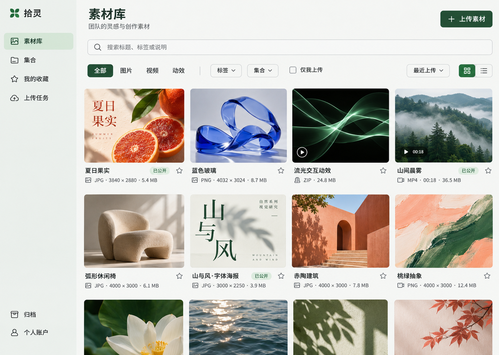
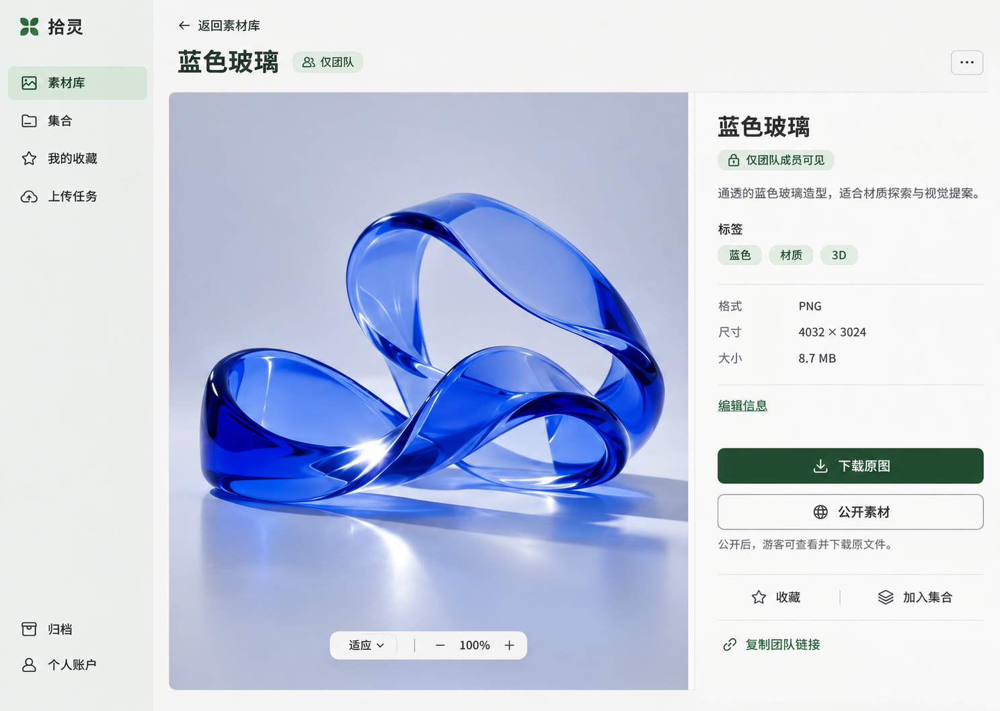
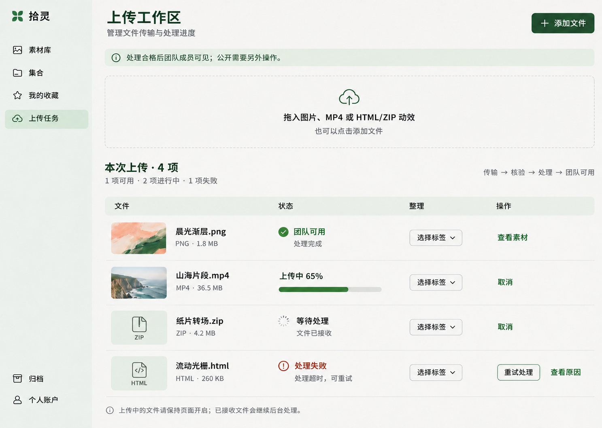
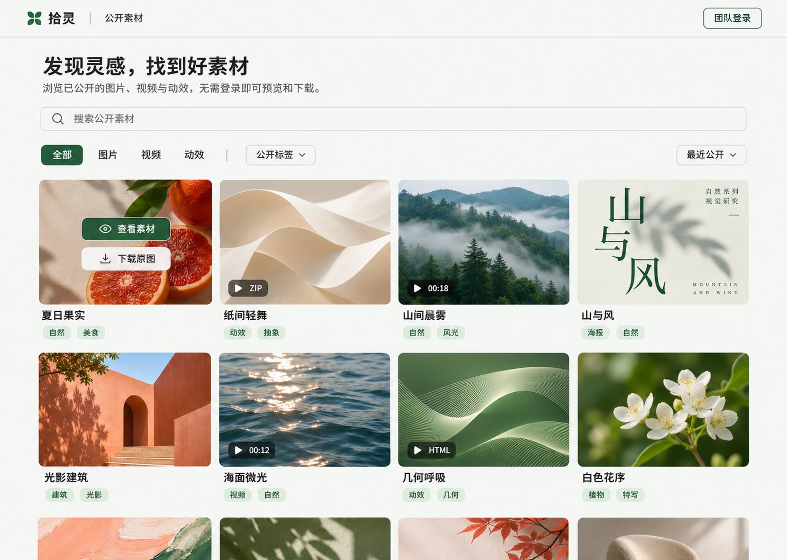

# 拾灵核心页面原型 v0.1

状态：已被 [v0.2](../v0.2/README.md) 替代，仅保留为视觉探索历史。用户要求尽量延续当前拾灵风格，因此本版绿色主题和四叶标识不再采用。使用内置 image_gen 生成，所有内容为合成示例；本次没有实现页面或接入业务服务。

本组为同一视觉方向下的四个桌面页面，不是四套互斥方案。采用浅色底、深绿色操作强调、中文界面和以素材预览为主的信息层级。品牌图形和配色是本轮提案，不代表已经确定最终品牌。

## 页面一：团队素材库

重点查看封面尺寸、信息密度、筛选位置和左侧导航。主操作是上传素材，网格与列表使用同一查询。默认素材均已处理合格，未完成任务留在上传工作区。

## 页面二：本人素材详情

使用“蓝色玻璃”作为本人、未公开的合格图片示例。大预览与信息操作区分开，下载原图是主操作，公开是独立动作。此图展示直接打开详情的页面布局；从素材库打开的侧栏、关闭返回与移动端布局尚未绘制。

## 页面三：上传工作区

展示团队可用、上传中、等待处理和处理失败四种状态。上传与公开分开；等待或失败的动效用文件类型图标，不展示未经成功处理的动效预览。本图为已修正的最终归档版本。

## 页面四：公开素材页

游客使用独立精简布局，只搜索与浏览公开素材，无团队侧栏、成员身份和内部集合。示例“蓝色玻璃”仍仅团队可见，因此不出现在公开页。游客可查看和下载公开内容，不要求先登录。

## 评审范围

- 优先确认整体配色、导航形式、素材卡片密度、详情预览比例、上传状态是否易懂，以及团队页与公开页的区分。
- 当前为静态图，不支持点击、实际上传、播放或下载，也不能替代真实浏览器和响应式验收。
- 素材名称、尺寸、格式与文件大小均为示例，不代表真实数据、上传上限或已经冻结的媒体支持矩阵；图片原件策略仍按首期计划确认。
- 暂未绘制移动端、公开确认表单、集合、标签治理、账号和管理设置页面；后续按已认可的视觉方向补齐。
- 四张图实际尺寸均为 1487 × 1058，生成目标为约 1440 × 1024 的桌面比例，未裁剪或拉伸输出。

产品行为依据[页面与流程](../../design/01-page-flows.md)和[首期业务开发计划](../../plans/phase-1-implementation.md)。本轮不新增业务规则，也不将原型确认视为所有待定参数已经确认。

[原始生成记录](generation-prompts.json)保存内置工具提示词及上传页修订输入，供后续复现和修改；其中提示词按工具实际输入保留，中文评审说明以本页为准。
