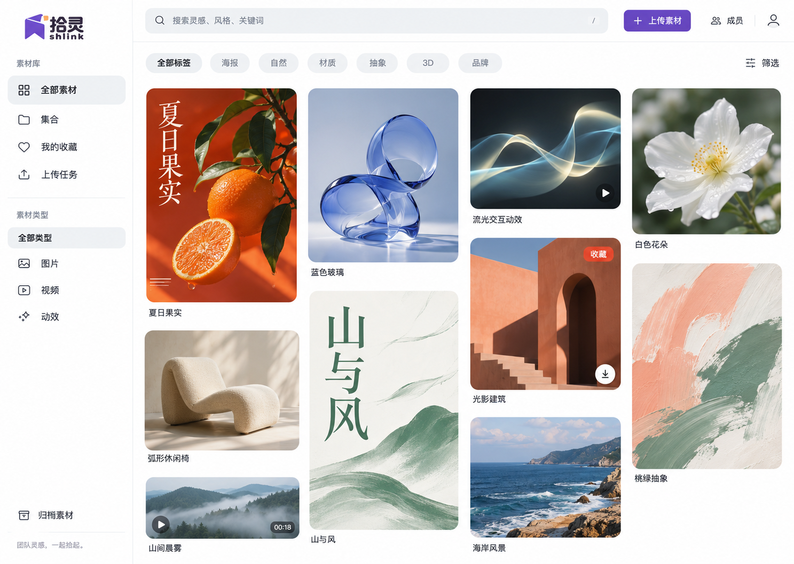
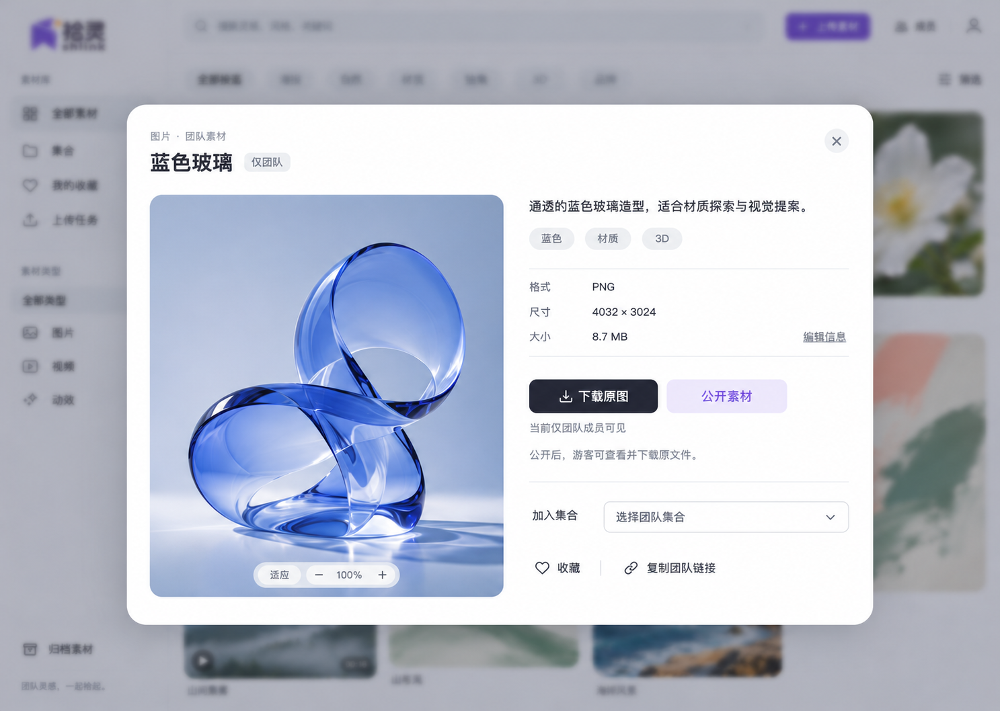
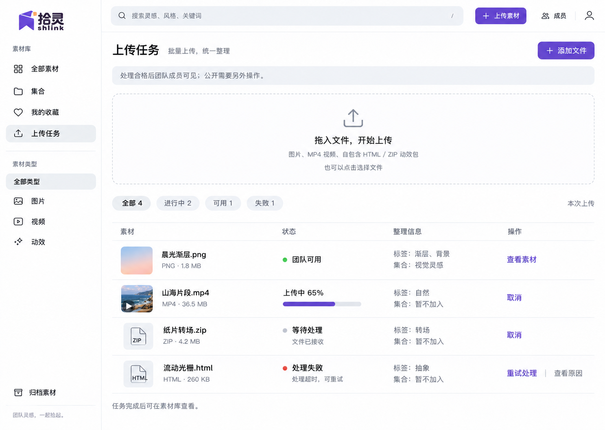
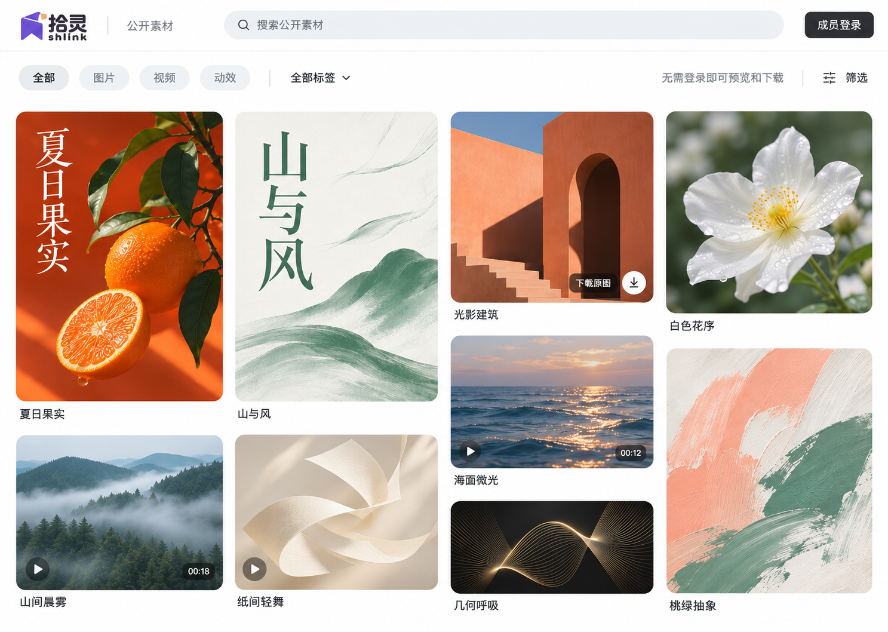

# 拾灵核心页面原型 v0.2

状态：**用户已确认本版视觉方向，作为后续实施基准；交互与业务验收未执行。** 根据用户要求延续当前拾灵风格，使用内置 image_gen 生成。确认范围见 [ADR 0003](../../adr/0003-prototype-visual-direction.md)；本次确认不授权业务开发。

本版替代 [v0.1](../v0.1/README.md) 的视觉方向。沿用现有拾灵的品牌和界面特征，保留新版产品流程；不恢复旧分类树、私人收藏夹或旧上传发布向导。

## 视觉依据与沿用方式

依据为参考平台的实际素材库、动效详情截图，以及最终生效的浏览、团队目录和上传样式。核对时以最后加载的 `browse.css` 及实际截图为准，不能仅凭早期基础样式推断当前界面。

| 视觉元素   | 本轮采用方式                                                               | 依据                                   |
| ---------- | -------------------------------------------------------------------------- | -------------------------------------- |
| 品牌       | 紫色折页、杏色小方块、拾灵与 shlink 字标；不采用 v0.1 四叶图形             | 现有 `shlink-logo.png` 与实际页面      |
| 基础配色   | 白底 `#ffffff`，灰黑文字 `#191b20`，次级文字 `#737986`，细分隔 `#eceef1`   | `browse.css`                           |
| 强调色     | 上传等主要管理操作使用紫色 `#7657C8`；下载以深灰按钮呈现；收藏悬停保留红色 | 实际页面与浏览、上传样式               |
| 团队导航   | 约 240px 白色侧栏、浅灰选中项、细线图标                                    | 现有侧栏组件与截图                     |
| 搜索和筛选 | 约 76px 顶栏，浅灰搜索框与胶囊标签；不增加欢迎横幅或统计卡片               | `browse.css` 与素材库截图              |
| 素材展示   | 桌面四列原比例瀑布流，图片圆角约 16px，图下小标题，不加外层卡片边框和阴影  | `browse.css` 与素材库截图              |
| 详情       | 灰色模糊背景、居中白色双栏弹窗、约 24px 圆角                               | `team-catalog.css` 与实际详情截图      |
| 上传       | 白色工作区、浅灰分隔、紫色操作；调整为批次任务流程                         | `uploads.css` 的视觉语言与新版上传设计 |

以上尺寸与色值是视觉基准，不代表生成位图达到逐像素复刻。后续实现应使用正式品牌资源和设计变量；平台名称、Logo 和品牌配置仍应允许部署者替换。旧截图只在本地作为参考，没有复制进本项目；图中素材为合成示例。

## 页面一：团队素材库

沿用原平台图片优先的浏览体验，保持搜索、标签筛选和原比例瀑布流。左侧导航按新版功能调整为素材库、集合、个人收藏、上传任务与归档；图片、视频、动效作为类型筛选。图中默认展示已处理合格的素材。

本图只画瀑布流视图，未取消首期计划中的列表视图、排序、批量操作或完整筛选能力；相应控件和状态后续补齐。收藏和下载悬停样式为桌面示意，触屏和键盘入口仍需单独设计。

## 页面二：本人素材详情

“蓝色玻璃”为本人、已合格、尚未公开的图片示例。大预览位于左侧，右侧显示说明、标签、文件信息及下载、公开、加入团队集合、收藏、复制团队链接。公开入口表示打开独立确认表单，不表示一次点击立即对外公开。

桌面从列表打开时采用居中双栏弹窗，该视觉与布局方向已确认；详情深链、关闭后恢复列表位置、直接访问独立详情及移动端全屏规则不变。弹窗不叠加第二个完整详情层，公开表单的具体承载方式后续补图。

示例 8.7 MB 按 P02“保留原件、衍生预览另设预算”方案展示。该方案依据用户先前允许自行评估后的工程结论，不是由视觉确认推导；具体格式、大小和资源上限仍待 D03/D04 输入与验证，示例不是上传上限。

## 页面三：上传工作区

沿用原平台白色表面、灰色分隔和紫色动作，采用新版批次任务流程。示例包括团队可用、上传中、等待处理、处理失败四种状态，上传与公开分开。

上传百分比仅表示文件传输。传输完成不等于团队可用；等待处理和失败的动效使用文件图标。上传中的视频缩略图仅表达本地文件的静态识别信息，不代表服务器已验证或可供团队播放。完整的取消、重传、过期、失败原因和并发上限等状态以详细设计为准，本图未穷举。

## 页面四：公开素材页

沿用同一品牌、搜索、胶囊筛选和瀑布流。游客布局移除团队导航、上传和管理操作，直接浏览与下载公开素材；“成员登录”不构成游客下载的前置条件。未公开的“蓝色玻璃”不在此页出现。

公开列表、详情与检索只使用有效公开快照。下载对应公开版本的原件，动效下载为 HTML／ZIP 源包；下载文件名不直接使用内部原始文件名。界面和 API 隐藏成员身份，不承诺自动清除原件自身的嵌入元数据或内容。内部信息修改不自动同步公开快照。

## 本轮评审与后续边界

- 已确认：沿用当前拾灵的 Logo 方向、配色、素材展示密度、筛选形式与详情双栏弹窗；后续补齐未画出的状态与响应式细节，按[体验验收](../../design/05-prototype-acceptance.md)验证实现。
- 本组是同一视觉方向的四个静态页面，不支持实际点击、上传、播放、下载；不替代浏览器、键盘焦点和响应式验收。
- 四张图实际尺寸均为 1487 × 1058，未裁剪或拉伸。生成工具可能对字形、图标和素材细节作近似处理，不能直接作为正式组件或品牌源文件。
- 名称、数量、标签、尺寸、格式、状态和文件大小均为示例。媒体支持范围与预算仍按首期计划确认，不承诺所有 MP4 编码或任意网页动效能力。
- 后续补齐移动端、直接访问详情、公开确认、撤回、归档恢复、空／错／加载态，以及集合、治理与账户页面。本轮不增加功能范围，也未授权业务开发。

产品行为依据[页面与流程](../../design/01-page-flows.md)、[权限与验收](../../design/04-permissions-and-acceptance.md)和[首期业务开发计划](../../plans/phase-1-implementation.md)。视觉确认不替代既有权限、公开与归档规则。P00/P01/P03 已按 [ADR 0004](../../adr/0004-product-defaults-recovery-and-m0-scope.md) 确认；D03～D07 仍按各自最晚时点补充，P02 已形成设计基线。

[原始生成记录](generation-prompts.json)保存四张图的实际提示词与参考职责。部分工具提示词保留原始英文，中文设计说明以本页为准。
